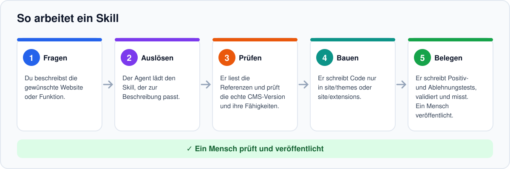
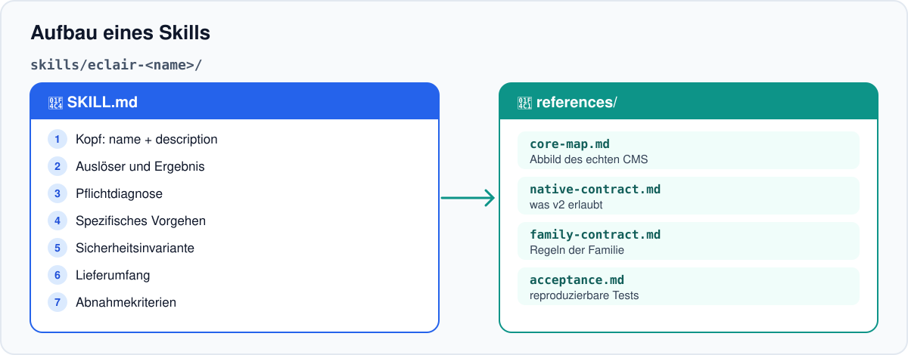
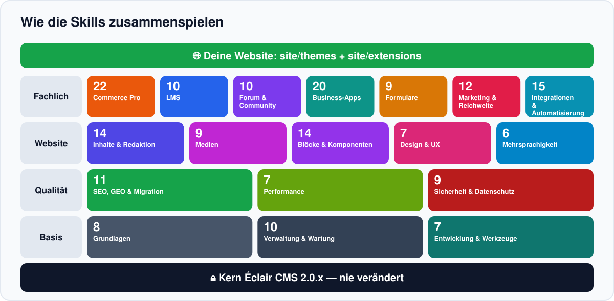
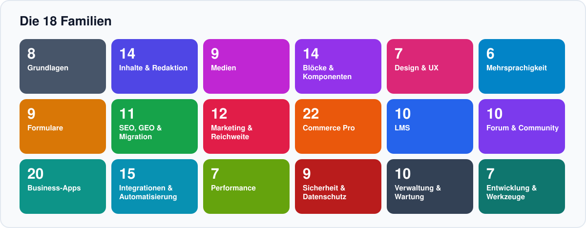
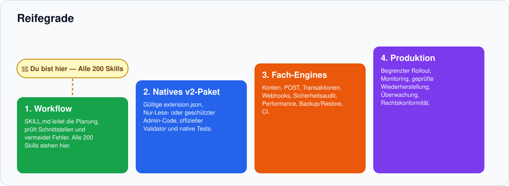

<!-- Generated by scripts/build_readmes.py — edit scripts/readme_data_*.py, not this file. -->
<a id="top"></a>

<p align="center"></p>

<p align="center"><a href="README.md">English</a> · <a href="README.fr.md">Français</a> · <a href="README.es.md">Español</a> · <b>Deutsch</b> · <a href="README.it.md">Italiano</a> · <a href="README.pt.md">Português</a></p>

<p align="center"><a href="https://github.com/Jacckisback/eclair-skills/actions/workflows/validate.yml"></a>    <a href="LICENSE"></a></p>

**Éclair Skills** ist eine Bibliothek mit **57 Agent Skills** für [Éclair CMS](https://github.com/Jacckisback/eclair-cms) 2.0.x. Füge sie deinem Projekt hinzu, und dein Coding-Agent (Claude Code, Codex, ChatGPT oder jeder Agent, der `SKILL.md`-Ordner liest) improvisiert nicht mehr: Er folgt einer bewährten Methode, respektiert den CMS-Vertrag, rührt den Kern nie an und belegt seine Arbeit mit Tests.

> [!IMPORTANT]
> **Zuerst lesen** — **57 Skills ≠ 57 PHP-Erweiterungen.** Ein Skill ist eine Anleitung für deinen Agenten (Anweisungen, Referenzen und zu schreibende Tests). Er ist kein Plugin für eine Live-Website. Das einzige lauffähige Beispiel ist das schreibgeschützte `catalogue-demo`.

## Warum Éclair Skills?

- **Methode statt Zufall** — jeder Skill verlangt Diagnose, Vorgehen, Sicherheitsinvariante und Abnahmekriterien, bevor eine einzige Codezeile entsteht.
- **Der Kern bleibt unberührt** — dein Code liegt nur in `site/themes/` und `site/extensions/`, damit CMS-Updates weiter funktionieren.
- **Sicher und schnell ab Werk** — CSRF, Objektrechte, Escaping, keine personenbezogenen Daten im gemeinsamen Cache, gemessene Performance-Budgets.
- **Ehrlich bei Grenzen** — jeder Skill sagt, was Éclair 2.0 heute kann und was noch eine Kernfunktion braucht.

## So funktioniert es

<p align="center"></p>

Du beschreibst dein Ziel in normaler Sprache. Der Agent findet den passenden Skill über dessen Beschreibung und folgt fünf Schritten:

1. **Fragen** — Du beschreibst die gewünschte Website oder Funktion.
2. **Auslösen** — Der Agent lädt den Skill, der zur Beschreibung passt.
3. **Prüfen** — Er liest die Referenzen und prüft die echte CMS-Version und ihre Fähigkeiten.
4. **Bauen** — Er schreibt Code nur in site/themes oder site/extensions.
5. **Belegen** — Er schreibt Positiv- und Ablehnungstests, validiert und misst. Ein Mensch veröffentlicht.

## Aufbau eines Skills

<p align="center"></p>

Jeder Skill ist ein eigenständiger Ordner. Keiner hängt von Dateien eines anderen Skills ab.

```text
skills/eclair-commerce-pro/
├── SKILL.md
└── references/
    ├── core-map.md
    ├── native-contract.md
    ├── family-contract.md
    └── acceptance.md
```

| Teil | Aufgabe |
|---|---|
| `SKILL.md` — Kopf | `name` und `description`: der Agent entscheidet anhand der Beschreibung, wann er den Skill lädt. |
| Auslöser und Ergebnis | Wofür der Skill da ist und was er liefern muss. |
| Pflichtdiagnose | Referenzen lesen, CMS-Version, Manifest `eclair-extension/1` und verfügbare Fähigkeiten prüfen, Datenmodell erfassen. |
| Spezifisches Vorgehen | Geschäftsablauf, erlaubte Orte, Grenzen des aktuellen Vertrags, Sicherheitsinvariante, Nachweise, native Validierung. |
| Lieferumfang und Abnahme | Mini-Spezifikation, Rechte-/Cache-Matrix, Paket nur wenn der Vertrag es erlaubt, Tests die bestehen und Tests die ablehnen müssen. |
| `references/core-map.md` | Momentaufnahme des echten Éclair-CMS-Kerns, gegen den der Skill geprüft wurde. |
| `references/native-contract.md` | Was der native Vertrag `eclair-extension/1` erlaubt (und was nicht). |
| `references/family-contract.md` | Gemeinsame Regeln der Familie (Sicherheit, Cache, Daten). |
| `references/acceptance.md` | Reproduzierbarer Testplan: Normalfall, Ablehnung, Invariante, Cache, Aktivierung/Deaktivierung. |

## Wie die Skills zusammenspielen

<p align="center"></p>

Die Skills sind zum Kombinieren gedacht. Denke in Schichten:

1. **Kern von Éclair CMS 2.0.x** — Wird von keinem Skill verändert. Strukturelle Änderungen laufen über eigenen RFC und Pull Request.
2. **Grundlagen (8)** — Immer zuerst: Architektur, Erweiterung, Speicher, Rollen, Routing, Cache, Sicherheit, Tests. Alle anderen bauen darauf auf.
3. **Fachfamilien** — Commerce, LMS, Community, Business-Apps und Integrationen: wähle, was dein Projekt braucht.
4. **Übergreifende Qualität** — Design & UX sowie SEO & GEO gelten für jede Seite, egal in welchem Bereich.
5. **Deine Website** — Das Ergebnis liegt in site/themes und site/extensions, validiert und getestet.

## Die 8 Familien

<p align="center"></p>

| | Familie | Umfang | Skills |
|---|---|---|---:|
| 🧱 | **Grundlagen** | Nativer v2-Vertrag, Tests und Sicherheit | 8 |
| 🛒 | **Commerce Pro** | Shop mit Transaktionen und Zahlungen, vor dem Einsatz geplant | 10 |
| 🎓 | **LMS** | Kurse, Einschreibungen, Fortschritt, Zertifikate | 7 |
| 💬 | **Forum & Community** | Diskussionen, Moderation, Profile, Benachrichtigungen | 6 |
| 🗂️ | **Business-Apps** | Buchungen, Mitgliedschaften, Verzeichnisse, Fachwerkzeuge | 8 |
| 🎨 | **Design & UX** | Themes, Blöcke, Barrierefreiheit, Tempo | 7 |
| 🔎 | **SEO, GEO & Migration** | Indexierbarkeit, strukturierte Daten, WordPress | 5 |
| 🔌 | **Integrationen & Automatisierung** | APIs, Webhooks, E-Mail, KI, Monitoring | 6 |
| | | | **57** |

## Schnellstart

Voraussetzungen: Git und Python 3 (nur Standardbibliothek). PHP 8.1+ für die PHP-Beispiele und -Tests.

**1. Bibliothek holen und prüfen**

```bash
git clone https://github.com/Jacckisback/eclair-skills.git
cd eclair-skills
python3 scripts/validate_skills.py
```

**2. Verfügbare Skills anzeigen**

```bash
python3 scripts/install_skills.py --list
```

**3. Skills in dein Projekt installieren**

```bash
python3 scripts/install_skills.py --project /path/to/my-site --category commerce   # eine Familie
python3 scripts/install_skills.py --project /path/to/my-site --skill eclair-wordpress-migration   # ein Skill
python3 scripts/install_skills.py --project /path/to/my-site --all   # alles
```

Der Installer kopiert Skills in dein Projekt. Er überschreibt nie einen vorhandenen Skill, außer mit `--force` nach Prüfung.

**4. Dann frag einfach deinen Agenten**

> Plane einen Onlineshop für meine Éclair-Website: Katalog, Varianten und Checkout. Nutze den Skill eclair-commerce-pro und sag mir, was Éclair 2.0 noch nicht kann.

> Migriere meinen WordPress-Blog zu Éclair 2, ohne URLs oder Traffic zu verlieren.

> Prüfe Barrierefreiheit und Performance meines Themes und behebe die Probleme.

Der Agent wählt den Skill automatisch über seine Beschreibung. Du kannst ihn auch direkt nennen.

## Rezepte: welche Skills für welches Projekt

Beginne mit den Grundlagen und folge dann der Reihenfolge. Jeder Pfeil ist ein Schritt, den der Agent abschließt und testet, bevor er weitergeht.

**Onlineshop**

[`eclair-architecture`](skills/eclair-architecture/SKILL.md) → [`eclair-storage`](skills/eclair-storage/SKILL.md) → [`eclair-auth-roles`](skills/eclair-auth-roles/SKILL.md) → [`eclair-commerce-pro`](skills/eclair-commerce-pro/SKILL.md) → [`eclair-product-catalog`](skills/eclair-product-catalog/SKILL.md) → [`eclair-product-variants`](skills/eclair-product-variants/SKILL.md) → [`eclair-inventory`](skills/eclair-inventory/SKILL.md) → [`eclair-cart-checkout`](skills/eclair-cart-checkout/SKILL.md) → [`eclair-orders-payments`](skills/eclair-orders-payments/SKILL.md) → [`eclair-tax-invoicing`](skills/eclair-tax-invoicing/SKILL.md) → [`eclair-shipping`](skills/eclair-shipping/SKILL.md) → [`eclair-discounts`](skills/eclair-discounts/SKILL.md) → [`eclair-email-automation`](skills/eclair-email-automation/SKILL.md) → [`eclair-security-audit`](skills/eclair-security-audit/SKILL.md) → [`eclair-test-suite`](skills/eclair-test-suite/SKILL.md)

**Online-Schule**

[`eclair-architecture`](skills/eclair-architecture/SKILL.md) → [`eclair-auth-roles`](skills/eclair-auth-roles/SKILL.md) → [`eclair-lms`](skills/eclair-lms/SKILL.md) → [`eclair-course-builder`](skills/eclair-course-builder/SKILL.md) → [`eclair-lessons-media`](skills/eclair-lessons-media/SKILL.md) → [`eclair-enrollment-access`](skills/eclair-enrollment-access/SKILL.md) → [`eclair-progress`](skills/eclair-progress/SKILL.md) → [`eclair-quizzes-certificates`](skills/eclair-quizzes-certificates/SKILL.md) → [`eclair-lms-analytics`](skills/eclair-lms-analytics/SKILL.md) → [`eclair-test-suite`](skills/eclair-test-suite/SKILL.md)

**Community / Forum**

[`eclair-auth-roles`](skills/eclair-auth-roles/SKILL.md) → [`eclair-forum`](skills/eclair-forum/SKILL.md) → [`eclair-discussions-topics`](skills/eclair-discussions-topics/SKILL.md) → [`eclair-community-profiles`](skills/eclair-community-profiles/SKILL.md) → [`eclair-moderation`](skills/eclair-moderation/SKILL.md) → [`eclair-notifications`](skills/eclair-notifications/SKILL.md) → [`eclair-community-search`](skills/eclair-community-search/SKILL.md) → [`eclair-security-audit`](skills/eclair-security-audit/SKILL.md)

**Website für lokales Unternehmen**

[`eclair-design`](skills/eclair-design/SKILL.md) → [`eclair-theme-builder`](skills/eclair-theme-builder/SKILL.md) → [`eclair-bookings`](skills/eclair-bookings/SKILL.md) → [`eclair-appointments-calendar`](skills/eclair-appointments-calendar/SKILL.md) → [`eclair-forms-crm`](skills/eclair-forms-crm/SKILL.md) → [`eclair-crm-integration`](skills/eclair-crm-integration/SKILL.md) → [`eclair-seo-audit`](skills/eclair-seo-audit/SKILL.md) → [`eclair-structured-data`](skills/eclair-structured-data/SKILL.md)

**WordPress-Migration & SEO/GEO**

[`eclair-wordpress-migration`](skills/eclair-wordpress-migration/SKILL.md) → [`eclair-routing`](skills/eclair-routing/SKILL.md) → [`eclair-seo-audit`](skills/eclair-seo-audit/SKILL.md) → [`eclair-structured-data`](skills/eclair-structured-data/SKILL.md) → [`eclair-multilingual-seo`](skills/eclair-multilingual-seo/SKILL.md) → [`eclair-geo-optimization`](skills/eclair-geo-optimization/SKILL.md) → [`eclair-performance-ux`](skills/eclair-performance-ux/SKILL.md) → [`eclair-accessibility`](skills/eclair-accessibility/SKILL.md)

## Vollständiger Katalog der 57 Skills

Klicke auf einen Skill, um seine `SKILL.md` zu öffnen. Die Statusspalte zeigt, was heute mit Éclair 2.0 lieferbar ist.

**Legende** — 🟢 **Nativ v2**: heute mit dem nativen Vertrag umsetzbar. 🔵 **Nur-Lese-Prototyp möglich**: eine öffentliche GET-Version ist jetzt möglich; Schreibzugriffe brauchen mehr. 🟠 **Planung · Kern nötig**: vollständige Planung und Tests ab sofort, der Produktivbetrieb braucht Kernfunktionen, die Éclair 2.0 noch fehlen (öffentliches POST, Transaktionen, Mitgliederkonten…). 🟡 **Teilweise blockiert**: einige Teile hängen von einer Änderung des Kernvertrags ab.

### 🧱 Grundlagen (8)

_Nativer v2-Vertrag, Tests und Sicherheit._

| Skill | Wobei er dem Agenten hilft | Status |
|---|---|---|
| [`eclair-architecture`](skills/eclair-architecture/SKILL.md) | Entscheiden, wohin eine Funktion gehört (Einstellung, Theme, Erweiterung oder Kern-RFC), ohne den v2-Kern anzufassen. | 🟢 Nativ v2 |
| [`eclair-extension-builder`](skills/eclair-extension-builder/SKILL.md) | Eine wirklich installierbare v2-Erweiterung bauen: `extension.json`, `extension.php`, Vertrag `eclair-extension/1`. | 🟢 Nativ v2 |
| [`eclair-storage`](skills/eclair-storage/SKILL.md) | Die richtige Persistenz, Migrationen, Backups und SQL-Anforderungen je Modul wählen. | 🟢 Nativ v2 |
| [`eclair-auth-roles`](skills/eclair-auth-roles/SKILL.md) | Admin-Rechte sauber von Mitgliedern, Lernenden, Kunden und Moderatoren trennen. | 🟢 Nativ v2 |
| [`eclair-routing`](skills/eclair-routing/SKILL.md) | Öffentliche/Admin-Routen anlegen und dabei bestehende URLs, Weiterleitungen und SEO schützen. | 🟢 Nativ v2 |
| [`eclair-cache-contract`](skills/eclair-cache-contract/SKILL.md) | Den schnellen Cache sicher halten: Invalidierung, Datenschutz und Performance-Budgets. | 🟢 Nativ v2 |
| [`eclair-security-audit`](skills/eclair-security-audit/SKILL.md) | Eine Erweiterung vor der Aktivierung prüfen: Lieferkette, Admin-Aktionen, Mitgliederdaten. | 🟢 Nativ v2 |
| [`eclair-test-suite`](skills/eclair-test-suite/SKILL.md) | CI-, Regressions-, Sicherheits- und Performance-Tests schreiben: Beweis vor der Veröffentlichung. | 🟢 Nativ v2 |

### 🛒 Commerce Pro (10)

_Shop mit Transaktionen und Zahlungen, vor dem Einsatz geplant._

| Skill | Wobei er dem Agenten hilft | Status |
|---|---|---|
| [`eclair-commerce-pro`](skills/eclair-commerce-pro/SKILL.md) | Einen kompletten Shop planen, vom Katalog bis zur gelieferten Bestellung (Einstieg der Familie). | 🟠 Planung · Kern nötig |
| [`eclair-product-catalog`](skills/eclair-product-catalog/SKILL.md) | Einen schnellen, indexierbaren öffentlichen Produktkatalog bauen. | 🔵 Nur-Lese-Prototyp möglich |
| [`eclair-product-variants`](skills/eclair-product-variants/SKILL.md) | Größen, Farben und Konfigurationen ohne Preisfehler modellieren. | 🟠 Planung · Kern nötig |
| [`eclair-cart-checkout`](skills/eclair-cart-checkout/SKILL.md) | Warenkorb und Checkout mit mehreren Positionen, konsistenten Preisen und Lagerbeständen planen. | 🟠 Planung · Kern nötig |
| [`eclair-orders-payments`](skills/eclair-orders-payments/SKILL.md) | Bestellstatus und Zahlungsanbieter (PSP) mit signierten Webhooks umsetzen. | 🟠 Planung · Kern nötig |
| [`eclair-tax-invoicing`](skills/eclair-tax-invoicing/SKILL.md) | MwSt.- und Rechnungs-Schnittstellen je Rechtsraum vorbereiten (kein Einheitssatz). | 🟠 Planung · Kern nötig |
| [`eclair-inventory`](skills/eclair-inventory/SKILL.md) | Den echten Lagerbestand zwischen Produkten, Varianten und Bestellungen synchronisieren. | 🟠 Planung · Kern nötig |
| [`eclair-shipping`](skills/eclair-shipping/SKILL.md) | Versandzonen, Tarife, Sendungsverfolgung und Lieferstatus verwalten. | 🟠 Planung · Kern nötig |
| [`eclair-discounts`](skills/eclair-discounts/SKILL.md) | Rabatte und Gutscheine anlegen, die konsistent sind und sich nie versehentlich addieren. | 🟠 Planung · Kern nötig |
| [`eclair-commerce-analytics`](skills/eclair-commerce-analytics/SKILL.md) | Verkäufe und Conversions messen, ohne Kundendaten offenzulegen. | 🟠 Planung · Kern nötig |

### 🎓 LMS (7)

_Kurse, Einschreibungen, Fortschritt, Zertifikate._

| Skill | Wobei er dem Agenten hilft | Status |
|---|---|---|
| [`eclair-lms`](skills/eclair-lms/SKILL.md) | Eine modulare Online-Schule strukturieren (Einstieg der Familie). | 🟠 Planung · Kern nötig |
| [`eclair-course-builder`](skills/eclair-course-builder/SKILL.md) | Versionierte Kurse, Abschnitte und Lektionen zusammenstellen. | 🟠 Planung · Kern nötig |
| [`eclair-lessons-media`](skills/eclair-lessons-media/SKILL.md) | Geschützte Videos und Dokumente für Kurse bereitstellen. | 🟠 Planung · Kern nötig |
| [`eclair-enrollment-access`](skills/eclair-enrollment-access/SKILL.md) | Einen Kauf oder eine Freigabe mit einer Einschreibung und deren Rechten verknüpfen. | 🟠 Planung · Kern nötig |
| [`eclair-progress`](skills/eclair-progress/SKILL.md) | Lernfortschritt ohne Verluste oder inkonsistente Updates verfolgen. | 🟠 Planung · Kern nötig |
| [`eclair-quizzes-certificates`](skills/eclair-quizzes-certificates/SKILL.md) | Quizze, Bestehensgrenzen und kontrollierte Zertifikate erstellen. | 🟠 Planung · Kern nötig |
| [`eclair-lms-analytics`](skills/eclair-lms-analytics/SKILL.md) | Abschluss und Engagement ohne übermäßige Überwachung analysieren. | 🟠 Planung · Kern nötig |

### 💬 Forum & Community (6)

_Diskussionen, Moderation, Profile, Benachrichtigungen._

| Skill | Wobei er dem Agenten hilft | Status |
|---|---|---|
| [`eclair-forum`](skills/eclair-forum/SKILL.md) | Öffentliche und private Diskussionen mit Moderation planen (Einstieg der Familie). | 🟠 Planung · Kern nötig |
| [`eclair-discussions-topics`](skills/eclair-discussions-topics/SKILL.md) | Erstellung, Bearbeitung und Status von Themen und Antworten verwalten. | 🟠 Planung · Kern nötig |
| [`eclair-community-profiles`](skills/eclair-community-profiles/SKILL.md) | Selbst gewählte öffentliche Profile, getrennt von privaten Daten. | 🟠 Planung · Kern nötig |
| [`eclair-moderation`](skills/eclair-moderation/SKILL.md) | Werkzeuge für Entfernung, Meldung und Einspruch bauen. | 🟠 Planung · Kern nötig |
| [`eclair-notifications`](skills/eclair-notifications/SKILL.md) | Mitglieder ohne Spam und ohne Datenlecks benachrichtigen. | 🟠 Planung · Kern nötig |
| [`eclair-community-search`](skills/eclair-community-search/SKILL.md) | Themen und Beiträge unter Beachtung der Berechtigungen durchsuchen. | 🟠 Planung · Kern nötig |

### 🗂️ Business-Apps (8)

_Buchungen, Mitgliedschaften, Verzeichnisse, Fachwerkzeuge._

| Skill | Wobei er dem Agenten hilft | Status |
|---|---|---|
| [`eclair-bookings`](skills/eclair-bookings/SKILL.md) | Eine buchbare Ressource ohne Doppelbuchungen verwalten. | 🟠 Planung · Kern nötig |
| [`eclair-appointments-calendar`](skills/eclair-appointments-calendar/SKILL.md) | Termine vergeben und externe Kalender anbinden. | 🟠 Planung · Kern nötig |
| [`eclair-memberships`](skills/eclair-memberships/SKILL.md) | Mitgliedschaftsstufen, Verlängerungen und Zugriffsrechte verwalten. | 🟠 Planung · Kern nötig |
| [`eclair-directory`](skills/eclair-directory/SKILL.md) | Indexierbare Einträge und Filter für ein Branchenverzeichnis erstellen. | 🔵 Nur-Lese-Prototyp möglich |
| [`eclair-events-ticketing`](skills/eclair-events-ticketing/SKILL.md) | Plätze, Tickets und Einlass für Veranstaltungen verkaufen. | 🟠 Planung · Kern nötig |
| [`eclair-job-board`](skills/eclair-job-board/SKILL.md) | Stellenanzeigen und Bewerbungen datenschutzkonform veröffentlichen. | 🟠 Planung · Kern nötig |
| [`eclair-real-estate`](skills/eclair-real-estate/SKILL.md) | Einen Immobilienkatalog mit Suche und Kontakt aufbauen. | 🟠 Planung · Kern nötig |
| [`eclair-forms-crm`](skills/eclair-forms-crm/SKILL.md) | Anfragen per Formular erfassen und ihre Bearbeitung verfolgen (Mini-CRM). | 🟠 Planung · Kern nötig |

### 🎨 Design & UX (7)

_Themes, Blöcke, Barrierefreiheit, Tempo._

| Skill | Wobei er dem Agenten hilft | Status |
|---|---|---|
| [`eclair-design`](skills/eclair-design/SKILL.md) | Art Direction: stimmige Websites mit Éclair Design und dem nativen Theme gestalten. | 🟢 Nativ v2 |
| [`eclair-theme-builder`](skills/eclair-theme-builder/SKILL.md) | Ein Éclair-v2-Theme erstellen, das Updates übersteht. | 🟢 Nativ v2 |
| [`eclair-blocks-library`](skills/eclair-blocks-library/SKILL.md) | Bearbeitbare Inhaltsblöcke und Erweiterungen zusammenstellen. | 🟢 Nativ v2 |
| [`eclair-accessibility`](skills/eclair-accessibility/SKILL.md) | Eine barrierefreie Oberfläche prüfen und korrigieren (WCAG). | 🟢 Nativ v2 |
| [`eclair-design-system`](skills/eclair-design-system/SKILL.md) | Eine stimmige, wartbare Designsprache aufbauen (Tokens, Komponenten). | 🟢 Nativ v2 |
| [`eclair-responsive-ux`](skills/eclair-responsive-ux/SKILL.md) | Navigation, Formulare und Layouts für Mobilgeräte optimieren. | 🟢 Nativ v2 |
| [`eclair-performance-ux`](skills/eclair-performance-ux/SKILL.md) | Seitengewicht und Layout-Instabilität messen und reduzieren. | 🟢 Nativ v2 |

### 🔎 SEO, GEO & Migration (5)

_Indexierbarkeit, strukturierte Daten, WordPress._

| Skill | Wobei er dem Agenten hilft | Status |
|---|---|---|
| [`eclair-seo-audit`](skills/eclair-seo-audit/SKILL.md) | Indexierbarkeit, Canonicals, Robots, Links und Performance prüfen. | 🟢 Nativ v2 |
| [`eclair-geo-optimization`](skills/eclair-geo-optimization/SKILL.md) | Seiten für Suchmaschinen und KI-Assistenten gut lesbar machen (GEO). | 🟢 Nativ v2 |
| [`eclair-wordpress-migration`](skills/eclair-wordpress-migration/SKILL.md) | Von WordPress migrieren und dabei URLs, Inhalte und Traffic erhalten. | 🟢 Nativ v2 |
| [`eclair-structured-data`](skills/eclair-structured-data/SKILL.md) | schema.org-Daten passend zum sichtbaren Inhalt ergänzen oder prüfen. | 🟡 Teilweise blockiert |
| [`eclair-multilingual-seo`](skills/eclair-multilingual-seo/SKILL.md) | Mehrere Sprachen ohne Duplikate oder falsche Canonicals betreiben (hreflang). | 🟢 Nativ v2 |

### 🔌 Integrationen & Automatisierung (6)

_APIs, Webhooks, E-Mail, KI, Monitoring._

| Skill | Wobei er dem Agenten hilft | Status |
|---|---|---|
| [`eclair-webhooks`](skills/eclair-webhooks/SKILL.md) | Externe Apps über sichere, signierte, idempotente Ereignisse anbinden. | 🟠 Planung · Kern nötig |
| [`eclair-email-automation`](skills/eclair-email-automation/SKILL.md) | Zuverlässige Bestätigungen und Erinnerungen senden (Transaktions-E-Mails). | 🟠 Planung · Kern nötig |
| [`eclair-api-integration`](skills/eclair-api-integration/SKILL.md) | Robuste, begrenzte Konnektoren zu externen APIs bauen. | 🟠 Planung · Kern nötig |
| [`eclair-crm-integration`](skills/eclair-crm-integration/SKILL.md) | Leads und Kunden ohne Duplikate mit einem CRM synchronisieren. | 🟠 Planung · Kern nötig |
| [`eclair-ai-workflows`](skills/eclair-ai-workflows/SKILL.md) | Redaktionelle Hilfe mit KI automatisieren, nie ohne Menschen veröffentlichen. | 🟠 Planung · Kern nötig |
| [`eclair-observability`](skills/eclair-observability/SKILL.md) | Zustand, Kosten und Störungen der Module überwachen, mit Alarmen. | 🟠 Planung · Kern nötig |

## Reifegrad: vom Agenten-Leitfaden zur Produktion

<p align="center"></p>

Ein Skill ist der erste Schritt, nicht der letzte. Vier Stufen trennen einen Leitfaden von einer produktiven Anwendung:

1. **Workflow** — SKILL.md leitet die Planung, prüft Schnittstellen und vermeidet Fehler. Alle 57 Skills stehen hier.
2. **Natives v2-Paket** — Gültige extension.json, Nur-Lese- oder geschützter Admin-Code, offizieller Validator und native Tests.
3. **Fach-Engines** — Konten, POST, Transaktionen, Webhooks, Sicherheitsaudit, Performance, Backup/Restore, CI.
4. **Produktion** — Begrenzter Rollout, Monitoring, geprüfte Wiederherstellung, Überwachung, Rechtskonformität.

> [!WARNING]
> Bevor eine kommerzielle Anwendung aktiviert wird, müssen fünf Hürden genommen sein: exakte CMS-Kompatibilität, getestete Authentifizierung und Datentrennung, transaktionale Speicherung und signierte Zahlungen, unabhängiges Sicherheitsaudit sowie keine Performance- oder SEO-Regression. Siehe [docs/ROADMAP_57.md](docs/ROADMAP_57.md).

## Beispiele und Prototypen

| Ordner | Zustand | Was es ist |
|---|---|---|
| [`examples/extensions/catalogue-demo`](examples/extensions/catalogue-demo) | ✅ Lauffähiges Beispiel | Schreibgeschütztes Schaufenster, GET `/catalogue-demo`, ohne Kunden, Warenkorb, Bestellung oder Zahlung. |
| [`examples/extensions/skill-sample`](examples/extensions/skill-sample) | ✅ Testmuster | Minimales natives Paket für die Offline-Tests. |
| [`examples/extensions/member-directory`](examples/extensions/member-directory) | ⚠️ Experimentell | Unabhängiger, nicht qualifizierter Prototyp. Registrierung und Wiederherstellung standardmäßig aus. Nicht für Produktion. |
| [`core-patch/`](core-patch/) | ⚠️ Experimentell | Patch für öffentliche POST-Routen, gebunden an den nicht gemergten Entwurf [eclair-cms PR #19](https://github.com/Jacckisback/eclair-cms/pull/19). Nicht für Produktion. |

**Die Demo auf einem echten Éclair-Checkout testen**

```bash
# in a checkout of https://github.com/Jacckisback/eclair-cms
php tools/validate.php /path/to/eclair-skills/examples/extensions/catalogue-demo --json
php tests/run.php
php tools/measure.php --check
```

## Qualität und Tests

Jeder Push startet den Workflow [validate](.github/workflows/validate.yml) auf PHP 8.1 und 8.3:

```bash
python3 scripts/validate_skills.py
python3 scripts/check_release.py
python3 scripts/verify_sample.py
python3 scripts/verify_member_directory.py
python3 -m unittest discover -s tests -p 'test_*.py' -v
php -l examples/extensions/catalogue-demo/extension.php
php tests/member-directory.php
php tests/member-public.php
php tests/member-enroll.php
```

Diese Prüfungen belegen Struktur und isoliertes Verhalten. Sie sind **keine** HTTP/SMTP-Integrationstests und **kein** Sicherheitsaudit der experimentellen Prototypen.

## Was diese Bibliothek nicht verspricht

- Keine garantierte Lighthouse-Punktzahl, kein Google-Ranking, keine Zitierung durch KI-Assistenten: das wird gemessen, nicht versprochen.
- Kein schlüsselfertiger Shop, kein LMS, kein Forum: die Commerce-, LMS- und Community-Skills sind Bauanleitungen.
- Keine automatische Rechts- oder Steuerkonformität: MwSt., Rechnungen und personenbezogene Daten werden lokal geprüft.
- Kein automatisches Deployment: der Agent bereitet vor, eine berechtigte Person prüft und veröffentlicht.

## Kompatibilität

- Éclair CMS **2.0.x**, Erweiterungsvertrag `eclair-extension/1`.
- PHP **8.1+** für die Beispiele (CI auf 8.1 und 8.3). Python **3** Standardbibliothek für die Skripte.
- Agenten: Claude Code, Codex, ChatGPT und jeder Agent, der `SKILL.md`-Ordner unterstützt.
- Die Skill-Inhalte sind auf Französisch verfasst; sie funktionieren mit jedem Agenten, egal in welcher Sprache du mit ihm sprichst.

## Weiterlesen

- [Vollständiger Katalog (generiert)](docs/CATALOGUE_COMPLET.md)
- [Roadmap und Produktionshürden](docs/ROADMAP_57.md)
- [Fähigkeitsmatrix](docs/CAPABILITY_MATRIX.md)
- [Schnellstart für Agenten](docs/AGENT_QUICKSTART.md)
- [Regeln für Agenten](AGENTS.md)
- [Mitwirken](CONTRIBUTING.md)
- [Sicherheitslücke melden](SECURITY.md)

## Lizenz

GNU Affero General Public License v3.0 only (`AGPL-3.0-only`), wie Éclair CMS. Vollständiger offizieller Text in [LICENSE](LICENSE).

---

<p align="center"><a href="README.md">English</a> · <a href="README.fr.md">Français</a> · <a href="README.es.md">Español</a> · <b>Deutsch</b> · <a href="README.it.md">Italiano</a> · <a href="README.pt.md">Português</a> · <a href="#top">Nach oben ↑</a></p>
