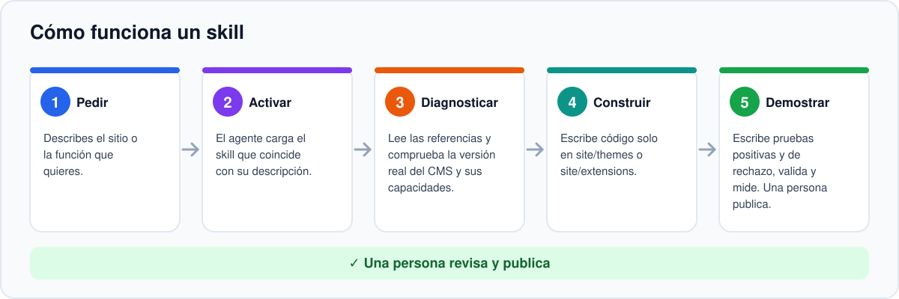
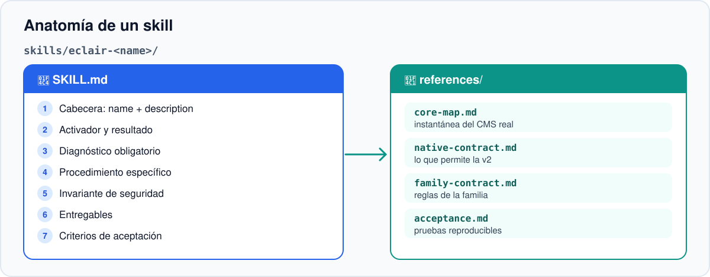
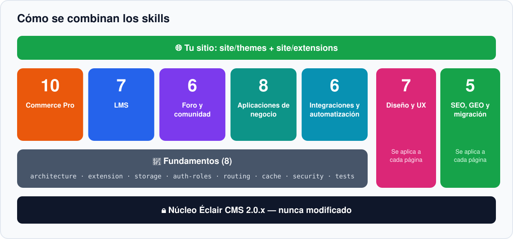
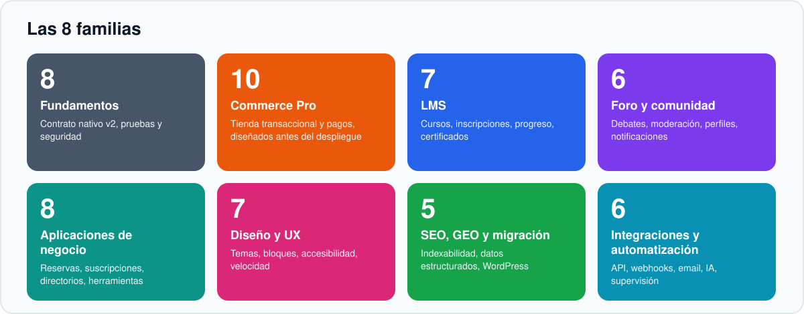
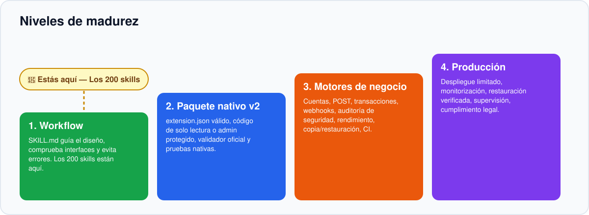

<!-- Generated by scripts/build_readmes.py — edit scripts/readme_data_*.py, not this file. -->
<a id="top"></a>

<p align="center"></p>

<p align="center"><a href="README.md">English</a> · <a href="README.fr.md">Français</a> · <b>Español</b> · <a href="README.de.md">Deutsch</a> · <a href="README.it.md">Italiano</a> · <a href="README.pt.md">Português</a></p>

<p align="center"><a href="https://github.com/Jacckisback/eclair-skills/actions/workflows/validate.yml"></a>    <a href="LICENSE"></a></p>

**Éclair Skills** es una biblioteca de **57 Agent Skills** para [Éclair CMS](https://github.com/Jacckisback/eclair-cms) 2.0.x. Añádelos a tu proyecto y tu agente de código (Claude Code, Codex, ChatGPT o cualquier agente que lea carpetas `SKILL.md`) deja de improvisar: sigue un método probado, respeta el contrato del CMS, nunca toca el núcleo y demuestra su trabajo con pruebas.

> [!IMPORTANT]
> **Lee esto primero** — **57 skills ≠ 57 extensiones PHP.** Un skill es una guía para tu agente (instrucciones, referencias y pruebas que escribir). No es un plugin que se instala en un sitio en producción. El único ejemplo funcional es `catalogue-demo`, de solo lectura.

## ¿Por qué Éclair Skills?

- **Método, no azar** — cada skill impone un diagnóstico, un procedimiento, un invariante de seguridad y criterios de aceptación antes de escribir una sola línea de código.
- **El núcleo queda intacto** — tu código vive solo en `site/themes/` y `site/extensions/`, así las actualizaciones del CMS siguen funcionando.
- **Seguro y rápido por defecto** — CSRF, permisos por objeto, escapado, ningún dato personal en caché compartida, presupuestos de rendimiento medidos.
- **Honesto con los límites** — cada skill indica lo que Éclair 2.0 permite hoy y lo que aún necesita una capacidad del núcleo.

## Cómo funciona

<p align="center"></p>

Describes tu objetivo con palabras normales. El agente encuentra el skill adecuado por su descripción y sigue cinco pasos:

1. **Pedir** — Describes el sitio o la función que quieres.
2. **Activar** — El agente carga el skill que coincide con su descripción.
3. **Diagnosticar** — Lee las referencias y comprueba la versión real del CMS y sus capacidades.
4. **Construir** — Escribe código solo en site/themes o site/extensions.
5. **Demostrar** — Escribe pruebas positivas y de rechazo, valida y mide. Una persona publica.

## Anatomía de un skill

<p align="center"></p>

Cada skill es una carpeta autónoma. Ninguno depende de los archivos de otro skill.

```text
skills/eclair-commerce-pro/
├── SKILL.md
└── references/
    ├── core-map.md
    ├── native-contract.md
    ├── family-contract.md
    └── acceptance.md
```

| Parte | Función |
|---|---|
| `SKILL.md` — cabecera | `name` y `description`: el agente usa la descripción para decidir cuándo cargar el skill. |
| Activador y resultado esperado | Para qué sirve el skill y qué debe entregar. |
| Diagnóstico obligatorio | Leer las referencias, comprobar la versión del CMS, el manifiesto `eclair-extension/1` y las capacidades disponibles, mapear los datos. |
| Procedimiento específico | Flujo de negocio, ubicaciones permitidas, límites del contrato actual, invariante de seguridad, pruebas, validación nativa. |
| Entregables y aceptación | Mini especificación, matriz de permisos/caché, paquete solo si el contrato lo permite, pruebas que pasan y pruebas que deben rechazar. |
| `references/core-map.md` | Instantánea del núcleo real de Éclair CMS con el que se verificó el skill. |
| `references/native-contract.md` | Lo que el contrato nativo `eclair-extension/1` permite (y lo que no). |
| `references/family-contract.md` | Reglas comunes a toda la familia (seguridad, caché, datos). |
| `references/acceptance.md` | Plan de pruebas reproducible: caso nominal, rechazo, invariante, caché, activación/desactivación. |

## Cómo se combinan los skills

<p align="center"></p>

Los skills están pensados para combinarse. Piénsalos por capas:

1. **Núcleo Éclair CMS 2.0.x** — Ningún skill lo modifica. Los cambios estructurales pasan por un RFC y una PR dedicados.
2. **Fundamentos (8)** — Siempre primero: arquitectura, extensión, almacenamiento, roles, rutas, caché, seguridad, pruebas. Todos los demás se apoyan en ellos.
3. **Familias de negocio** — Comercio, LMS, comunidad, aplicaciones de negocio e integraciones: elige las que tu proyecto necesita.
4. **Calidad transversal** — Diseño y UX, SEO y GEO se aplican a todas las páginas, sea cual sea el dominio.
5. **Tu sitio** — El resultado vive en site/themes y site/extensions, validado y probado.

## Las 8 familias

<p align="center"></p>

| | Familia | Alcance | Skills |
|---|---|---|---:|
| 🧱 | **Fundamentos** | Contrato nativo v2, pruebas y seguridad | 8 |
| 🛒 | **Commerce Pro** | Tienda transaccional y pagos, diseñados antes del despliegue | 10 |
| 🎓 | **LMS** | Cursos, inscripciones, progreso, certificados | 7 |
| 💬 | **Foro y comunidad** | Debates, moderación, perfiles, notificaciones | 6 |
| 🗂️ | **Aplicaciones de negocio** | Reservas, suscripciones, directorios, herramientas | 8 |
| 🎨 | **Diseño y UX** | Temas, bloques, accesibilidad, velocidad | 7 |
| 🔎 | **SEO, GEO y migración** | Indexabilidad, datos estructurados, WordPress | 5 |
| 🔌 | **Integraciones y automatización** | API, webhooks, email, IA, supervisión | 6 |
| | | | **57** |

## Inicio rápido

Requisitos: Git y Python 3 (solo biblioteca estándar). PHP 8.1+ para ejecutar los ejemplos y pruebas PHP.

**1. Obtener la biblioteca y comprobarla**

```bash
git clone https://github.com/Jacckisback/eclair-skills.git
cd eclair-skills
python3 scripts/validate_skills.py
```

**2. Ver lo que hay disponible**

```bash
python3 scripts/install_skills.py --list
```

**3. Instalar skills en tu proyecto**

```bash
python3 scripts/install_skills.py --project /path/to/my-site --category commerce   # una familia
python3 scripts/install_skills.py --project /path/to/my-site --skill eclair-wordpress-migration   # un skill
python3 scripts/install_skills.py --project /path/to/my-site --all   # todo
```

El instalador copia los skills en tu proyecto. Nunca sobrescribe un skill existente salvo con `--force` tras revisarlo.

**4. Después, simplemente pide a tu agente**

> Prepara una tienda online para mi sitio Éclair: catálogo, variantes y pedido. Usa el skill eclair-commerce-pro y dime qué no puede hacer todavía Éclair 2.0.

> Migra mi blog de WordPress a Éclair 2 sin perder URL ni tráfico.

> Audita la accesibilidad y el rendimiento de mi tema y corrige los problemas.

El agente elige el skill automáticamente por su descripción. También puedes nombrarlo.

## Recetas: qué skills para qué proyecto

Empieza por los fundamentos y sigue el orden indicado. Cada flecha es un paso que el agente termina y prueba antes del siguiente.

**Tienda online**

[`eclair-architecture`](skills/eclair-architecture/SKILL.md) → [`eclair-storage`](skills/eclair-storage/SKILL.md) → [`eclair-auth-roles`](skills/eclair-auth-roles/SKILL.md) → [`eclair-commerce-pro`](skills/eclair-commerce-pro/SKILL.md) → [`eclair-product-catalog`](skills/eclair-product-catalog/SKILL.md) → [`eclair-product-variants`](skills/eclair-product-variants/SKILL.md) → [`eclair-inventory`](skills/eclair-inventory/SKILL.md) → [`eclair-cart-checkout`](skills/eclair-cart-checkout/SKILL.md) → [`eclair-orders-payments`](skills/eclair-orders-payments/SKILL.md) → [`eclair-tax-invoicing`](skills/eclair-tax-invoicing/SKILL.md) → [`eclair-shipping`](skills/eclair-shipping/SKILL.md) → [`eclair-discounts`](skills/eclair-discounts/SKILL.md) → [`eclair-email-automation`](skills/eclair-email-automation/SKILL.md) → [`eclair-security-audit`](skills/eclair-security-audit/SKILL.md) → [`eclair-test-suite`](skills/eclair-test-suite/SKILL.md)

**Escuela online**

[`eclair-architecture`](skills/eclair-architecture/SKILL.md) → [`eclair-auth-roles`](skills/eclair-auth-roles/SKILL.md) → [`eclair-lms`](skills/eclair-lms/SKILL.md) → [`eclair-course-builder`](skills/eclair-course-builder/SKILL.md) → [`eclair-lessons-media`](skills/eclair-lessons-media/SKILL.md) → [`eclair-enrollment-access`](skills/eclair-enrollment-access/SKILL.md) → [`eclair-progress`](skills/eclair-progress/SKILL.md) → [`eclair-quizzes-certificates`](skills/eclair-quizzes-certificates/SKILL.md) → [`eclair-lms-analytics`](skills/eclair-lms-analytics/SKILL.md) → [`eclair-test-suite`](skills/eclair-test-suite/SKILL.md)

**Comunidad / foro**

[`eclair-auth-roles`](skills/eclair-auth-roles/SKILL.md) → [`eclair-forum`](skills/eclair-forum/SKILL.md) → [`eclair-discussions-topics`](skills/eclair-discussions-topics/SKILL.md) → [`eclair-community-profiles`](skills/eclair-community-profiles/SKILL.md) → [`eclair-moderation`](skills/eclair-moderation/SKILL.md) → [`eclair-notifications`](skills/eclair-notifications/SKILL.md) → [`eclair-community-search`](skills/eclair-community-search/SKILL.md) → [`eclair-security-audit`](skills/eclair-security-audit/SKILL.md)

**Web de negocio local**

[`eclair-design`](skills/eclair-design/SKILL.md) → [`eclair-theme-builder`](skills/eclair-theme-builder/SKILL.md) → [`eclair-bookings`](skills/eclair-bookings/SKILL.md) → [`eclair-appointments-calendar`](skills/eclair-appointments-calendar/SKILL.md) → [`eclair-forms-crm`](skills/eclair-forms-crm/SKILL.md) → [`eclair-crm-integration`](skills/eclair-crm-integration/SKILL.md) → [`eclair-seo-audit`](skills/eclair-seo-audit/SKILL.md) → [`eclair-structured-data`](skills/eclair-structured-data/SKILL.md)

**Migración WordPress y SEO/GEO**

[`eclair-wordpress-migration`](skills/eclair-wordpress-migration/SKILL.md) → [`eclair-routing`](skills/eclair-routing/SKILL.md) → [`eclair-seo-audit`](skills/eclair-seo-audit/SKILL.md) → [`eclair-structured-data`](skills/eclair-structured-data/SKILL.md) → [`eclair-multilingual-seo`](skills/eclair-multilingual-seo/SKILL.md) → [`eclair-geo-optimization`](skills/eclair-geo-optimization/SKILL.md) → [`eclair-performance-ux`](skills/eclair-performance-ux/SKILL.md) → [`eclair-accessibility`](skills/eclair-accessibility/SKILL.md)

## Catálogo completo de los 57 skills

Haz clic en un skill para abrir su `SKILL.md`. La columna estado indica lo que se puede entregar hoy en Éclair 2.0.

**Leyenda** — 🟢 **Nativo v2**: se puede construir hoy con el contrato nativo. 🔵 **Prototipo de solo lectura posible**: una versión pública GET es posible ya; las escrituras requieren más. 🟠 **Diseño · requiere núcleo**: diseño y pruebas completos ya, la producción exige capacidades aún ausentes en Éclair 2.0 (POST público, transacciones, cuentas de miembros…). 🟡 **Parcialmente bloqueado**: algunas partes dependen de un cambio del contrato del núcleo.

### 🧱 Fundamentos (8)

_Contrato nativo v2, pruebas y seguridad._

| Skill | Qué ayuda a hacer al agente | Estado |
|---|---|---|
| [`eclair-architecture`](skills/eclair-architecture/SKILL.md) | Decidir dónde va cada función (ajuste, tema, extensión o RFC del núcleo) sin tocar el núcleo v2. | 🟢 Nativo v2 |
| [`eclair-extension-builder`](skills/eclair-extension-builder/SKILL.md) | Crear una extensión v2 realmente instalable: `extension.json`, `extension.php`, contrato `eclair-extension/1`. | 🟢 Nativo v2 |
| [`eclair-storage`](skills/eclair-storage/SKILL.md) | Elegir la persistencia adecuada, migraciones, copias de seguridad y necesidades SQL de cada módulo. | 🟢 Nativo v2 |
| [`eclair-auth-roles`](skills/eclair-auth-roles/SKILL.md) | Separar los derechos de administración de miembros, alumnos, clientes y moderadores. | 🟢 Nativo v2 |
| [`eclair-routing`](skills/eclair-routing/SKILL.md) | Crear rutas públicas/admin protegiendo las URL existentes, las redirecciones y el SEO. | 🟢 Nativo v2 |
| [`eclair-cache-contract`](skills/eclair-cache-contract/SKILL.md) | Mantener la caché rápida y segura: invalidación, privacidad y presupuestos de rendimiento. | 🟢 Nativo v2 |
| [`eclair-security-audit`](skills/eclair-security-audit/SKILL.md) | Auditar una extensión antes de activarla: cadena de suministro, acciones admin, datos de miembros. | 🟢 Nativo v2 |
| [`eclair-test-suite`](skills/eclair-test-suite/SKILL.md) | Escribir pruebas de CI, regresión, seguridad y rendimiento: una prueba antes de publicar. | 🟢 Nativo v2 |

### 🛒 Commerce Pro (10)

_Tienda transaccional y pagos, diseñados antes del despliegue._

| Skill | Qué ayuda a hacer al agente | Estado |
|---|---|---|
| [`eclair-commerce-pro`](skills/eclair-commerce-pro/SKILL.md) | Diseñar una tienda completa, del catálogo al pedido entregado (punto de entrada de la familia). | 🟠 Diseño · requiere núcleo |
| [`eclair-product-catalog`](skills/eclair-product-catalog/SKILL.md) | Crear un catálogo público de productos rápido e indexable. | 🔵 Prototipo de solo lectura posible |
| [`eclair-product-variants`](skills/eclair-product-variants/SKILL.md) | Modelar tallas, colores y configuraciones sin errores de precio. | 🟠 Diseño · requiere núcleo |
| [`eclair-cart-checkout`](skills/eclair-cart-checkout/SKILL.md) | Diseñar carrito y checkout multilínea con precios y stock coherentes. | 🟠 Diseño · requiere núcleo |
| [`eclair-orders-payments`](skills/eclair-orders-payments/SKILL.md) | Implementar estados de pedido y pasarelas de pago (PSP) con webhooks firmados. | 🟠 Diseño · requiere núcleo |
| [`eclair-tax-invoicing`](skills/eclair-tax-invoicing/SKILL.md) | Preparar los puntos de IVA y facturación adaptados a cada jurisdicción (sin tipo universal). | 🟠 Diseño · requiere núcleo |
| [`eclair-inventory`](skills/eclair-inventory/SKILL.md) | Sincronizar el stock real entre productos, variantes y pedidos. | 🟠 Diseño · requiere núcleo |
| [`eclair-shipping`](skills/eclair-shipping/SKILL.md) | Gestionar zonas, tarifas, seguimiento y estados de envío. | 🟠 Diseño · requiere núcleo |
| [`eclair-discounts`](skills/eclair-discounts/SKILL.md) | Crear descuentos y cupones coherentes, nunca acumulados por error. | 🟠 Diseño · requiere núcleo |
| [`eclair-commerce-analytics`](skills/eclair-commerce-analytics/SKILL.md) | Medir ventas y conversiones sin exponer datos de clientes. | 🟠 Diseño · requiere núcleo |

### 🎓 LMS (7)

_Cursos, inscripciones, progreso, certificados._

| Skill | Qué ayuda a hacer al agente | Estado |
|---|---|---|
| [`eclair-lms`](skills/eclair-lms/SKILL.md) | Estructurar una escuela online modular (punto de entrada de la familia). | 🟠 Diseño · requiere núcleo |
| [`eclair-course-builder`](skills/eclair-course-builder/SKILL.md) | Componer cursos, secciones y lecciones versionados. | 🟠 Diseño · requiere núcleo |
| [`eclair-lessons-media`](skills/eclair-lessons-media/SKILL.md) | Servir vídeos y documentos protegidos para los cursos. | 🟠 Diseño · requiere núcleo |
| [`eclair-enrollment-access`](skills/eclair-enrollment-access/SKILL.md) | Vincular una compra o validación a una inscripción y sus permisos. | 🟠 Diseño · requiere núcleo |
| [`eclair-progress`](skills/eclair-progress/SKILL.md) | Seguir el progreso sin pérdidas ni actualizaciones incoherentes. | 🟠 Diseño · requiere núcleo |
| [`eclair-quizzes-certificates`](skills/eclair-quizzes-certificates/SKILL.md) | Crear evaluaciones, umbrales de aprobado y certificados controlados. | 🟠 Diseño · requiere núcleo |
| [`eclair-lms-analytics`](skills/eclair-lms-analytics/SKILL.md) | Analizar finalización y compromiso sin vigilancia abusiva. | 🟠 Diseño · requiere núcleo |

### 💬 Foro y comunidad (6)

_Debates, moderación, perfiles, notificaciones._

| Skill | Qué ayuda a hacer al agente | Estado |
|---|---|---|
| [`eclair-forum`](skills/eclair-forum/SKILL.md) | Diseñar debates públicos y privados con moderación (punto de entrada de la familia). | 🟠 Diseño · requiere núcleo |
| [`eclair-discussions-topics`](skills/eclair-discussions-topics/SKILL.md) | Gestionar creación, edición y estado de temas y respuestas. | 🟠 Diseño · requiere núcleo |
| [`eclair-community-profiles`](skills/eclair-community-profiles/SKILL.md) | Ofrecer perfiles públicos elegidos, separados de los datos privados. | 🟠 Diseño · requiere núcleo |
| [`eclair-moderation`](skills/eclair-moderation/SKILL.md) | Crear herramientas de retirada, denuncia y apelación. | 🟠 Diseño · requiere núcleo |
| [`eclair-notifications`](skills/eclair-notifications/SKILL.md) | Notificar a los miembros sin spam ni fugas de datos. | 🟠 Diseño · requiere núcleo |
| [`eclair-community-search`](skills/eclair-community-search/SKILL.md) | Buscar temas y mensajes respetando los permisos. | 🟠 Diseño · requiere núcleo |

### 🗂️ Aplicaciones de negocio (8)

_Reservas, suscripciones, directorios, herramientas._

| Skill | Qué ayuda a hacer al agente | Estado |
|---|---|---|
| [`eclair-bookings`](skills/eclair-bookings/SKILL.md) | Gestionar un recurso reservable sin reservas dobles. | 🟠 Diseño · requiere núcleo |
| [`eclair-appointments-calendar`](skills/eclair-appointments-calendar/SKILL.md) | Gestionar citas e integrar calendarios externos. | 🟠 Diseño · requiere núcleo |
| [`eclair-memberships`](skills/eclair-memberships/SKILL.md) | Gestionar niveles de socio, vencimientos y derechos de acceso. | 🟠 Diseño · requiere núcleo |
| [`eclair-directory`](skills/eclair-directory/SKILL.md) | Crear fichas y filtros indexables de un directorio profesional. | 🔵 Prototipo de solo lectura posible |
| [`eclair-events-ticketing`](skills/eclair-events-ticketing/SKILL.md) | Vender plazas, entradas y accesos para eventos. | 🟠 Diseño · requiere núcleo |
| [`eclair-job-board`](skills/eclair-job-board/SKILL.md) | Publicar ofertas de empleo y candidaturas que respetan los datos. | 🟠 Diseño · requiere núcleo |
| [`eclair-real-estate`](skills/eclair-real-estate/SKILL.md) | Crear un catálogo inmobiliario con búsqueda y contacto. | 🟠 Diseño · requiere núcleo |
| [`eclair-forms-crm`](skills/eclair-forms-crm/SKILL.md) | Recoger solicitudes por formulario y seguir su gestión (mini-CRM). | 🟠 Diseño · requiere núcleo |

### 🎨 Diseño y UX (7)

_Temas, bloques, accesibilidad, velocidad._

| Skill | Qué ayuda a hacer al agente | Estado |
|---|---|---|
| [`eclair-design`](skills/eclair-design/SKILL.md) | Dirección de arte: crear sitios coherentes con Éclair Design y el tema nativo. | 🟢 Nativo v2 |
| [`eclair-theme-builder`](skills/eclair-theme-builder/SKILL.md) | Producir un tema Éclair v2 compatible con las actualizaciones. | 🟢 Nativo v2 |
| [`eclair-blocks-library`](skills/eclair-blocks-library/SKILL.md) | Componer bloques de contenido y extensiones editables. | 🟢 Nativo v2 |
| [`eclair-accessibility`](skills/eclair-accessibility/SKILL.md) | Auditar y corregir una interfaz accesible (WCAG). | 🟢 Nativo v2 |
| [`eclair-design-system`](skills/eclair-design-system/SKILL.md) | Construir un lenguaje visual coherente y mantenible (tokens, componentes). | 🟢 Nativo v2 |
| [`eclair-responsive-ux`](skills/eclair-responsive-ux/SKILL.md) | Optimizar navegación, formularios y maquetación en móvil. | 🟢 Nativo v2 |
| [`eclair-performance-ux`](skills/eclair-performance-ux/SKILL.md) | Medir y reducir el peso y la inestabilidad de las páginas. | 🟢 Nativo v2 |

### 🔎 SEO, GEO y migración (5)

_Indexabilidad, datos estructurados, WordPress._

| Skill | Qué ayuda a hacer al agente | Estado |
|---|---|---|
| [`eclair-seo-audit`](skills/eclair-seo-audit/SKILL.md) | Verificar indexabilidad, canonical, robots, enlaces y rendimiento. | 🟢 Nativo v2 |
| [`eclair-geo-optimization`](skills/eclair-geo-optimization/SKILL.md) | Hacer las páginas legibles para buscadores y asistentes de IA (GEO). | 🟢 Nativo v2 |
| [`eclair-wordpress-migration`](skills/eclair-wordpress-migration/SKILL.md) | Migrar desde WordPress conservando URL, contenidos y tráfico. | 🟢 Nativo v2 |
| [`eclair-structured-data`](skills/eclair-structured-data/SKILL.md) | Añadir o verificar datos schema.org coherentes con el contenido. | 🟡 Parcialmente bloqueado |
| [`eclair-multilingual-seo`](skills/eclair-multilingual-seo/SKILL.md) | Gestionar varios idiomas sin duplicados ni canonical erróneas (hreflang). | 🟢 Nativo v2 |

### 🔌 Integraciones y automatización (6)

_API, webhooks, email, IA, supervisión._

| Skill | Qué ayuda a hacer al agente | Estado |
|---|---|---|
| [`eclair-webhooks`](skills/eclair-webhooks/SKILL.md) | Conectar aplicaciones externas mediante eventos seguros, firmados e idempotentes. | 🟠 Diseño · requiere núcleo |
| [`eclair-email-automation`](skills/eclair-email-automation/SKILL.md) | Enviar confirmaciones y recordatorios fiables (emails transaccionales). | 🟠 Diseño · requiere núcleo |
| [`eclair-api-integration`](skills/eclair-api-integration/SKILL.md) | Crear conectores de API externos robustos y limitados. | 🟠 Diseño · requiere núcleo |
| [`eclair-crm-integration`](skills/eclair-crm-integration/SKILL.md) | Sincronizar leads y clientes con un CRM, sin duplicados. | 🟠 Diseño · requiere núcleo |
| [`eclair-ai-workflows`](skills/eclair-ai-workflows/SKILL.md) | Automatizar la ayuda editorial con IA, sin publicar sin un humano. | 🟠 Diseño · requiere núcleo |
| [`eclair-observability`](skills/eclair-observability/SKILL.md) | Supervisar salud, costes e incidencias de los módulos, con alertas. | 🟠 Diseño · requiere núcleo |

## Madurez: de la guía del agente a la producción

<p align="center"></p>

Un skill es el primer paso, no el último. Cuatro niveles separan una guía de una aplicación en producción:

1. **Workflow** — SKILL.md guía el diseño, comprueba interfaces y evita errores. Los 57 skills están aquí.
2. **Paquete nativo v2** — extension.json válido, código de solo lectura o admin protegido, validador oficial y pruebas nativas.
3. **Motores de negocio** — Cuentas, POST, transacciones, webhooks, auditoría de seguridad, rendimiento, copia/restauración, CI.
4. **Producción** — Despliegue limitado, monitorización, restauración verificada, supervisión, cumplimiento legal.

> [!WARNING]
> Antes de activar una aplicación comercial deben superarse cinco barreras: compatibilidad exacta del CMS, autenticación y aislamiento de datos probados, almacenamiento transaccional y pagos firmados, auditoría de seguridad independiente y ninguna regresión de rendimiento o SEO. Ver [docs/ROADMAP_57.md](docs/ROADMAP_57.md).

## Ejemplos y prototipos

| Carpeta | Estado | Qué es |
|---|---|---|
| [`examples/extensions/catalogue-demo`](examples/extensions/catalogue-demo) | ✅ Ejemplo funcional | Escaparate de solo lectura, GET `/catalogue-demo`, sin clientes, carrito, pedido ni pago. |
| [`examples/extensions/skill-sample`](examples/extensions/skill-sample) | ✅ Muestra de prueba | Paquete nativo mínimo usado por las pruebas offline. |
| [`examples/extensions/member-directory`](examples/extensions/member-directory) | ⚠️ Experimental | Prototipo independiente, no cualificado. Registro y recuperación desactivados por defecto. No apto para producción. |
| [`core-patch/`](core-patch/) | ⚠️ Experimental | Parche de rutas POST públicas, ligado a la [PR #19 de eclair-cms](https://github.com/Jacckisback/eclair-cms/pull/19), en borrador y sin fusionar. No apto para producción. |

**Probar la demo en un checkout real de Éclair**

```bash
# in a checkout of https://github.com/Jacckisback/eclair-cms
php tools/validate.php /path/to/eclair-skills/examples/extensions/catalogue-demo --json
php tests/run.php
php tools/measure.php --check
```

## Calidad y pruebas

Cada push ejecuta el workflow [validate](.github/workflows/validate.yml) en PHP 8.1 y 8.3:

```bash
python3 scripts/validate_skills.py
python3 scripts/check_release.py
python3 scripts/verify_sample.py
python3 scripts/verify_member_directory.py
python3 -m unittest discover -s tests -p 'test_*.py' -v
php -l examples/extensions/catalogue-demo/extension.php
php tests/member-directory.php
php tests/member-public.php
php tests/member-enroll.php
```

Estas comprobaciones demuestran la estructura y el comportamiento aislado. **No** son pruebas de integración HTTP/SMTP ni una auditoría de seguridad de los prototipos experimentales.

### 🔏 Verificar la firma antes de instalar

Cada versión está firmada con la clave Ed25519 del mantenedor de Éclair CMS (la misma clave pública que el actualizador del CMS: `H+pk0ph+U+csV7aoGTUZp8hsWBrjvtxavotdKqJuYEs=`). Una sola firma cubre `SHA256SUMS.json`, que enumera el SHA-256 de cada archivo. Requiere PHP con sodium (estándar desde PHP 7.2).

```bash
php scripts/verify_signature.php
```

`✓ Authentic` significa que cada skill es exactamente el firmado por el mantenedor. Cualquier otro resultado: no instalar. Detalles en [docs/SECURITY_REVIEW.md](docs/SECURITY_REVIEW.md).

## Lo que esta biblioteca no promete

- Ninguna puntuación Lighthouse, posición en Google ni cita por asistentes de IA garantizada: se mide, no se promete.
- Ninguna tienda, LMS o foro llave en mano: los skills de comercio, LMS y comunidad son guías de construcción.
- Ningún cumplimiento legal o fiscal por defecto: IVA, facturación y datos personales se validan localmente.
- Ningún despliegue automático: el agente prepara, una persona autorizada revisa y publica.

## Compatibilidad

- Éclair CMS **2.0.x**, contrato de extensiones `eclair-extension/1`.
- PHP **8.1+** para los ejemplos (CI en 8.1 y 8.3). Python **3**, biblioteca estándar, para los scripts.
- Agentes: Claude Code, Codex, ChatGPT y cualquier agente compatible con carpetas `SKILL.md`.
- El contenido de los skills está redactado en francés; funcionan con cualquier agente, hables en el idioma que hables.

## Ir más lejos

- [Catálogo completo (generado)](docs/CATALOGUE_COMPLET.md)
- [Hoja de ruta y barreras de producción](docs/ROADMAP_57.md)
- [Matriz de capacidades](docs/CAPABILITY_MATRIX.md)
- [Inicio rápido para agentes](docs/AGENT_QUICKSTART.md)
- [Reglas para agentes](AGENTS.md)
- [Contribuir](CONTRIBUTING.md)
- [Informar de una vulnerabilidad](SECURITY.md)

## Licencia

GNU Affero General Public License v3.0 only (`AGPL-3.0-only`), como Éclair CMS. Texto oficial completo en [LICENSE](LICENSE).

---

<p align="center"><a href="README.md">English</a> · <a href="README.fr.md">Français</a> · <b>Español</b> · <a href="README.de.md">Deutsch</a> · <a href="README.it.md">Italiano</a> · <a href="README.pt.md">Português</a> · <a href="#top">Volver arriba ↑</a></p>
