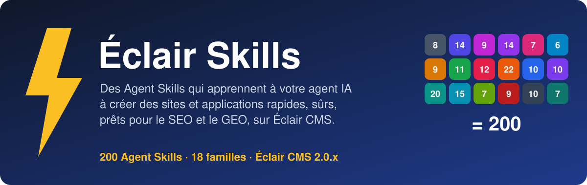
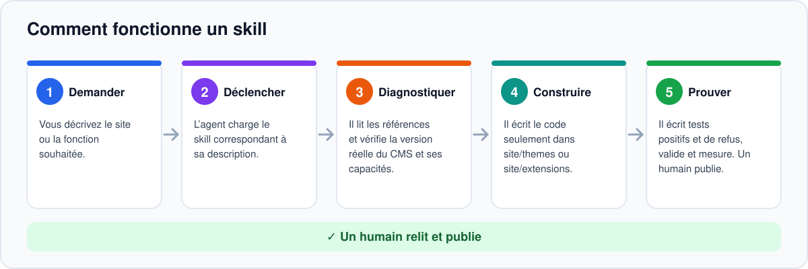
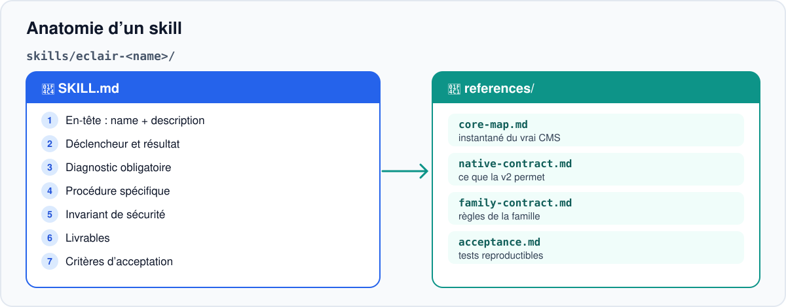
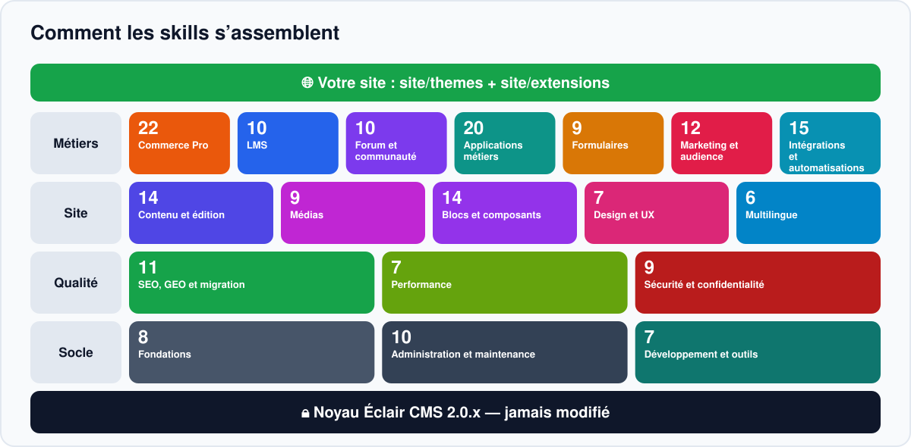
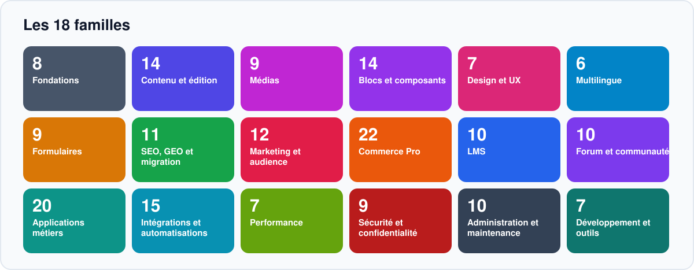
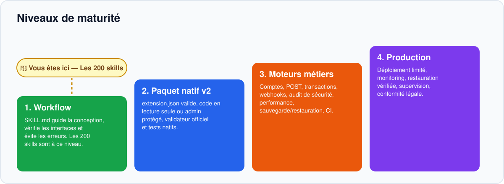

<!-- Generated by scripts/build_readmes.py — edit scripts/readme_data_*.py, not this file. -->
<a id="top"></a>

<p align="center"></p>

<p align="center"><a href="README.md">English</a> · <b>Français</b> · <a href="README.es.md">Español</a> · <a href="README.de.md">Deutsch</a> · <a href="README.it.md">Italiano</a> · <a href="README.pt.md">Português</a></p>

<p align="center"><a href="https://github.com/Jacckisback/eclair-skills/actions/workflows/validate.yml"></a>    <a href="LICENSE"></a></p>

**Éclair Skills** est une bibliothèque de **57 Agent Skills** pour [Éclair CMS](https://github.com/Jacckisback/eclair-cms) 2.0.x. Ajoutez-les à votre projet et votre agent de code (Claude Code, Codex, ChatGPT ou tout agent qui lit des dossiers `SKILL.md`) cesse d’improviser : il suit une méthode éprouvée, respecte le contrat du CMS, ne touche jamais au noyau et prouve son travail par des tests.

> [!IMPORTANT]
> **À lire d’abord** — **57 skills ≠ 57 extensions PHP.** Un skill est un guide pour votre agent (instructions, références et tests à écrire). Ce n’est pas un plugin à installer sur un site en ligne. Le seul exemple fonctionnel est `catalogue-demo`, en lecture seule.

## Pourquoi Éclair Skills ?

- **Une méthode, pas du hasard** — chaque skill impose un diagnostic, une procédure, un invariant de sécurité et des critères d’acceptation avant la moindre ligne de code.
- **Le noyau reste intact** — votre code vit uniquement dans `site/themes/` et `site/extensions/` : les mises à jour du CMS continuent de fonctionner.
- **Sûr et rapide par défaut** — CSRF, permissions par objet, échappement, aucune donnée personnelle en cache partagé, budgets de performance mesurés.
- **Honnête sur les limites** — chaque skill indique ce qu’Éclair 2.0 permet aujourd’hui et ce qui exige encore une capacité du noyau.

## Comment ça marche

<p align="center"></p>

Vous décrivez votre objectif en langage courant. L’agent trouve le bon skill grâce à sa description, puis suit cinq étapes :

1. **Demander** — Vous décrivez le site ou la fonction souhaitée.
2. **Déclencher** — L’agent charge le skill correspondant à sa description.
3. **Diagnostiquer** — Il lit les références et vérifie la version réelle du CMS et ses capacités.
4. **Construire** — Il écrit le code seulement dans site/themes ou site/extensions.
5. **Prouver** — Il écrit tests positifs et de refus, valide et mesure. Un humain publie.

## Anatomie d’un skill

<p align="center"></p>

Chaque skill est un dossier autonome. Aucun ne dépend des fichiers d’un autre skill.

```text
skills/eclair-commerce-pro/
├── SKILL.md
└── references/
    ├── core-map.md
    ├── native-contract.md
    ├── family-contract.md
    └── acceptance.md
```

| Partie | Rôle |
|---|---|
| `SKILL.md` — en-tête | `name` et `description` : l’agent utilise la description pour décider quand charger le skill. |
| Déclencheur et résultat attendu | À quoi sert le skill et ce qu’il doit livrer. |
| Diagnostic obligatoire | Lire les références, vérifier la version du CMS, le manifeste `eclair-extension/1` et les capacités disponibles, cartographier les données. |
| Procédure spécifique | Parcours métier, emplacements autorisés, limites du contrat actuel, invariant de sécurité, preuves, validation native. |
| Livrables et acceptation | Mini-spécification, matrice permissions/cache, paquet seulement si le contrat le permet, tests qui passent et tests qui doivent refuser. |
| `references/core-map.md` | Instantané du vrai noyau Éclair CMS sur lequel le skill a été vérifié. |
| `references/native-contract.md` | Ce que le contrat natif `eclair-extension/1` permet (et ne permet pas). |
| `references/family-contract.md` | Règles communes à toute la famille (sécurité, cache, données). |
| `references/acceptance.md` | Plan de test reproductible : cas nominal, refus, invariant, cache, activation/désactivation. |

## Comment les skills s’assemblent

<p align="center"></p>

Les skills sont faits pour être combinés. Pensez-les en couches :

1. **Noyau Éclair CMS 2.0.x** — Jamais modifié par un skill. Les changements structurels passent par une RFC et une PR dédiées.
2. **Fondations (8)** — Toujours en premier : architecture, extension, stockage, rôles, routage, cache, sécurité, tests. Tous les autres s’appuient dessus.
3. **Familles métier** — Commerce, LMS, communauté, applications métiers et intégrations : prenez celles dont votre projet a besoin.
4. **Qualité transversale** — Design et UX, SEO et GEO s’appliquent à chaque page, quel que soit le domaine.
5. **Votre site** — Le résultat vit dans site/themes et site/extensions, validé et testé.

## Les 8 familles

<p align="center"></p>

| | Famille | Portée | Skills |
|---|---|---|---:|
| 🧱 | **Fondations** | Contrat natif v2, tests et sécurité | 8 |
| 🛒 | **Commerce Pro** | Boutique transactionnelle et paiement, conçus avant déploiement | 10 |
| 🎓 | **LMS** | Cours, inscriptions, progression, certifications | 7 |
| 💬 | **Forum et communauté** | Discussions, modération, profils, notifications | 6 |
| 🗂️ | **Applications métiers** | Réservations, abonnements, annuaires, outils métiers | 8 |
| 🎨 | **Design et UX** | Thèmes, blocs, accessibilité, rapidité | 7 |
| 🔎 | **SEO, GEO et migration** | Indexabilité, données structurées, WordPress | 5 |
| 🔌 | **Intégrations et automatisations** | API, webhooks, emails, IA, supervision | 6 |
| | | | **57** |

## Démarrage rapide

Prérequis : Git et Python 3 (bibliothèque standard uniquement). PHP 8.1+ pour lancer les exemples et tests PHP.

**1. Récupérer la bibliothèque et la vérifier**

```bash
git clone https://github.com/Jacckisback/eclair-skills.git
cd eclair-skills
python3 scripts/validate_skills.py
```

**2. Voir ce qui est disponible**

```bash
python3 scripts/install_skills.py --list
```

**3. Installer des skills dans votre projet**

```bash
python3 scripts/install_skills.py --project /path/to/my-site --category commerce   # une famille
python3 scripts/install_skills.py --project /path/to/my-site --skill eclair-wordpress-migration   # un skill
python3 scripts/install_skills.py --project /path/to/my-site --all   # tout
```

L’installateur copie les skills dans votre projet. Il n’écrase jamais un skill existant, sauf avec `--force` après relecture.

**4. Ensuite, demandez simplement à votre agent**

> Prépare une boutique en ligne pour mon site Éclair : catalogue, variantes et commande. Utilise le skill eclair-commerce-pro et dis-moi ce qu’Éclair 2.0 ne sait pas encore faire.

> Migre mon blog WordPress vers Éclair 2 sans perdre d’URL ni de trafic.

> Audite l’accessibilité et la performance de mon thème et corrige les problèmes.

L’agent choisit automatiquement le skill grâce à sa description. Vous pouvez aussi le nommer.

## Recettes : quels skills pour quel projet

Commencez par les fondations, puis suivez l’ordre ci-dessous. Chaque flèche est une étape que l’agent termine et teste avant la suivante.

**Boutique en ligne**

[`eclair-architecture`](skills/eclair-architecture/SKILL.md) → [`eclair-storage`](skills/eclair-storage/SKILL.md) → [`eclair-auth-roles`](skills/eclair-auth-roles/SKILL.md) → [`eclair-commerce-pro`](skills/eclair-commerce-pro/SKILL.md) → [`eclair-product-catalog`](skills/eclair-product-catalog/SKILL.md) → [`eclair-product-variants`](skills/eclair-product-variants/SKILL.md) → [`eclair-inventory`](skills/eclair-inventory/SKILL.md) → [`eclair-cart-checkout`](skills/eclair-cart-checkout/SKILL.md) → [`eclair-orders-payments`](skills/eclair-orders-payments/SKILL.md) → [`eclair-tax-invoicing`](skills/eclair-tax-invoicing/SKILL.md) → [`eclair-shipping`](skills/eclair-shipping/SKILL.md) → [`eclair-discounts`](skills/eclair-discounts/SKILL.md) → [`eclair-email-automation`](skills/eclair-email-automation/SKILL.md) → [`eclair-security-audit`](skills/eclair-security-audit/SKILL.md) → [`eclair-test-suite`](skills/eclair-test-suite/SKILL.md)

**École en ligne**

[`eclair-architecture`](skills/eclair-architecture/SKILL.md) → [`eclair-auth-roles`](skills/eclair-auth-roles/SKILL.md) → [`eclair-lms`](skills/eclair-lms/SKILL.md) → [`eclair-course-builder`](skills/eclair-course-builder/SKILL.md) → [`eclair-lessons-media`](skills/eclair-lessons-media/SKILL.md) → [`eclair-enrollment-access`](skills/eclair-enrollment-access/SKILL.md) → [`eclair-progress`](skills/eclair-progress/SKILL.md) → [`eclair-quizzes-certificates`](skills/eclair-quizzes-certificates/SKILL.md) → [`eclair-lms-analytics`](skills/eclair-lms-analytics/SKILL.md) → [`eclair-test-suite`](skills/eclair-test-suite/SKILL.md)

**Communauté / forum**

[`eclair-auth-roles`](skills/eclair-auth-roles/SKILL.md) → [`eclair-forum`](skills/eclair-forum/SKILL.md) → [`eclair-discussions-topics`](skills/eclair-discussions-topics/SKILL.md) → [`eclair-community-profiles`](skills/eclair-community-profiles/SKILL.md) → [`eclair-moderation`](skills/eclair-moderation/SKILL.md) → [`eclair-notifications`](skills/eclair-notifications/SKILL.md) → [`eclair-community-search`](skills/eclair-community-search/SKILL.md) → [`eclair-security-audit`](skills/eclair-security-audit/SKILL.md)

**Site d’entreprise locale**

[`eclair-design`](skills/eclair-design/SKILL.md) → [`eclair-theme-builder`](skills/eclair-theme-builder/SKILL.md) → [`eclair-bookings`](skills/eclair-bookings/SKILL.md) → [`eclair-appointments-calendar`](skills/eclair-appointments-calendar/SKILL.md) → [`eclair-forms-crm`](skills/eclair-forms-crm/SKILL.md) → [`eclair-crm-integration`](skills/eclair-crm-integration/SKILL.md) → [`eclair-seo-audit`](skills/eclair-seo-audit/SKILL.md) → [`eclair-structured-data`](skills/eclair-structured-data/SKILL.md)

**Migration WordPress et SEO/GEO**

[`eclair-wordpress-migration`](skills/eclair-wordpress-migration/SKILL.md) → [`eclair-routing`](skills/eclair-routing/SKILL.md) → [`eclair-seo-audit`](skills/eclair-seo-audit/SKILL.md) → [`eclair-structured-data`](skills/eclair-structured-data/SKILL.md) → [`eclair-multilingual-seo`](skills/eclair-multilingual-seo/SKILL.md) → [`eclair-geo-optimization`](skills/eclair-geo-optimization/SKILL.md) → [`eclair-performance-ux`](skills/eclair-performance-ux/SKILL.md) → [`eclair-accessibility`](skills/eclair-accessibility/SKILL.md)

## Catalogue complet des 57 skills

Cliquez sur un skill pour ouvrir son `SKILL.md`. La colonne statut indique ce qui peut être livré sur Éclair 2.0 aujourd’hui.

**Légende** — 🟢 **Natif v2** : réalisable aujourd’hui avec le contrat natif. 🔵 **Prototype lecture seule possible** : une version publique GET est faisable maintenant ; les écritures demandent plus. 🟠 **Conception · noyau requis** : conception et tests complets dès maintenant, la production exige des capacités pas encore présentes dans Éclair 2.0 (POST public, transactions, comptes membres…). 🟡 **Partiellement bloqué** : certaines parties dépendent d’une évolution du contrat du noyau.

### 🧱 Fondations (8)

_Contrat natif v2, tests et sécurité._

| Skill | Ce qu’il aide l’agent à faire | Statut |
|---|---|---|
| [`eclair-architecture`](skills/eclair-architecture/SKILL.md) | Décider où placer une fonctionnalité (réglage, thème, extension ou RFC du noyau) sans toucher au cœur v2. | 🟢 Natif v2 |
| [`eclair-extension-builder`](skills/eclair-extension-builder/SKILL.md) | Construire une extension v2 réellement installable : `extension.json`, `extension.php`, contrat `eclair-extension/1`. | 🟢 Natif v2 |
| [`eclair-storage`](skills/eclair-storage/SKILL.md) | Choisir la bonne persistance, les migrations, sauvegardes et besoins SQL de chaque module. | 🟢 Natif v2 |
| [`eclair-auth-roles`](skills/eclair-auth-roles/SKILL.md) | Distinguer les droits d’administration des membres, élèves, clients et modérateurs. | 🟢 Natif v2 |
| [`eclair-routing`](skills/eclair-routing/SKILL.md) | Créer des routes publiques/admin en protégeant les URL existantes, les redirections et le SEO. | 🟢 Natif v2 |
| [`eclair-cache-contract`](skills/eclair-cache-contract/SKILL.md) | Garder le cache rapide et sûr : invalidation, confidentialité et budgets de performance. | 🟢 Natif v2 |
| [`eclair-security-audit`](skills/eclair-security-audit/SKILL.md) | Auditer une extension avant activation : chaîne d’approvisionnement, actions admin, données membres. | 🟢 Natif v2 |
| [`eclair-test-suite`](skills/eclair-test-suite/SKILL.md) | Écrire les tests CI, de régression, sécurité et performance : une preuve avant publication. | 🟢 Natif v2 |

### 🛒 Commerce Pro (10)

_Boutique transactionnelle et paiement, conçus avant déploiement._

| Skill | Ce qu’il aide l’agent à faire | Statut |
|---|---|---|
| [`eclair-commerce-pro`](skills/eclair-commerce-pro/SKILL.md) | Concevoir une boutique complète, du catalogue à la commande livrée (point d’entrée de la famille). | 🟠 Conception · noyau requis |
| [`eclair-product-catalog`](skills/eclair-product-catalog/SKILL.md) | Construire un catalogue produits public rapide et indexable. | 🔵 Prototype lecture seule possible |
| [`eclair-product-variants`](skills/eclair-product-variants/SKILL.md) | Modéliser tailles, couleurs et configurations sans erreur de prix. | 🟠 Conception · noyau requis |
| [`eclair-cart-checkout`](skills/eclair-cart-checkout/SKILL.md) | Concevoir panier et tunnel de commande multi-lignes, avec prix et stock cohérents. | 🟠 Conception · noyau requis |
| [`eclair-orders-payments`](skills/eclair-orders-payments/SKILL.md) | Implémenter les états de commande et les prestataires de paiement (PSP) avec webhooks signés. | 🟠 Conception · noyau requis |
| [`eclair-tax-invoicing`](skills/eclair-tax-invoicing/SKILL.md) | Préparer les points de branchement TVA et facturation adaptés à chaque juridiction (pas de taux universel). | 🟠 Conception · noyau requis |
| [`eclair-inventory`](skills/eclair-inventory/SKILL.md) | Synchroniser le stock réel entre produits, variantes et commandes. | 🟠 Conception · noyau requis |
| [`eclair-shipping`](skills/eclair-shipping/SKILL.md) | Gérer zones, tarifs, suivi et états de livraison. | 🟠 Conception · noyau requis |
| [`eclair-discounts`](skills/eclair-discounts/SKILL.md) | Créer remises et coupons cohérents, jamais cumulés par erreur. | 🟠 Conception · noyau requis |
| [`eclair-commerce-analytics`](skills/eclair-commerce-analytics/SKILL.md) | Suivre ventes et conversions sans exposer les données clients. | 🟠 Conception · noyau requis |

### 🎓 LMS (7)

_Cours, inscriptions, progression, certifications._

| Skill | Ce qu’il aide l’agent à faire | Statut |
|---|---|---|
| [`eclair-lms`](skills/eclair-lms/SKILL.md) | Structurer une école en ligne modulaire (point d’entrée de la famille). | 🟠 Conception · noyau requis |
| [`eclair-course-builder`](skills/eclair-course-builder/SKILL.md) | Composer cours, sections et leçons versionnés. | 🟠 Conception · noyau requis |
| [`eclair-lessons-media`](skills/eclair-lessons-media/SKILL.md) | Fournir vidéos et documents protégés pour les cours. | 🟠 Conception · noyau requis |
| [`eclair-enrollment-access`](skills/eclair-enrollment-access/SKILL.md) | Lier un achat ou une validation à une inscription et à ses autorisations. | 🟠 Conception · noyau requis |
| [`eclair-progress`](skills/eclair-progress/SKILL.md) | Suivre la progression sans perte ni mise à jour incohérente. | 🟠 Conception · noyau requis |
| [`eclair-quizzes-certificates`](skills/eclair-quizzes-certificates/SKILL.md) | Créer évaluations, seuils de réussite et attestations contrôlées. | 🟠 Conception · noyau requis |
| [`eclair-lms-analytics`](skills/eclair-lms-analytics/SKILL.md) | Analyser complétion et engagement sans surveillance abusive. | 🟠 Conception · noyau requis |

### 💬 Forum et communauté (6)

_Discussions, modération, profils, notifications._

| Skill | Ce qu’il aide l’agent à faire | Statut |
|---|---|---|
| [`eclair-forum`](skills/eclair-forum/SKILL.md) | Concevoir des discussions publiques et privées avec modération (point d’entrée de la famille). | 🟠 Conception · noyau requis |
| [`eclair-discussions-topics`](skills/eclair-discussions-topics/SKILL.md) | Gérer création, édition et état des sujets et réponses. | 🟠 Conception · noyau requis |
| [`eclair-community-profiles`](skills/eclair-community-profiles/SKILL.md) | Proposer des profils publics choisis, séparés des données privées. | 🟠 Conception · noyau requis |
| [`eclair-moderation`](skills/eclair-moderation/SKILL.md) | Construire les outils de retrait, signalement et appel. | 🟠 Conception · noyau requis |
| [`eclair-notifications`](skills/eclair-notifications/SKILL.md) | Informer les membres sans spam ni fuite de données. | 🟠 Conception · noyau requis |
| [`eclair-community-search`](skills/eclair-community-search/SKILL.md) | Chercher sujets et messages selon les permissions. | 🟠 Conception · noyau requis |

### 🗂️ Applications métiers (8)

_Réservations, abonnements, annuaires, outils métiers._

| Skill | Ce qu’il aide l’agent à faire | Statut |
|---|---|---|
| [`eclair-bookings`](skills/eclair-bookings/SKILL.md) | Gérer une ressource réservable sans double réservation. | 🟠 Conception · noyau requis |
| [`eclair-appointments-calendar`](skills/eclair-appointments-calendar/SKILL.md) | Prendre rendez-vous et intégrer des calendriers externes. | 🟠 Conception · noyau requis |
| [`eclair-memberships`](skills/eclair-memberships/SKILL.md) | Gérer niveaux d’adhésion, échéances et droits d’accès. | 🟠 Conception · noyau requis |
| [`eclair-directory`](skills/eclair-directory/SKILL.md) | Créer les fiches et filtres indexables d’un annuaire professionnel. | 🔵 Prototype lecture seule possible |
| [`eclair-events-ticketing`](skills/eclair-events-ticketing/SKILL.md) | Commercialiser places, billets et admissions pour des événements. | 🟠 Conception · noyau requis |
| [`eclair-job-board`](skills/eclair-job-board/SKILL.md) | Publier offres d’emploi et candidatures respectueuses des données. | 🟠 Conception · noyau requis |
| [`eclair-real-estate`](skills/eclair-real-estate/SKILL.md) | Construire un catalogue de biens immobiliers avec recherche et contact. | 🟠 Conception · noyau requis |
| [`eclair-forms-crm`](skills/eclair-forms-crm/SKILL.md) | Collecter des demandes par formulaire et suivre leur traitement (mini-CRM). | 🟠 Conception · noyau requis |

### 🎨 Design et UX (7)

_Thèmes, blocs, accessibilité, rapidité._

| Skill | Ce qu’il aide l’agent à faire | Statut |
|---|---|---|
| [`eclair-design`](skills/eclair-design/SKILL.md) | Direction artistique : créer des sites cohérents avec Éclair Design et le thème natif. | 🟢 Natif v2 |
| [`eclair-theme-builder`](skills/eclair-theme-builder/SKILL.md) | Produire un thème Éclair v2 compatible avec les mises à jour. | 🟢 Natif v2 |
| [`eclair-blocks-library`](skills/eclair-blocks-library/SKILL.md) | Composer des blocs de contenu et extensions éditables. | 🟢 Natif v2 |
| [`eclair-accessibility`](skills/eclair-accessibility/SKILL.md) | Auditer et corriger une interface accessible (WCAG). | 🟢 Natif v2 |
| [`eclair-design-system`](skills/eclair-design-system/SKILL.md) | Construire un langage visuel cohérent et maintenable (tokens, composants). | 🟢 Natif v2 |
| [`eclair-responsive-ux`](skills/eclair-responsive-ux/SKILL.md) | Optimiser navigation, formulaires et mises en page mobiles. | 🟢 Natif v2 |
| [`eclair-performance-ux`](skills/eclair-performance-ux/SKILL.md) | Mesurer et réduire le poids et l’instabilité des pages. | 🟢 Natif v2 |

### 🔎 SEO, GEO et migration (5)

_Indexabilité, données structurées, WordPress._

| Skill | Ce qu’il aide l’agent à faire | Statut |
|---|---|---|
| [`eclair-seo-audit`](skills/eclair-seo-audit/SKILL.md) | Vérifier indexabilité, canonical, robots, liens et performance. | 🟢 Natif v2 |
| [`eclair-geo-optimization`](skills/eclair-geo-optimization/SKILL.md) | Rendre les pages lisibles par les moteurs et les assistants IA (GEO). | 🟢 Natif v2 |
| [`eclair-wordpress-migration`](skills/eclair-wordpress-migration/SKILL.md) | Migrer depuis WordPress en préservant URL, contenus et trafic. | 🟢 Natif v2 |
| [`eclair-structured-data`](skills/eclair-structured-data/SKILL.md) | Ajouter ou vérifier des données schema.org cohérentes avec le contenu. | 🟡 Partiellement bloqué |
| [`eclair-multilingual-seo`](skills/eclair-multilingual-seo/SKILL.md) | Gérer plusieurs langues sans duplication ni mauvaises canonical (hreflang). | 🟢 Natif v2 |

### 🔌 Intégrations et automatisations (6)

_API, webhooks, emails, IA, supervision._

| Skill | Ce qu’il aide l’agent à faire | Statut |
|---|---|---|
| [`eclair-webhooks`](skills/eclair-webhooks/SKILL.md) | Relier des applications externes par des événements sûrs, signés et idempotents. | 🟠 Conception · noyau requis |
| [`eclair-email-automation`](skills/eclair-email-automation/SKILL.md) | Envoyer des confirmations et relances fiables (emails transactionnels). | 🟠 Conception · noyau requis |
| [`eclair-api-integration`](skills/eclair-api-integration/SKILL.md) | Créer des connecteurs API externes robustes et limités. | 🟠 Conception · noyau requis |
| [`eclair-crm-integration`](skills/eclair-crm-integration/SKILL.md) | Synchroniser prospects et clients avec un CRM, sans doublons. | 🟠 Conception · noyau requis |
| [`eclair-ai-workflows`](skills/eclair-ai-workflows/SKILL.md) | Automatiser l’aide éditoriale par IA, sans publication sans humain. | 🟠 Conception · noyau requis |
| [`eclair-observability`](skills/eclair-observability/SKILL.md) | Surveiller santé, coûts et incidents des modules, avec alertes. | 🟠 Conception · noyau requis |

## Maturité : du guide d’agent à la production

<p align="center"></p>

Un skill est la première étape, pas la dernière. Quatre niveaux séparent un guide d’une application en production :

1. **Workflow** — SKILL.md guide la conception, vérifie les interfaces et évite les erreurs. Les 57 skills sont à ce niveau.
2. **Paquet natif v2** — extension.json valide, code en lecture seule ou admin protégé, validateur officiel et tests natifs.
3. **Moteurs métiers** — Comptes, POST, transactions, webhooks, audit de sécurité, performance, sauvegarde/restauration, CI.
4. **Production** — Déploiement limité, monitoring, restauration vérifiée, supervision, conformité légale.

> [!WARNING]
> Avant d’activer une application commerciale, cinq barrières doivent être franchies : compatibilité exacte du CMS, authentification et isolation des données testées, stockage transactionnel et paiements signés, audit de sécurité indépendant, aucune régression de performance ou de SEO. Voir [docs/ROADMAP_57.md](docs/ROADMAP_57.md).

## Exemples et prototypes

| Dossier | État | De quoi il s’agit |
|---|---|---|
| [`examples/extensions/catalogue-demo`](examples/extensions/catalogue-demo) | ✅ Exemple fonctionnel | Vitrine en lecture seule, GET `/catalogue-demo`, sans clients, panier, commande ni paiement. |
| [`examples/extensions/skill-sample`](examples/extensions/skill-sample) | ✅ Échantillon de test | Paquet natif minimal utilisé par les tests hors ligne. |
| [`examples/extensions/member-directory`](examples/extensions/member-directory) | ⚠️ Expérimental | Prototype indépendant, non qualifié. Inscription et récupération désactivées par défaut. Pas pour la production. |
| [`core-patch/`](core-patch/) | ⚠️ Expérimental | Patch de routes POST publiques, lié à la [PR #19 d’eclair-cms](https://github.com/Jacckisback/eclair-cms/pull/19), en brouillon et non fusionnée. Pas pour la production. |

**Tester la démo sur un vrai checkout Éclair**

```bash
# in a checkout of https://github.com/Jacckisback/eclair-cms
php tools/validate.php /path/to/eclair-skills/examples/extensions/catalogue-demo --json
php tests/run.php
php tools/measure.php --check
```

## Qualité et tests

Chaque push lance le workflow [validate](.github/workflows/validate.yml) sur PHP 8.1 et 8.3 :

```bash
python3 scripts/validate_skills.py
python3 scripts/check_release.py
python3 scripts/verify_sample.py
python3 scripts/verify_member_directory.py
python3 -m unittest discover -s tests -p 'test_*.py' -v
php -l examples/extensions/catalogue-demo/extension.php
php tests/member-directory.php
php tests/member-public.php
php tests/member-enroll.php
```

Ces contrôles prouvent la structure et le comportement isolé. Ce ne sont **pas** des tests d’intégration HTTP/SMTP ni un audit de sécurité des prototypes expérimentaux.

## Ce que cette bibliothèque ne promet pas

- Aucun score Lighthouse, positionnement Google ou citation par les assistants IA garantis : cela se mesure, cela ne se promet pas.
- Aucune boutique, LMS ou forum clé en main : les skills commerce, LMS et communauté sont des guides de construction.
- Aucune conformité juridique ou fiscale par défaut : TVA, facturation et données personnelles se valident localement.
- Aucun déploiement automatique : l’agent prépare, une personne autorisée relit et publie.

## Compatibilité

- Éclair CMS **2.0.x**, contrat d’extensions `eclair-extension/1`.
- PHP **8.1+** pour les exemples (CI en 8.1 et 8.3). Python **3**, bibliothèque standard, pour les scripts.
- Agents : Claude Code, Codex, ChatGPT et tout agent compatible avec les dossiers `SKILL.md`.
- Le contenu des skills est rédigé en français ; ils fonctionnent avec tout agent, quelle que soit la langue dans laquelle vous lui parlez.

## Aller plus loin

- [Catalogue complet (généré)](docs/CATALOGUE_COMPLET.md)
- [Feuille de route et barrières de production](docs/ROADMAP_57.md)
- [Matrice des capacités](docs/CAPABILITY_MATRIX.md)
- [Démarrage rapide pour agents](docs/AGENT_QUICKSTART.md)
- [Règles pour les agents](AGENTS.md)
- [Contribuer](CONTRIBUTING.md)
- [Signaler une vulnérabilité](SECURITY.md)

## Licence

GNU Affero General Public License v3.0 only (`AGPL-3.0-only`), comme Éclair CMS. Texte officiel intégral dans [LICENSE](LICENSE).

---

<p align="center"><a href="README.md">English</a> · <b>Français</b> · <a href="README.es.md">Español</a> · <a href="README.de.md">Deutsch</a> · <a href="README.it.md">Italiano</a> · <a href="README.pt.md">Português</a> · <a href="#top">Retour en haut ↑</a></p>
