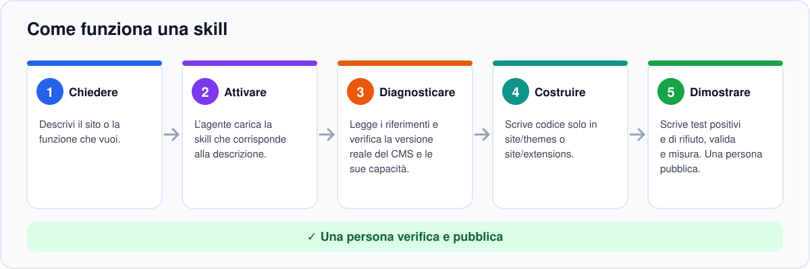
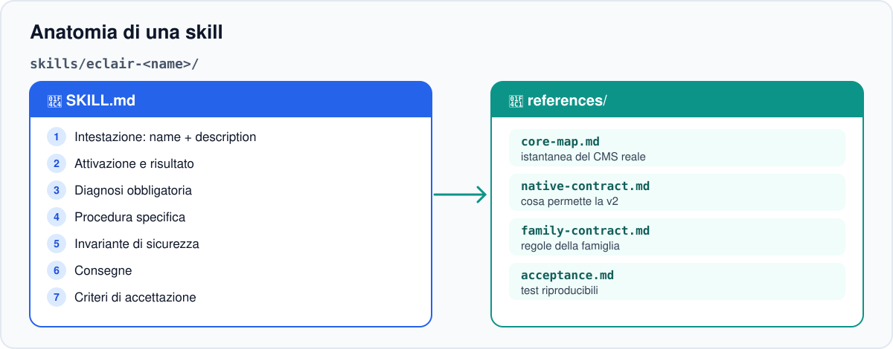
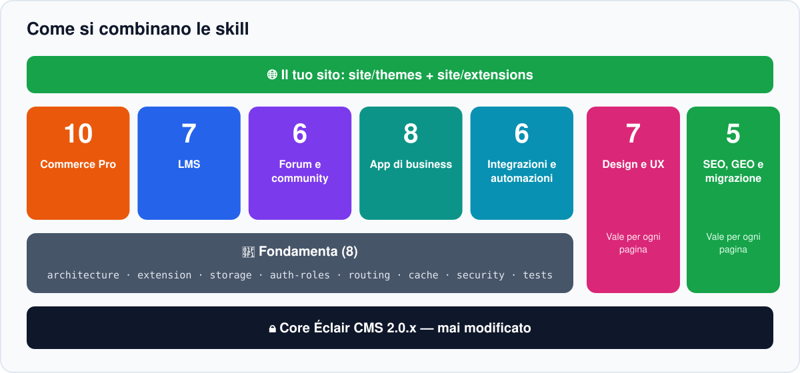
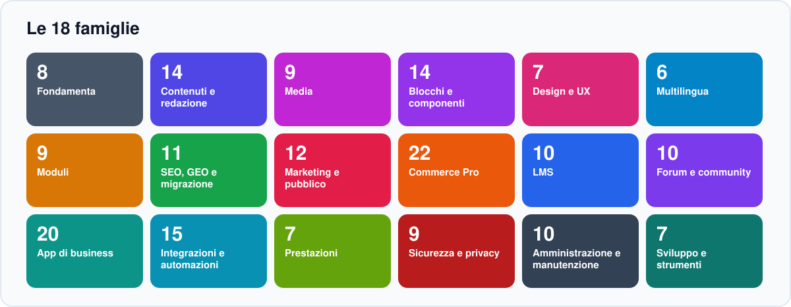
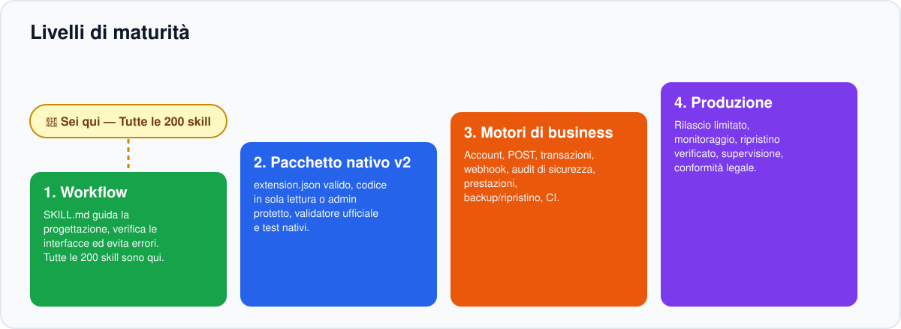

<!-- Generated by scripts/build_readmes.py — edit scripts/readme_data_*.py, not this file. -->
<a id="top"></a>

<p align="center"></p>

<p align="center"><a href="README.md">English</a> · <a href="README.fr.md">Français</a> · <a href="README.es.md">Español</a> · <a href="README.de.md">Deutsch</a> · <b>Italiano</b> · <a href="README.pt.md">Português</a></p>

<p align="center"><a href="https://github.com/Jacckisback/eclair-skills/actions/workflows/validate.yml"></a>    <a href="LICENSE"></a></p>

**Éclair Skills** è una libreria di **200 Agent Skills** per [Éclair CMS](https://github.com/Jacckisback/eclair-cms) 2.0.x. Aggiungile al tuo progetto e il tuo agente di codice (Claude Code, Codex, ChatGPT o qualsiasi agente che legge cartelle `SKILL.md`) smette di improvvisare: segue un metodo collaudato, rispetta il contratto del CMS, non tocca mai il core e dimostra il suo lavoro con i test.

> [!IMPORTANT]
> **Da leggere prima** — **200 skill ≠ 200 estensioni PHP.** Una skill è una guida per il tuo agente (istruzioni, riferimenti e test da scrivere). Non è un plugin da installare su un sito in produzione. L’unico esempio funzionante è `catalogue-demo`, in sola lettura.

## Perché Éclair Skills?

- **Metodo, non improvvisazione** — ogni skill impone diagnosi, procedura, invariante di sicurezza e criteri di accettazione prima di scrivere una sola riga di codice.
- **Il core resta intatto** — il tuo codice vive solo in `site/themes/` e `site/extensions/`, così gli aggiornamenti del CMS continuano a funzionare.
- **Sicuro e veloce di default** — CSRF, permessi per oggetto, escaping, nessun dato personale in cache condivisa, budget di prestazioni misurati.
- **Onesto sui limiti** — ogni skill dice cosa Éclair 2.0 permette oggi e cosa richiede ancora una capacità del core.

## Come funziona

<p align="center"></p>

Descrivi il tuo obiettivo con parole semplici. L’agente trova la skill giusta grazie alla sua descrizione e segue cinque passi:

1. **Chiedere** — Descrivi il sito o la funzione che vuoi.
2. **Attivare** — L’agente carica la skill che corrisponde alla descrizione.
3. **Diagnosticare** — Legge i riferimenti e verifica la versione reale del CMS e le sue capacità.
4. **Costruire** — Scrive codice solo in site/themes o site/extensions.
5. **Dimostrare** — Scrive test positivi e di rifiuto, valida e misura. Una persona pubblica.

## Anatomia di una skill

<p align="center"></p>

Ogni skill è una cartella autonoma. Nessuna dipende dai file di un’altra skill.

```text
skills/eclair-commerce-pro/
├── SKILL.md
└── references/
    ├── core-map.md
    ├── native-contract.md
    ├── family-contract.md
    └── acceptance.md
```

| Parte | Ruolo |
|---|---|
| `SKILL.md` — intestazione | `name` e `description`: l’agente usa la descrizione per decidere quando caricare la skill. |
| Attivazione e risultato atteso | A cosa serve la skill e cosa deve consegnare. |
| Diagnosi obbligatoria | Leggere i riferimenti, verificare versione del CMS, manifesto `eclair-extension/1` e capacità disponibili, mappare i dati. |
| Procedura specifica | Flusso di business, posizioni consentite, limiti del contratto attuale, invariante di sicurezza, prove, validazione nativa. |
| Consegne e accettazione | Mini specifica, matrice permessi/cache, pacchetto solo se il contratto lo consente, test che passano e test che devono rifiutare. |
| `references/core-map.md` | Istantanea del vero core di Éclair CMS su cui la skill è stata verificata. |
| `references/native-contract.md` | Cosa permette (e non permette) il contratto nativo `eclair-extension/1`. |
| `references/family-contract.md` | Regole comuni a tutta la famiglia (sicurezza, cache, dati). |
| `references/acceptance.md` | Piano di test riproducibile: caso nominale, rifiuto, invariante, cache, attivazione/disattivazione. |

## Come si combinano le skill

<p align="center"></p>

Le skill sono pensate per essere combinate. Pensale a livelli:

1. **Core di Éclair CMS 2.0.x** — Mai modificato da una skill. Le modifiche strutturali passano da una RFC e una PR dedicate.
2. **Fondamenta (8)** — Sempre per prime: architettura, estensione, archiviazione, ruoli, routing, cache, sicurezza, test. Tutte le altre si basano su di esse.
3. **Famiglie di dominio** — Commercio, LMS, community, app di business e integrazioni: scegli quelle che servono al progetto.
4. **Qualità trasversale** — Design e UX, SEO e GEO valgono per ogni pagina, qualunque sia il dominio.
5. **Il tuo sito** — Il risultato vive in site/themes e site/extensions, validato e testato.

## Le 18 famiglie

<p align="center"></p>

| | Famiglia | Ambito | Skills |
|---|---|---|---:|
| 🧱 | **Fondamenta** | Contratto nativo v2, test e sicurezza | 8 |
| 📝 | **Contenuti e redazione** | Articoli, pagine, categorie, menu, ricerca, feed | 14 |
| 🖼️ | **Media** | Libreria, immagini, gallerie, video, audio, documenti | 9 |
| 🧩 | **Blocchi e componenti** | FAQ, schede, tabelle, prezzi, sezioni, navigazione | 14 |
| 🎨 | **Design e UX** | Temi, blocchi, accessibilità, velocità | 7 |
| 🌍 | **Multilingua** | Lingue, selettore, formati, URL, traduzione | 6 |
| 📮 | **Moduli** | Contatti, preventivi, passaggi, allegati, sondaggi, calcoli | 9 |
| 🔎 | **SEO, GEO e migrazione** | Indicizzabilità, dati strutturati, WordPress | 11 |
| 📣 | **Marketing e pubblico** | Newsletter, landing page, misurazione, condivisione, pubblicità | 12 |
| 🛒 | **Commerce Pro** | Negozio transazionale e pagamenti, progettati prima del rilascio | 22 |
| 🎓 | **LMS** | Corsi, iscrizioni, progressi, certificati | 10 |
| 💬 | **Forum e community** | Discussioni, moderazione, profili, notifiche | 10 |
| 🗂️ | **App di business** | Prenotazioni, abbonamenti, elenchi, strumenti di settore | 20 |
| 🔌 | **Integrazioni e automazioni** | API, webhook, email, IA, monitoraggio | 15 |
| ⚡ | **Prestazioni** | Cache, CDN, immagini, peso, Core Web Vitals | 7 |
| 🛡️ | **Sicurezza e privacy** | Accesso, 2FA, spam, header, integrità, dati personali | 9 |
| 🛠️ | **Amministrazione e manutenzione** | Account, backup, aggiornamenti, trasferimento, registro | 10 |
| 💻 | **Sviluppo e strumenti** | API in lettura, Markdown, MCP, riga di comando, porting | 7 |
| | | | **200** |

## Vieni da WordPress?

Il catalogo copre le funzioni su cui si basa la maggior parte dei siti WordPress: articoli, menu, moduli, SEO, backup, negozio. Ogni skill indica il suo equivalente WordPress e dice onestamente cosa Éclair 2.0 può consegnare oggi:

| Cosa consegna oggi Éclair 2.0 | Skill |
|---|---:|
| 🟣 Integrato nel core | 46 |
| 🟢 Nativo v2 | 72 |
| 🔵 Prototipo in sola lettura possibile | 9 |
| 🟡 Parzialmente bloccato | 15 |
| 🟠 Progetto · serve il core | 58 |

Per sostituire un sito WordPress, inizia da `eclair-wordpress-migration` (contenuti e URL) e `eclair-wp-plugin-porting` (un plugin alla volta). Le skill contrassegnate con 🟠 sono progetti: richiedono capacità che il core non offre ancora.

## Avvio rapido

Requisiti: Git e Python 3 (solo libreria standard). PHP 8.1+ per eseguire esempi e test PHP.

**1. Scaricare la libreria e verificarla**

```bash
git clone https://github.com/Jacckisback/eclair-skills.git
cd eclair-skills
python3 scripts/validate_skills.py
```

**2. Vedere cosa è disponibile**

```bash
python3 scripts/install_skills.py --list
```

**3. Installare skill nel tuo progetto**

```bash
python3 scripts/install_skills.py --project /path/to/my-site --category commerce   # una famiglia
python3 scripts/install_skills.py --project /path/to/my-site --skill eclair-wordpress-migration   # una skill
python3 scripts/install_skills.py --project /path/to/my-site --all   # tutto
python3 scripts/install_skills.py --project /path/to/my-site --all --lang it   # in italiano
```

L’installer copia le skill nel progetto. Non sovrascrive mai una skill esistente, salvo con `--force` dopo una verifica.

**4. Poi chiedi semplicemente al tuo agente**

> Prepara un negozio online per il mio sito Éclair: catalogo, varianti e checkout. Usa la skill eclair-commerce-pro e dimmi cosa Éclair 2.0 non sa ancora fare.

> Migra il mio blog WordPress su Éclair 2 senza perdere URL né traffico.

> Verifica accessibilità e prestazioni del mio tema e correggi i problemi.

L’agente sceglie la skill automaticamente dalla descrizione. Puoi anche nominarla.

## Ricette: quali skill per quale progetto

Parti dalle fondamenta e segui l’ordine indicato. Ogni freccia è un passo che l’agente completa e testa prima del successivo.

**Negozio online**

[`eclair-architecture`](translations/it/eclair-architecture/SKILL.md) → [`eclair-storage`](translations/it/eclair-storage/SKILL.md) → [`eclair-auth-roles`](translations/it/eclair-auth-roles/SKILL.md) → [`eclair-commerce-pro`](translations/it/eclair-commerce-pro/SKILL.md) → [`eclair-product-catalog`](translations/it/eclair-product-catalog/SKILL.md) → [`eclair-product-variants`](translations/it/eclair-product-variants/SKILL.md) → [`eclair-inventory`](translations/it/eclair-inventory/SKILL.md) → [`eclair-cart-checkout`](translations/it/eclair-cart-checkout/SKILL.md) → [`eclair-orders-payments`](translations/it/eclair-orders-payments/SKILL.md) → [`eclair-tax-invoicing`](translations/it/eclair-tax-invoicing/SKILL.md) → [`eclair-shipping`](translations/it/eclair-shipping/SKILL.md) → [`eclair-discounts`](translations/it/eclair-discounts/SKILL.md) → [`eclair-email-automation`](translations/it/eclair-email-automation/SKILL.md) → [`eclair-security-audit`](translations/it/eclair-security-audit/SKILL.md) → [`eclair-test-suite`](translations/it/eclair-test-suite/SKILL.md)

**Scuola online**

[`eclair-architecture`](translations/it/eclair-architecture/SKILL.md) → [`eclair-auth-roles`](translations/it/eclair-auth-roles/SKILL.md) → [`eclair-lms`](translations/it/eclair-lms/SKILL.md) → [`eclair-course-builder`](translations/it/eclair-course-builder/SKILL.md) → [`eclair-lessons-media`](translations/it/eclair-lessons-media/SKILL.md) → [`eclair-enrollment-access`](translations/it/eclair-enrollment-access/SKILL.md) → [`eclair-progress`](translations/it/eclair-progress/SKILL.md) → [`eclair-quizzes-certificates`](translations/it/eclair-quizzes-certificates/SKILL.md) → [`eclair-lms-analytics`](translations/it/eclair-lms-analytics/SKILL.md) → [`eclair-test-suite`](translations/it/eclair-test-suite/SKILL.md)

**Community / forum**

[`eclair-auth-roles`](translations/it/eclair-auth-roles/SKILL.md) → [`eclair-forum`](translations/it/eclair-forum/SKILL.md) → [`eclair-discussions-topics`](translations/it/eclair-discussions-topics/SKILL.md) → [`eclair-community-profiles`](translations/it/eclair-community-profiles/SKILL.md) → [`eclair-moderation`](translations/it/eclair-moderation/SKILL.md) → [`eclair-notifications`](translations/it/eclair-notifications/SKILL.md) → [`eclair-community-search`](translations/it/eclair-community-search/SKILL.md) → [`eclair-security-audit`](translations/it/eclair-security-audit/SKILL.md)

**Sito per attività locale**

[`eclair-design`](translations/it/eclair-design/SKILL.md) → [`eclair-theme-builder`](translations/it/eclair-theme-builder/SKILL.md) → [`eclair-bookings`](translations/it/eclair-bookings/SKILL.md) → [`eclair-appointments-calendar`](translations/it/eclair-appointments-calendar/SKILL.md) → [`eclair-forms-crm`](translations/it/eclair-forms-crm/SKILL.md) → [`eclair-crm-integration`](translations/it/eclair-crm-integration/SKILL.md) → [`eclair-seo-audit`](translations/it/eclair-seo-audit/SKILL.md) → [`eclair-structured-data`](translations/it/eclair-structured-data/SKILL.md)

**Migrazione WordPress e SEO/GEO**

[`eclair-wordpress-migration`](translations/it/eclair-wordpress-migration/SKILL.md) → [`eclair-routing`](translations/it/eclair-routing/SKILL.md) → [`eclair-seo-audit`](translations/it/eclair-seo-audit/SKILL.md) → [`eclair-structured-data`](translations/it/eclair-structured-data/SKILL.md) → [`eclair-multilingual-seo`](translations/it/eclair-multilingual-seo/SKILL.md) → [`eclair-geo-optimization`](translations/it/eclair-geo-optimization/SKILL.md) → [`eclair-performance-ux`](translations/it/eclair-performance-ux/SKILL.md) → [`eclair-accessibility`](translations/it/eclair-accessibility/SKILL.md)

## Catalogo completo delle 200 skill

Clicca su una skill per aprire il suo `SKILL.md`. La colonna stato indica cosa si può consegnare oggi su Éclair 2.0.

**Legenda** — 🟣 **Integrato nel core**: già parte di Éclair 2.0; la skill lo configura e lo verifica, senza estensione. 🟢 **Nativo v2**: realizzabile oggi con il contratto nativo. 🔵 **Prototipo in sola lettura possibile**: una versione pubblica GET è già fattibile; le scritture richiedono di più. 🟠 **Progetto · serve il core**: progettazione e test completi da subito, la produzione richiede capacità non ancora presenti in Éclair 2.0 (POST pubblico, transazioni, account membri…). 🟡 **Parzialmente bloccato**: alcune parti dipendono da un’evoluzione del contratto del core.

<details open>
<summary><b>🧱 Fondamenta (8)</b> — Contratto nativo v2, test e sicurezza</summary>

| Skill | Cosa aiuta a fare all’agente | Stato |
|---|---|---|
| [`eclair-architecture`](translations/it/eclair-architecture/SKILL.md) | Decidere dove collocare una funzione (impostazione, tema, estensione o RFC del core) senza toccare il core v2. | 🟢 Nativo v2 |
| [`eclair-extension-builder`](translations/it/eclair-extension-builder/SKILL.md) | Creare un’estensione v2 davvero installabile: `extension.json`, `extension.php`, contratto `eclair-extension/1`. | 🟢 Nativo v2 |
| [`eclair-storage`](translations/it/eclair-storage/SKILL.md) | Scegliere la persistenza giusta, migrazioni, backup ed esigenze SQL di ogni modulo. | 🟢 Nativo v2 |
| [`eclair-auth-roles`](translations/it/eclair-auth-roles/SKILL.md) | Separare i diritti di amministrazione da membri, studenti, clienti e moderatori. | 🟢 Nativo v2 |
| [`eclair-routing`](translations/it/eclair-routing/SKILL.md) | Creare rotte pubbliche/admin proteggendo URL esistenti, redirect e SEO. | 🟢 Nativo v2 |
| [`eclair-cache-contract`](translations/it/eclair-cache-contract/SKILL.md) | Mantenere la cache veloce e sicura: invalidazione, privacy e budget di prestazioni. | 🟢 Nativo v2 |
| [`eclair-security-audit`](translations/it/eclair-security-audit/SKILL.md) | Verificare un’estensione prima dell’attivazione: supply chain, azioni admin, dati dei membri. | 🟢 Nativo v2 |
| [`eclair-test-suite`](translations/it/eclair-test-suite/SKILL.md) | Scrivere test CI, di regressione, sicurezza e prestazioni: una prova prima di pubblicare. | 🟢 Nativo v2 |

</details>

<details>
<summary><b>📝 Contenuti e redazione (14)</b> — Articoli, pagine, categorie, menu, ricerca, feed</summary>

| Skill | Cosa aiuta a fare all’agente | Stato |
|---|---|---|
| [`eclair-blog-posts`](translations/it/eclair-blog-posts/SKILL.md) | Pubblicare e organizzare articoli del blog con l'editor a blocchi nativo. | 🟣 Integrato nel core |
| [`eclair-static-pages`](translations/it/eclair-static-pages/SKILL.md) | Creare le pagine fisse del sito (home, chi siamo, servizi, contatti) e la loro struttura. | 🟣 Integrato nel core |
| [`eclair-categories`](translations/it/eclair-categories/SKILL.md) | Strutturare i contenuti in categorie pilastro utili a visitatori e SEO. | 🟣 Integrato nel core |
| [`eclair-tags-taxonomies`](translations/it/eclair-tags-taxonomies/SKILL.md) | Riprendere tag o tassonomie personalizzate quando il core offre solo categorie. | 🟡 Parzialmente bloccato |
| [`eclair-custom-content-types`](translations/it/eclair-custom-content-types/SKILL.md) | Modellare contenuti di settore (progetti, immobili, eventi) senza tipi di contenuto personalizzati nel core. | 🟡 Parzialmente bloccato |
| [`eclair-custom-fields`](translations/it/eclair-custom-fields/SKILL.md) | Aggiungere campi strutturati a blocchi o impostazioni di estensione. | 🟢 Nativo v2 |
| [`eclair-comments`](translations/it/eclair-comments/SKILL.md) | Progettare i commenti agli articoli con moderazione e antispam. | 🟠 Progetto · serve il core |
| [`eclair-editorial-workflow`](translations/it/eclair-editorial-workflow/SKILL.md) | Organizzare bozze, revisione e calendario editoriale di un team. | 🟣 Integrato nel core |
| [`eclair-authors`](translations/it/eclair-authors/SKILL.md) | Presentare gli autori con biografia e competenze verificabili. | 🟣 Integrato nel core |
| [`eclair-navigation-menus`](translations/it/eclair-navigation-menus/SKILL.md) | Costruire menu di navigazione chiari per intestazione e piè di pagina. | 🟣 Integrato nel core |
| [`eclair-site-search`](translations/it/eclair-site-search/SKILL.md) | Offrire una ricerca interna veloce senza database. | 🟢 Nativo v2 |
| [`eclair-rss-feeds`](translations/it/eclair-rss-feeds/SKILL.md) | Verificare e valorizzare il feed RSS nativo del sito. | 🟣 Integrato nel core |
| [`eclair-related-posts`](translations/it/eclair-related-posts/SKILL.md) | Proporre articoli correlati pertinenti a fine pagina. | 🟢 Nativo v2 |
| [`eclair-table-of-contents`](translations/it/eclair-table-of-contents/SKILL.md) | Aggiungere un indice cliccabile ai contenuti lunghi. | 🟢 Nativo v2 |

</details>

<details>
<summary><b>🖼️ Media (9)</b> — Libreria, immagini, gallerie, video, audio, documenti</summary>

| Skill | Cosa aiuta a fare all’agente | Stato |
|---|---|---|
| [`eclair-media-library`](translations/it/eclair-media-library/SKILL.md) | Organizzare immagini e file nella libreria media nativa. | 🟣 Integrato nel core |
| [`eclair-image-optimization`](translations/it/eclair-image-optimization/SKILL.md) | Sfruttare WebP responsive e caricamento differito nativi. | 🟣 Integrato nel core |
| [`eclair-image-galleries`](translations/it/eclair-image-galleries/SKILL.md) | Creare gallerie fotografiche leggere e accessibili. | 🟢 Nativo v2 |
| [`eclair-video-embeds`](translations/it/eclair-video-embeds/SKILL.md) | Incorporare video senza rallentare la pagina né impostare cookie. | 🟣 Integrato nel core |
| [`eclair-audio-podcast`](translations/it/eclair-audio-podcast/SKILL.md) | Pubblicare episodi audio con player e feed podcast. | 🟢 Nativo v2 |
| [`eclair-file-downloads`](translations/it/eclair-file-downloads/SKILL.md) | Offrire file da scaricare (PDF, modelli, schede). | 🟢 Nativo v2 |
| [`eclair-sliders-carousels`](translations/it/eclair-sliders-carousels/SKILL.md) | Creare uno slider sobrio che non penalizzi velocità né accessibilità. | 🟢 Nativo v2 |
| [`eclair-lightbox`](translations/it/eclair-lightbox/SKILL.md) | Ingrandire le immagini al clic con un visualizzatore leggero. | 🟢 Nativo v2 |
| [`eclair-pdf-documents`](translations/it/eclair-pdf-documents/SKILL.md) | Pubblicare PDF leggibili, accessibili e indicizzati. | 🟢 Nativo v2 |

</details>

<details>
<summary><b>🧩 Blocchi e componenti (14)</b> — FAQ, schede, tabelle, prezzi, sezioni, navigazione</summary>

| Skill | Cosa aiuta a fare all’agente | Stato |
|---|---|---|
| [`eclair-accordions-faq`](translations/it/eclair-accordions-faq/SKILL.md) | Presentare domande e risposte con il blocco FAQ nativo. | 🟣 Integrato nel core |
| [`eclair-tabs`](translations/it/eclair-tabs/SKILL.md) | Organizzare un contenuto in schede accessibili. | 🟢 Nativo v2 |
| [`eclair-data-tables`](translations/it/eclair-data-tables/SKILL.md) | Presentare tabelle leggibili su mobile. | 🟣 Integrato nel core |
| [`eclair-pricing-tables`](translations/it/eclair-pricing-tables/SKILL.md) | Presentare offerte e prezzi in modo chiaro e onesto. | 🟢 Nativo v2 |
| [`eclair-timelines`](translations/it/eclair-timelines/SKILL.md) | Raccontare una storia o un processo in tappe datate. | 🟢 Nativo v2 |
| [`eclair-countdowns`](translations/it/eclair-countdowns/SKILL.md) | Mostrare un conto alla rovescia verso una data reale. | 🟢 Nativo v2 |
| [`eclair-team-members`](translations/it/eclair-team-members/SKILL.md) | Presentare il team con il blocco nativo. | 🟣 Integrato nel core |
| [`eclair-logo-walls`](translations/it/eclair-logo-walls/SKILL.md) | Mostrare i loghi di clienti o partner autorizzati. | 🟢 Nativo v2 |
| [`eclair-cta-sections`](translations/it/eclair-cta-sections/SKILL.md) | Inserire inviti all'azione chiari con i blocchi nativi. | 🟣 Integrato nel core |
| [`eclair-hero-sections`](translations/it/eclair-hero-sections/SKILL.md) | Comporre una sezione di apertura forte con il blocco nativo. | 🟣 Integrato nel core |
| [`eclair-headers-footers`](translations/it/eclair-headers-footers/SKILL.md) | Personalizzare intestazione e piè di pagina tramite un tema del sito. | 🟢 Nativo v2 |
| [`eclair-breadcrumbs`](translations/it/eclair-breadcrumbs/SKILL.md) | Verificare il percorso di navigazione nativo e il suo markup. | 🟣 Integrato nel core |
| [`eclair-pagination`](translations/it/eclair-pagination/SKILL.md) | Paginare in modo pulito le liste di articoli e schede. | 🟢 Nativo v2 |
| [`eclair-dark-mode`](translations/it/eclair-dark-mode/SKILL.md) | Offrire una modalità scura fedele all'identità. | 🟢 Nativo v2 |

</details>

<details>
<summary><b>🎨 Design e UX (7)</b> — Temi, blocchi, accessibilità, velocità</summary>

| Skill | Cosa aiuta a fare all’agente | Stato |
|---|---|---|
| [`eclair-design`](translations/it/eclair-design/SKILL.md) | Direzione artistica: creare siti coerenti con Éclair Design e il tema nativo. | 🟢 Nativo v2 |
| [`eclair-theme-builder`](translations/it/eclair-theme-builder/SKILL.md) | Produrre un tema Éclair v2 compatibile con gli aggiornamenti. | 🟢 Nativo v2 |
| [`eclair-blocks-library`](translations/it/eclair-blocks-library/SKILL.md) | Comporre blocchi di contenuto ed estensioni modificabili. | 🟢 Nativo v2 |
| [`eclair-accessibility`](translations/it/eclair-accessibility/SKILL.md) | Verificare e correggere un’interfaccia accessibile (WCAG). | 🟢 Nativo v2 |
| [`eclair-design-system`](translations/it/eclair-design-system/SKILL.md) | Costruire un linguaggio visivo coerente e manutenibile (token, componenti). | 🟢 Nativo v2 |
| [`eclair-responsive-ux`](translations/it/eclair-responsive-ux/SKILL.md) | Ottimizzare navigazione, moduli e layout su mobile. | 🟢 Nativo v2 |
| [`eclair-performance-ux`](translations/it/eclair-performance-ux/SKILL.md) | Misurare e ridurre peso e instabilità delle pagine. | 🟢 Nativo v2 |

</details>

<details>
<summary><b>🌍 Multilingua (6)</b> — Lingue, selettore, formati, URL, traduzione</summary>

| Skill | Cosa aiuta a fare all’agente | Stato |
|---|---|---|
| [`eclair-multilingual-content`](translations/it/eclair-multilingual-content/SKILL.md) | Pubblicare un sito in più lingue con versioni collegate. | 🟡 Parzialmente bloccato |
| [`eclair-language-switcher`](translations/it/eclair-language-switcher/SKILL.md) | Aggiungere un selettore di lingua chiaro e accessibile. | 🟢 Nativo v2 |
| [`eclair-rtl-support`](translations/it/eclair-rtl-support/SKILL.md) | Adattare il tema all'arabo o all'ebraico. | 🟢 Nativo v2 |
| [`eclair-locale-formats`](translations/it/eclair-locale-formats/SKILL.md) | Mostrare date, numeri, prezzi e indirizzi nel formato di ogni paese. | 🟢 Nativo v2 |
| [`eclair-translated-urls`](translations/it/eclair-translated-urls/SKILL.md) | Tradurre gli URL senza perdere posizionamento. | 🟡 Parzialmente bloccato |
| [`eclair-translation-workflow`](translations/it/eclair-translation-workflow/SKILL.md) | Organizzare traduzione, revisione e aggiornamento delle versioni. | 🟢 Nativo v2 |

</details>

<details>
<summary><b>📮 Moduli (9)</b> — Contatti, preventivi, passaggi, allegati, sondaggi, calcoli</summary>

| Skill | Cosa aiuta a fare all’agente | Stato |
|---|---|---|
| [`eclair-contact-forms`](translations/it/eclair-contact-forms/SKILL.md) | Configurare il modulo di contatto nativo e la sua casella. | 🟣 Integrato nel core |
| [`eclair-form-inbox`](translations/it/eclair-form-inbox/SKILL.md) | Gestire i messaggi ricevuti senza perderne nessuno. | 🟣 Integrato nel core |
| [`eclair-multi-step-forms`](translations/it/eclair-multi-step-forms/SKILL.md) | Progettare un modulo lungo suddiviso in passaggi. | 🟠 Progetto · serve il core |
| [`eclair-file-upload-forms`](translations/it/eclair-file-upload-forms/SKILL.md) | Progettare il caricamento sicuro di file da parte dei visitatori. | 🟠 Progetto · serve il core |
| [`eclair-payment-forms`](translations/it/eclair-payment-forms/SKILL.md) | Incassare un acconto, una donazione o un servizio semplice tramite link di pagamento. | 🔵 Prototipo in sola lettura possibile |
| [`eclair-surveys-polls`](translations/it/eclair-surveys-polls/SKILL.md) | Progettare sondaggi e questionari di soddisfazione. | 🟠 Progetto · serve il core |
| [`eclair-quote-requests`](translations/it/eclair-quote-requests/SKILL.md) | Raccogliere richieste di preventivo qualificate. | 🔵 Prototipo in sola lettura possibile |
| [`eclair-conditional-forms`](translations/it/eclair-conditional-forms/SKILL.md) | Progettare moduli i cui campi dipendono dalle risposte. | 🟠 Progetto · serve il core |
| [`eclair-calculators`](translations/it/eclair-calculators/SKILL.md) | Offrire un simulatore di prezzo o misura senza raccolta di dati. | 🟢 Nativo v2 |

</details>

<details>
<summary><b>🔎 SEO, GEO e migrazione (11)</b> — Indicizzabilità, dati strutturati, WordPress</summary>

| Skill | Cosa aiuta a fare all’agente | Stato |
|---|---|---|
| [`eclair-seo-audit`](translations/it/eclair-seo-audit/SKILL.md) | Verificare indicizzabilità, canonical, robots, link e prestazioni. | 🟢 Nativo v2 |
| [`eclair-geo-optimization`](translations/it/eclair-geo-optimization/SKILL.md) | Rendere le pagine leggibili da motori di ricerca e assistenti IA (GEO). | 🟢 Nativo v2 |
| [`eclair-wordpress-migration`](translations/it/eclair-wordpress-migration/SKILL.md) | Migrare da WordPress preservando URL, contenuti e traffico. | 🟢 Nativo v2 |
| [`eclair-structured-data`](translations/it/eclair-structured-data/SKILL.md) | Aggiungere o verificare dati schema.org coerenti con il contenuto. | 🟡 Parzialmente bloccato |
| [`eclair-multilingual-seo`](translations/it/eclair-multilingual-seo/SKILL.md) | Gestire più lingue senza duplicati né canonical errate (hreflang). | 🟢 Nativo v2 |
| [`eclair-meta-tags`](translations/it/eclair-meta-tags/SKILL.md) | Scrivere titoli e descrizioni con l'analisi SEO nativa. | 🟣 Integrato nel core |
| [`eclair-xml-sitemaps`](translations/it/eclair-xml-sitemaps/SKILL.md) | Verificare la sitemap nativa e dichiararla ai motori di ricerca. | 🟣 Integrato nel core |
| [`eclair-redirects-manager`](translations/it/eclair-redirects-manager/SKILL.md) | Gestire i redirect 301 con il gestore nativo. | 🟣 Integrato nel core |
| [`eclair-local-seo`](translations/it/eclair-local-seo/SKILL.md) | Rendere visibile un'attività locale con i dati nativi. | 🟣 Integrato nel core |
| [`eclair-social-previews`](translations/it/eclair-social-previews/SKILL.md) | Curare l'anteprima delle pagine condivise su social e messaggistica. | 🟣 Integrato nel core |
| [`eclair-internal-linking`](translations/it/eclair-internal-linking/SKILL.md) | Collegare le pagine tra loro per visitatori e motori di ricerca. | 🟢 Nativo v2 |

</details>

<details>
<summary><b>📣 Marketing e pubblico (12)</b> — Newsletter, landing page, misurazione, condivisione, pubblicità</summary>

| Skill | Cosa aiuta a fare all’agente | Stato |
|---|---|---|
| [`eclair-newsletter-signup`](translations/it/eclair-newsletter-signup/SKILL.md) | Raccogliere iscrizioni alla newsletter nel rispetto delle regole. | 🟡 Parzialmente bloccato |
| [`eclair-email-campaigns`](translations/it/eclair-email-campaigns/SKILL.md) | Progettare campagne email a partire dai contenuti del sito. | 🟠 Progetto · serve il core |
| [`eclair-popups-optins`](translations/it/eclair-popups-optins/SKILL.md) | Mostrare un invito promozionale discreto e rispettoso. | 🟢 Nativo v2 |
| [`eclair-landing-pages`](translations/it/eclair-landing-pages/SKILL.md) | Comporre una landing page mirata con i blocchi nativi. | 🟣 Integrato nel core |
| [`eclair-ab-testing`](translations/it/eclair-ab-testing/SKILL.md) | Progettare test A/B compatibili con un sito servito da cache. | 🟠 Progetto · serve il core |
| [`eclair-privacy-analytics`](translations/it/eclair-privacy-analytics/SKILL.md) | Misurare il traffico senza cookie né profilazione. | 🟡 Parzialmente bloccato |
| [`eclair-social-sharing`](translations/it/eclair-social-sharing/SKILL.md) | Aggiungere link di condivisione senza script di terze parti. | 🟢 Nativo v2 |
| [`eclair-social-feeds`](translations/it/eclair-social-feeds/SKILL.md) | Mostrare gli ultimi post social senza appesantire il sito. | 🟡 Parzialmente bloccato |
| [`eclair-testimonials`](translations/it/eclair-testimonials/SKILL.md) | Presentare testimonianze autentiche dei clienti. | 🟢 Nativo v2 |
| [`eclair-affiliate-links`](translations/it/eclair-affiliate-links/SKILL.md) | Gestire i link di affiliazione con le diciture legali native. | 🟣 Integrato nel core |
| [`eclair-ads-adsense`](translations/it/eclair-ads-adsense/SKILL.md) | Mostrare pubblicità conforme negli articoli. | 🟣 Integrato nel core |
| [`eclair-announcement-bars`](translations/it/eclair-announcement-bars/SKILL.md) | Mostrare una barra di annuncio temporanea. | 🟢 Nativo v2 |

</details>

<details>
<summary><b>🛒 Commerce Pro (22)</b> — Negozio transazionale e pagamenti, progettati prima del rilascio</summary>

| Skill | Cosa aiuta a fare all’agente | Stato |
|---|---|---|
| [`eclair-commerce-pro`](translations/it/eclair-commerce-pro/SKILL.md) | Progettare un negozio completo, dal catalogo all’ordine consegnato (punto di ingresso della famiglia). | 🟠 Progetto · serve il core |
| [`eclair-product-catalog`](translations/it/eclair-product-catalog/SKILL.md) | Costruire un catalogo prodotti pubblico veloce e indicizzabile. | 🟣 Integrato nel core |
| [`eclair-product-variants`](translations/it/eclair-product-variants/SKILL.md) | Modellare taglie, colori e configurazioni senza errori di prezzo. | 🟣 Integrato nel core |
| [`eclair-cart-checkout`](translations/it/eclair-cart-checkout/SKILL.md) | Progettare carrello e checkout multiriga con prezzi e scorte coerenti. | 🟠 Progetto · serve il core |
| [`eclair-orders-payments`](translations/it/eclair-orders-payments/SKILL.md) | Implementare stati d’ordine e provider di pagamento (PSP) con webhook firmati. | 🟠 Progetto · serve il core |
| [`eclair-tax-invoicing`](translations/it/eclair-tax-invoicing/SKILL.md) | Preparare gli agganci IVA e fatturazione adatti a ogni giurisdizione (nessuna aliquota universale). | 🟠 Progetto · serve il core |
| [`eclair-inventory`](translations/it/eclair-inventory/SKILL.md) | Sincronizzare le scorte reali tra prodotti, varianti e ordini. | 🟠 Progetto · serve il core |
| [`eclair-shipping`](translations/it/eclair-shipping/SKILL.md) | Gestire zone, tariffe, tracciamento e stati di spedizione. | 🟠 Progetto · serve il core |
| [`eclair-discounts`](translations/it/eclair-discounts/SKILL.md) | Creare sconti e coupon coerenti, mai cumulati per errore. | 🟠 Progetto · serve il core |
| [`eclair-commerce-analytics`](translations/it/eclair-commerce-analytics/SKILL.md) | Misurare vendite e conversioni senza esporre i dati dei clienti. | 🟠 Progetto · serve il core |
| [`eclair-shop-setup`](translations/it/eclair-shop-setup/SKILL.md) | Aprire il negozio leggero nativo con le sue pagine legali. | 🟣 Integrato nel core |
| [`eclair-payment-links`](translations/it/eclair-payment-links/SKILL.md) | Collegare ogni prodotto a un link di pagamento del provider. | 🟣 Integrato nel core |
| [`eclair-merchant-feed`](translations/it/eclair-merchant-feed/SKILL.md) | Diffondere i prodotti nei comparatori con il feed nativo. | 🟣 Integrato nel core |
| [`eclair-subscriptions-billing`](translations/it/eclair-subscriptions-billing/SKILL.md) | Progettare abbonamenti ricorrenti gestiti dal provider di pagamento. | 🟠 Progetto · serve il core |
| [`eclair-digital-downloads`](translations/it/eclair-digital-downloads/SKILL.md) | Progettare la vendita di file con consegna sicura. | 🟠 Progetto · serve il core |
| [`eclair-wishlists`](translations/it/eclair-wishlists/SKILL.md) | Progettare liste di preferiti per i visitatori. | 🟠 Progetto · serve il core |
| [`eclair-product-reviews`](translations/it/eclair-product-reviews/SKILL.md) | Progettare recensioni dei clienti verificate e moderate. | 🟠 Progetto · serve il core |
| [`eclair-product-filters`](translations/it/eclair-product-filters/SKILL.md) | Aiutare a trovare un prodotto con filtri e ordinamento. | 🔵 Prototipo in sola lettura possibile |
| [`eclair-abandoned-cart`](translations/it/eclair-abandoned-cart/SKILL.md) | Progettare il recupero degli acquisti non completati. | 🟠 Progetto · serve il core |
| [`eclair-gift-cards`](translations/it/eclair-gift-cards/SKILL.md) | Progettare vendita e utilizzo di carte regalo. | 🟠 Progetto · serve il core |
| [`eclair-customer-accounts`](translations/it/eclair-customer-accounts/SKILL.md) | Progettare l'area clienti: ordini, indirizzi, fatture. | 🟠 Progetto · serve il core |
| [`eclair-returns-refunds`](translations/it/eclair-returns-refunds/SKILL.md) | Organizzare resi e rimborsi in modo chiaro. | 🟠 Progetto · serve il core |

</details>

<details>
<summary><b>🎓 LMS (10)</b> — Corsi, iscrizioni, progressi, certificati</summary>

| Skill | Cosa aiuta a fare all’agente | Stato |
|---|---|---|
| [`eclair-lms`](translations/it/eclair-lms/SKILL.md) | Strutturare una scuola online modulare (punto di ingresso della famiglia). | 🟠 Progetto · serve il core |
| [`eclair-course-builder`](translations/it/eclair-course-builder/SKILL.md) | Comporre corsi, sezioni e lezioni con versioni. | 🟠 Progetto · serve il core |
| [`eclair-lessons-media`](translations/it/eclair-lessons-media/SKILL.md) | Fornire video e documenti protetti per i corsi. | 🟠 Progetto · serve il core |
| [`eclair-enrollment-access`](translations/it/eclair-enrollment-access/SKILL.md) | Collegare un acquisto o un’approvazione a un’iscrizione e ai suoi permessi. | 🟠 Progetto · serve il core |
| [`eclair-progress`](translations/it/eclair-progress/SKILL.md) | Tracciare i progressi senza perdite né aggiornamenti incoerenti. | 🟠 Progetto · serve il core |
| [`eclair-quizzes-certificates`](translations/it/eclair-quizzes-certificates/SKILL.md) | Creare quiz, soglie di superamento e attestati controllati. | 🟠 Progetto · serve il core |
| [`eclair-lms-analytics`](translations/it/eclair-lms-analytics/SKILL.md) | Analizzare completamento e coinvolgimento senza sorveglianza abusiva. | 🟠 Progetto · serve il core |
| [`eclair-assignments`](translations/it/eclair-assignments/SKILL.md) | Progettare la consegna dei compiti e la loro correzione. | 🟠 Progetto · serve il core |
| [`eclair-live-classes`](translations/it/eclair-live-classes/SKILL.md) | Annunciare e organizzare lezioni in diretta in videoconferenza. | 🔵 Prototipo in sola lettura possibile |
| [`eclair-drip-content`](translations/it/eclair-drip-content/SKILL.md) | Progettare lo sblocco progressivo delle lezioni. | 🟠 Progetto · serve il core |

</details>

<details>
<summary><b>💬 Forum e community (10)</b> — Discussioni, moderazione, profili, notifiche</summary>

| Skill | Cosa aiuta a fare all’agente | Stato |
|---|---|---|
| [`eclair-forum`](translations/it/eclair-forum/SKILL.md) | Progettare discussioni pubbliche e private con moderazione (punto di ingresso della famiglia). | 🟠 Progetto · serve il core |
| [`eclair-discussions-topics`](translations/it/eclair-discussions-topics/SKILL.md) | Gestire creazione, modifica e stato di argomenti e risposte. | 🟠 Progetto · serve il core |
| [`eclair-community-profiles`](translations/it/eclair-community-profiles/SKILL.md) | Offrire profili pubblici scelti, separati dai dati privati. | 🟠 Progetto · serve il core |
| [`eclair-moderation`](translations/it/eclair-moderation/SKILL.md) | Costruire strumenti di rimozione, segnalazione e ricorso. | 🟠 Progetto · serve il core |
| [`eclair-notifications`](translations/it/eclair-notifications/SKILL.md) | Notificare i membri senza spam né fughe di dati. | 🟠 Progetto · serve il core |
| [`eclair-community-search`](translations/it/eclair-community-search/SKILL.md) | Cercare argomenti e messaggi rispettando i permessi. | 🟠 Progetto · serve il core |
| [`eclair-private-messaging`](translations/it/eclair-private-messaging/SKILL.md) | Progettare messaggi privati tra membri. | 🟠 Progetto · serve il core |
| [`eclair-groups`](translations/it/eclair-groups/SKILL.md) | Progettare gruppi pubblici o privati di membri. | 🟠 Progetto · serve il core |
| [`eclair-activity-feed`](translations/it/eclair-activity-feed/SKILL.md) | Progettare un feed di attività della community. | 🟠 Progetto · serve il core |
| [`eclair-gamification`](translations/it/eclair-gamification/SKILL.md) | Progettare punti, badge e classifiche motivanti. | 🟠 Progetto · serve il core |

</details>

<details>
<summary><b>🗂️ App di business (20)</b> — Prenotazioni, abbonamenti, elenchi, strumenti di settore</summary>

| Skill | Cosa aiuta a fare all’agente | Stato |
|---|---|---|
| [`eclair-bookings`](translations/it/eclair-bookings/SKILL.md) | Gestire una risorsa prenotabile senza doppie prenotazioni. | 🟠 Progetto · serve il core |
| [`eclair-appointments-calendar`](translations/it/eclair-appointments-calendar/SKILL.md) | Prendere appuntamenti e integrare calendari esterni. | 🟠 Progetto · serve il core |
| [`eclair-memberships`](translations/it/eclair-memberships/SKILL.md) | Gestire livelli di iscrizione, scadenze e diritti di accesso. | 🟠 Progetto · serve il core |
| [`eclair-directory`](translations/it/eclair-directory/SKILL.md) | Creare schede e filtri indicizzabili di un elenco professionale. | 🔵 Prototipo in sola lettura possibile |
| [`eclair-events-ticketing`](translations/it/eclair-events-ticketing/SKILL.md) | Vendere posti, biglietti e ingressi per eventi. | 🟠 Progetto · serve il core |
| [`eclair-job-board`](translations/it/eclair-job-board/SKILL.md) | Pubblicare offerte di lavoro e candidature rispettose dei dati. | 🟠 Progetto · serve il core |
| [`eclair-real-estate`](translations/it/eclair-real-estate/SKILL.md) | Costruire un catalogo immobiliare con ricerca e contatto. | 🟠 Progetto · serve il core |
| [`eclair-forms-crm`](translations/it/eclair-forms-crm/SKILL.md) | Raccogliere richieste tramite moduli e seguirne la gestione (mini-CRM). | 🟠 Progetto · serve il core |
| [`eclair-restaurant-menu`](translations/it/eclair-restaurant-menu/SKILL.md) | Pubblicare la carta e i menu di un ristorante. | 🟢 Nativo v2 |
| [`eclair-recipes`](translations/it/eclair-recipes/SKILL.md) | Pubblicare ricette chiare e ben strutturate. | 🟢 Nativo v2 |
| [`eclair-hotel-rooms`](translations/it/eclair-hotel-rooms/SKILL.md) | Presentare camere o alloggi e indirizzare alla prenotazione. | 🔵 Prototipo in sola lettura possibile |
| [`eclair-professional-services`](translations/it/eclair-professional-services/SKILL.md) | Costruire il sito di uno studio o di un professionista regolamentato. | 🟢 Nativo v2 |
| [`eclair-nonprofit-donations`](translations/it/eclair-nonprofit-donations/SKILL.md) | Presentare un'associazione e ricevere donazioni tramite link di pagamento. | 🔵 Prototipo in sola lettura possibile |
| [`eclair-classifieds`](translations/it/eclair-classifieds/SKILL.md) | Progettare un sito di annunci inseriti dai visitatori. | 🟠 Progetto · serve il core |
| [`eclair-knowledge-base`](translations/it/eclair-knowledge-base/SKILL.md) | Creare una documentazione o un centro assistenza. | 🟢 Nativo v2 |
| [`eclair-helpdesk-tickets`](translations/it/eclair-helpdesk-tickets/SKILL.md) | Progettare il tracciamento delle richieste di assistenza. | 🟠 Progetto · serve il core |
| [`eclair-magazine-news`](translations/it/eclair-magazine-news/SKILL.md) | Realizzare un sito di notizie o una rivista online. | 🟢 Nativo v2 |
| [`eclair-portfolio`](translations/it/eclair-portfolio/SKILL.md) | Presentare lavori con casi di studio. | 🟢 Nativo v2 |
| [`eclair-coupons-deals`](translations/it/eclair-coupons-deals/SKILL.md) | Pubblicare offerte e codici promozionali aggiornati. | 🟢 Nativo v2 |
| [`eclair-glossary`](translations/it/eclair-glossary/SKILL.md) | Creare un glossario dei termini del settore. | 🟢 Nativo v2 |

</details>

<details>
<summary><b>🔌 Integrazioni e automazioni (15)</b> — API, webhook, email, IA, monitoraggio</summary>

| Skill | Cosa aiuta a fare all’agente | Stato |
|---|---|---|
| [`eclair-webhooks`](translations/it/eclair-webhooks/SKILL.md) | Collegare app esterne con eventi sicuri, firmati e idempotenti. | 🟠 Progetto · serve il core |
| [`eclair-email-automation`](translations/it/eclair-email-automation/SKILL.md) | Inviare conferme e promemoria affidabili (email transazionali). | 🟠 Progetto · serve il core |
| [`eclair-api-integration`](translations/it/eclair-api-integration/SKILL.md) | Creare connettori API esterni robusti e limitati. | 🟠 Progetto · serve il core |
| [`eclair-crm-integration`](translations/it/eclair-crm-integration/SKILL.md) | Sincronizzare lead e clienti con un CRM, senza duplicati. | 🟠 Progetto · serve il core |
| [`eclair-ai-workflows`](translations/it/eclair-ai-workflows/SKILL.md) | Automatizzare l’aiuto editoriale con l’IA, mai pubblicare senza un umano. | 🟠 Progetto · serve il core |
| [`eclair-observability`](translations/it/eclair-observability/SKILL.md) | Monitorare salute, costi e incidenti dei moduli, con avvisi. | 🟠 Progetto · serve il core |
| [`eclair-google-analytics`](translations/it/eclair-google-analytics/SKILL.md) | Collegare Google Analytics rispettando consenso e politica di sicurezza. | 🟡 Parzialmente bloccato |
| [`eclair-search-console`](translations/it/eclair-search-console/SKILL.md) | Verificare il sito negli strumenti dei motori di ricerca e seguirne l'indicizzazione. | 🟢 Nativo v2 |
| [`eclair-tag-manager`](translations/it/eclair-tag-manager/SKILL.md) | Valutare l'uso di un tag manager su un sito rigoroso. | 🟡 Parzialmente bloccato |
| [`eclair-email-marketing-providers`](translations/it/eclair-email-marketing-providers/SKILL.md) | Collegare il sito a un servizio di email marketing (Brevo, Mailchimp o altro). | 🟡 Parzialmente bloccato |
| [`eclair-automation-platforms`](translations/it/eclair-automation-platforms/SKILL.md) | Collegare il sito a Make, Zapier o n8n. | 🔵 Prototipo in sola lettura possibile |
| [`eclair-maps-embeds`](translations/it/eclair-maps-embeds/SKILL.md) | Mostrare una mappa di accesso senza tracciare i visitatori. | 🟡 Parzialmente bloccato |
| [`eclair-social-login`](translations/it/eclair-social-login/SKILL.md) | Progettare l'accesso dei membri con Google, Apple o altri. | 🟠 Progetto · serve il core |
| [`eclair-live-chat`](translations/it/eclair-live-chat/SKILL.md) | Offrire un contatto immediato senza widget pesante. | 🟡 Parzialmente bloccato |
| [`eclair-calendar-feeds`](translations/it/eclair-calendar-feeds/SKILL.md) | Pubblicare un calendario a cui ci si può abbonare. | 🟢 Nativo v2 |

</details>

<details>
<summary><b>⚡ Prestazioni (7)</b> — Cache, CDN, immagini, peso, Core Web Vitals</summary>

| Skill | Cosa aiuta a fare all’agente | Stato |
|---|---|---|
| [`eclair-page-cache`](translations/it/eclair-page-cache/SKILL.md) | Verificare che la cache statica nativa serva ogni pagina pubblica. | 🟣 Integrato nel core |
| [`eclair-cdn`](translations/it/eclair-cdn/SKILL.md) | Mettere il sito dietro un CDN senza rompere cache né sicurezza. | 🟢 Nativo v2 |
| [`eclair-lazy-loading`](translations/it/eclair-lazy-loading/SKILL.md) | Controllare il caricamento differito nativo di immagini e video. | 🟣 Integrato nel core |
| [`eclair-asset-budget`](translations/it/eclair-asset-budget/SKILL.md) | Rispettare un budget di peso per CSS, JavaScript e immagini. | 🟢 Nativo v2 |
| [`eclair-core-web-vitals`](translations/it/eclair-core-web-vitals/SKILL.md) | Misurare e migliorare i Core Web Vitals su pagine reali. | 🟢 Nativo v2 |
| [`eclair-fonts-loading`](translations/it/eclair-fonts-loading/SKILL.md) | Scegliere e caricare i font senza rallentare né dipendere da terzi. | 🟣 Integrato nel core |
| [`eclair-third-party-scripts`](translations/it/eclair-third-party-scripts/SKILL.md) | Decidere quali script di terze parti aggiungere e a quale costo. | 🟡 Parzialmente bloccato |

</details>

<details>
<summary><b>🛡️ Sicurezza e privacy (9)</b> — Accesso, 2FA, spam, header, integrità, dati personali</summary>

| Skill | Cosa aiuta a fare all’agente | Stato |
|---|---|---|
| [`eclair-login-protection`](translations/it/eclair-login-protection/SKILL.md) | Verificare le protezioni native della pagina di accesso. | 🟣 Integrato nel core |
| [`eclair-two-factor-auth`](translations/it/eclair-two-factor-auth/SKILL.md) | Attivare l'autenticazione a due fattori nativa per tutto il team. | 🟣 Integrato nel core |
| [`eclair-anti-spam`](translations/it/eclair-anti-spam/SKILL.md) | Limitare lo spam dei moduli senza tracciare i visitatori. | 🟣 Integrato nel core |
| [`eclair-captcha`](translations/it/eclair-captcha/SKILL.md) | Scegliere una protezione antibot compatibile con la politica di sicurezza. | 🟡 Parzialmente bloccato |
| [`eclair-security-headers`](translations/it/eclair-security-headers/SKILL.md) | Controllare gli header di sicurezza e la content policy nativi. | 🟣 Integrato nel core |
| [`eclair-file-integrity`](translations/it/eclair-file-integrity/SKILL.md) | Rilevare ogni modifica al codice con il controllo di integrità nativo. | 🟣 Integrato nel core |
| [`eclair-cookie-consent`](translations/it/eclair-cookie-consent/SKILL.md) | Restare senza banner quando possibile e conformi quando si aggiunge un tracker. | 🟢 Nativo v2 |
| [`eclair-privacy-requests`](translations/it/eclair-privacy-requests/SKILL.md) | Gestire le richieste di accesso e cancellazione dei dati personali. | 🟢 Nativo v2 |
| [`eclair-incident-recovery`](translations/it/eclair-incident-recovery/SKILL.md) | Reagire con metodo a un attacco o a una fuga di dati. | 🟢 Nativo v2 |

</details>

<details>
<summary><b>🛠️ Amministrazione e manutenzione (10)</b> — Account, backup, aggiornamenti, trasferimento, registro</summary>

| Skill | Cosa aiuta a fare all’agente | Stato |
|---|---|---|
| [`eclair-team-accounts`](translations/it/eclair-team-accounts/SKILL.md) | Creare gli account del team con i soli diritti necessari. | 🟣 Integrato nel core |
| [`eclair-backups-restore`](translations/it/eclair-backups-restore/SKILL.md) | Pianificare i backup nativi e dimostrare di saper ripristinare. | 🟣 Integrato nel core |
| [`eclair-updates-rollback`](translations/it/eclair-updates-rollback/SKILL.md) | Applicare in sicurezza gli aggiornamenti firmati del core. | 🟣 Integrato nel core |
| [`eclair-maintenance-mode`](translations/it/eclair-maintenance-mode/SKILL.md) | Mostrare una pagina di manutenzione pulita durante i lavori. | 🟢 Nativo v2 |
| [`eclair-staging-deploy`](translations/it/eclair-staging-deploy/SKILL.md) | Testare le modifiche su una copia prima della messa online. | 🟢 Nativo v2 |
| [`eclair-site-migration`](translations/it/eclair-site-migration/SKILL.md) | Trasferire un sito Éclair senza perdere contenuti né posizionamento. | 🟣 Integrato nel core |
| [`eclair-error-pages`](translations/it/eclair-error-pages/SKILL.md) | Curare le pagine 404 e di errore per trattenere i visitatori. | 🟢 Nativo v2 |
| [`eclair-site-settings`](translations/it/eclair-site-settings/SKILL.md) | Impostare identità, recapiti, lingua e aspetto del sito. | 🟣 Integrato nel core |
| [`eclair-activity-log`](translations/it/eclair-activity-log/SKILL.md) | Tracciare chi ha fatto cosa con il registro nativo. | 🟣 Integrato nel core |
| [`eclair-scheduled-tasks`](translations/it/eclair-scheduled-tasks/SKILL.md) | Automatizzare elaborazioni periodiche con i task di estensione. | 🟢 Nativo v2 |

</details>

<details>
<summary><b>💻 Sviluppo e strumenti (7)</b> — API in lettura, Markdown, MCP, riga di comando, porting</summary>

| Skill | Cosa aiuta a fare all’agente | Stato |
|---|---|---|
| [`eclair-public-api`](translations/it/eclair-public-api/SKILL.md) | Esporre dati pubblici del sito in JSON. | 🔵 Prototipo in sola lettura possibile |
| [`eclair-headless-content`](translations/it/eclair-headless-content/SKILL.md) | Riutilizzare i contenuti fuori dal sito con versioni Markdown e feed nativi. | 🟢 Nativo v2 |
| [`eclair-mcp-connector`](translations/it/eclair-mcp-connector/SKILL.md) | Collegare un assistente IA al sito tramite il connettore MCP nativo. | 🟣 Integrato nel core |
| [`eclair-cli-tools`](translations/it/eclair-cli-tools/SKILL.md) | Usare gli strumenti del repository per validare, testare e misurare. | 🟢 Nativo v2 |
| [`eclair-debugging-logs`](translations/it/eclair-debugging-logs/SKILL.md) | Diagnosticare un guasto senza esporre informazioni sensibili. | 🟢 Nativo v2 |
| [`eclair-local-development`](translations/it/eclair-local-development/SKILL.md) | Allestire un ambiente locale identico alla produzione. | 🟢 Nativo v2 |
| [`eclair-wp-plugin-porting`](translations/it/eclair-wp-plugin-porting/SKILL.md) | Sostituire un plugin WordPress con il suo equivalente Éclair. | 🟢 Nativo v2 |

</details>

## Maturità: dalla guida per l’agente alla produzione

<p align="center"></p>

Una skill è il primo passo, non l’ultimo. Quattro livelli separano una guida da un’applicazione in produzione:

1. **Workflow** — SKILL.md guida la progettazione, verifica le interfacce ed evita errori. Tutte le 200 skill sono qui.
2. **Pacchetto nativo v2** — extension.json valido, codice in sola lettura o admin protetto, validatore ufficiale e test nativi.
3. **Motori di business** — Account, POST, transazioni, webhook, audit di sicurezza, prestazioni, backup/ripristino, CI.
4. **Produzione** — Rilascio limitato, monitoraggio, ripristino verificato, supervisione, conformità legale.

> [!WARNING]
> Prima di attivare un’applicazione commerciale devono essere superate cinque soglie: compatibilità esatta del CMS, autenticazione e isolamento dei dati testati, archiviazione transazionale e pagamenti firmati, audit di sicurezza indipendente, nessuna regressione di prestazioni o SEO. Vedi [docs/ROADMAP.md](docs/ROADMAP.md).

## Esempi e prototipi

| Cartella | Stato | Che cos’è |
|---|---|---|
| [`examples/extensions/catalogue-demo`](examples/extensions/catalogue-demo) | ✅ Esempio funzionante | Vetrina in sola lettura, GET `/catalogue-demo`, senza clienti, carrello, ordine o pagamento. |
| [`examples/extensions/skill-sample`](examples/extensions/skill-sample) | ✅ Campione di test | Pacchetto nativo minimo usato dai test offline. |
| [`examples/extensions/member-directory`](examples/extensions/member-directory) | ⚠️ Sperimentale | Prototipo indipendente, non qualificato. Registrazione e recupero disattivati di default. Non per la produzione. |
| [`core-patch/`](core-patch/) | ⚠️ Sperimentale | Patch per rotte POST pubbliche, legata alla [PR #19 di eclair-cms](https://github.com/Jacckisback/eclair-cms/pull/19), in bozza e non unita. Non per la produzione. |

**Provare la demo su un vero checkout di Éclair**

```bash
# in a checkout of https://github.com/Jacckisback/eclair-cms
php tools/validate.php /path/to/eclair-skills/examples/extensions/catalogue-demo --json
php tests/run.php
php tools/measure.php --check
```

## Qualità e test

Ogni push avvia il workflow [validate](.github/workflows/validate.yml) su PHP 8.1 e 8.3:

```bash
python3 scripts/validate_skills.py
python3 scripts/check_release.py
python3 scripts/verify_sample.py
python3 scripts/verify_member_directory.py
python3 -m unittest discover -s tests -p 'test_*.py' -v
php -l examples/extensions/catalogue-demo/extension.php
php tests/member-directory.php
php tests/member-public.php
php tests/member-enroll.php
```

Questi controlli dimostrano struttura e comportamento isolato. **Non** sono test di integrazione HTTP/SMTP né un audit di sicurezza dei prototipi sperimentali.

### 🔏 Verificare la firma prima di installare

Ogni versione è firmata con la chiave Ed25519 del maintainer di Éclair CMS (la stessa chiave pubblica dell’aggiornamento del CMS: `H+pk0ph+U+csV7aoGTUZp8hsWBrjvtxavotdKqJuYEs=`). Una sola firma copre `SHA256SUMS.json`, che elenca lo SHA-256 di ogni file. Richiede PHP con sodium (standard da PHP 7.2).

```bash
php scripts/verify_signature.php
```

`✓ Authentic` significa che ogni skill è esattamente quella firmata dal maintainer. Qualsiasi altro risultato: non installare. Dettagli in [docs/SECURITY_REVIEW.md](docs/SECURITY_REVIEW.md).

## Cosa questa libreria non promette

- Nessun punteggio Lighthouse, posizionamento su Google o citazione da parte degli assistenti IA garantiti: si misurano, non si promettono.
- Nessun negozio, LMS o forum chiavi in mano: le skill di commercio, LMS e community sono guide di costruzione.
- Nessuna conformità legale o fiscale di default: IVA, fatturazione e dati personali si validano localmente.
- Nessun rilascio automatico: l’agente prepara, una persona autorizzata verifica e pubblica.

## Compatibilità

- Éclair CMS **2.0.x**, contratto di estensioni `eclair-extension/1`.
- PHP **8.1+** per gli esempi (CI su 8.1 e 8.3). Python **3**, libreria standard, per gli script.
- Agenti: Claude Code, Codex, ChatGPT e qualsiasi agente compatibile con le cartelle `SKILL.md`.
- Ogni skill esiste in sei lingue: francese (sorgente, in `skills/`), inglese, spagnolo, tedesco, italiano e portoghese (in `translations/<lingua>/`). Installa quella che vuoi con `--lang`.

## Per approfondire

- [Catalogo completo (generato)](docs/CATALOGUE_COMPLET.md)
- [Roadmap e soglie di produzione](docs/ROADMAP.md)
- [Matrice delle capacità](docs/CAPABILITY_MATRIX.md)
- [Avvio rapido per agenti](docs/AGENT_QUICKSTART.md)
- [Regole per gli agenti](AGENTS.md)
- [Contribuire](CONTRIBUTING.md)
- [Segnalare una vulnerabilità](SECURITY.md)

## Licenza

GNU Affero General Public License v3.0 only (`AGPL-3.0-only`), come Éclair CMS. Testo ufficiale completo in [LICENSE](LICENSE).

---

<p align="center"><a href="README.md">English</a> · <a href="README.fr.md">Français</a> · <a href="README.es.md">Español</a> · <a href="README.de.md">Deutsch</a> · <b>Italiano</b> · <a href="README.pt.md">Português</a> · <a href="#top">Torna su ↑</a></p>
