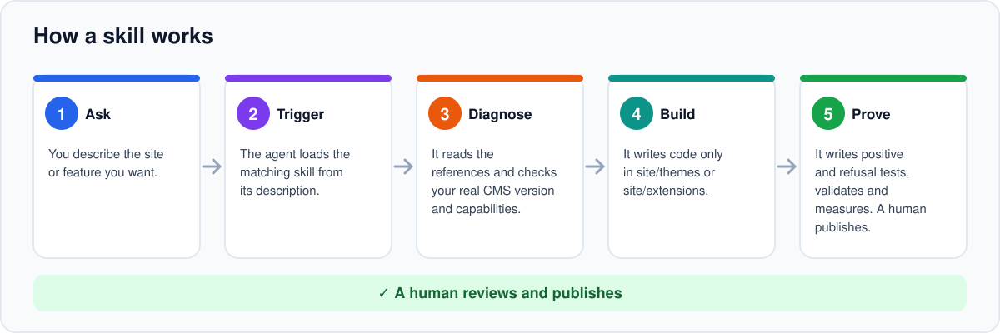
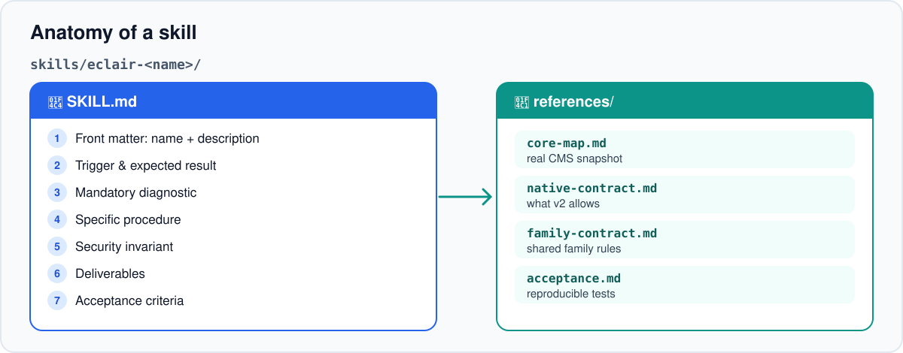
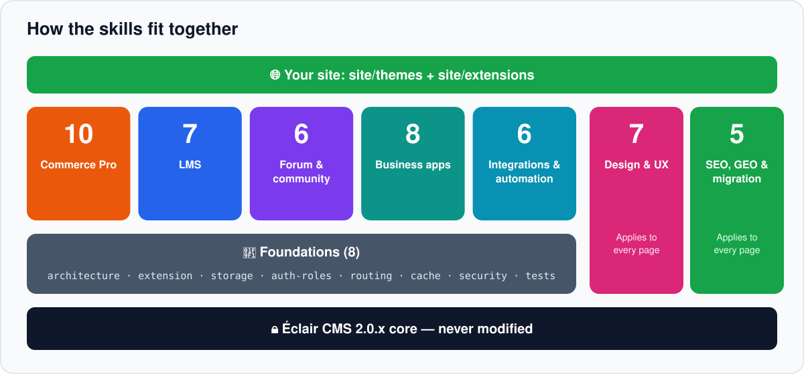
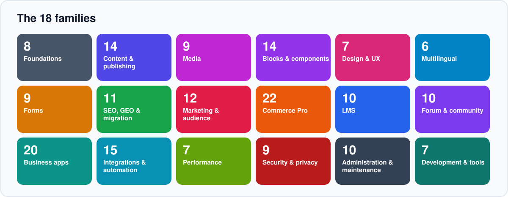
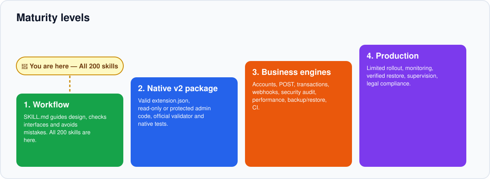

<!-- Generated by scripts/build_readmes.py — edit scripts/readme_data_*.py, not this file. -->
<a id="top"></a>

<p align="center"></p>

<p align="center"><b>English</b> · <a href="README.fr.md">Français</a> · <a href="README.es.md">Español</a> · <a href="README.de.md">Deutsch</a> · <a href="README.it.md">Italiano</a> · <a href="README.pt.md">Português</a></p>

<p align="center"><a href="https://github.com/Jacckisback/eclair-skills/actions/workflows/validate.yml"></a>    <a href="LICENSE"></a></p>

**Éclair Skills** is a library of **200 Agent Skills** for [Éclair CMS](https://github.com/Jacckisback/eclair-cms) 2.0.x. Add them to your project and your coding agent (Claude Code, Codex, ChatGPT or any agent that reads `SKILL.md` folders) stops improvising: it follows a proven method, respects the CMS contract, never touches the core and proves its work with tests.

> [!IMPORTANT]
> **Read this first** — **200 skills ≠ 200 PHP extensions.** A skill is a guide for your agent (instructions, references and tests to write). It is not a plugin you install on a live site. The only working example is the read-only `catalogue-demo`.

## Why Éclair Skills?

- **Method, not guesswork** — each skill imposes a diagnostic, a procedure, a security invariant and acceptance criteria before a single line of code is written.
- **The core stays intact** — your code lives only in `site/themes/` and `site/extensions/`, so CMS updates keep working.
- **Secure and fast by default** — CSRF, object permissions, escaping, no personal data in a shared cache, measured performance budgets.
- **Honest about limits** — every skill says what Éclair 2.0 supports today and what still needs a core capability.

## How it works

<p align="center"></p>

You describe your goal in plain language. The agent finds the right skill from its description, then follows five steps:

1. **Ask** — You describe the site or feature you want.
2. **Trigger** — The agent loads the matching skill from its description.
3. **Diagnose** — It reads the references and checks your real CMS version and capabilities.
4. **Build** — It writes code only in site/themes or site/extensions.
5. **Prove** — It writes positive and refusal tests, validates and measures. A human publishes.

## Anatomy of a skill

<p align="center"></p>

Every skill is a self-contained folder. Nothing depends on another skill’s files.

```text
skills/eclair-commerce-pro/
├── SKILL.md
└── references/
    ├── core-map.md
    ├── native-contract.md
    ├── family-contract.md
    └── acceptance.md
```

| Part | Role |
|---|---|
| `SKILL.md` — front matter | `name` and `description`: the agent uses the description to decide when to load the skill. |
| Trigger & expected result | What the skill is for and what it must deliver. |
| Mandatory diagnostic | Read the references, check the CMS version, the `eclair-extension/1` manifest and the available capabilities, map the data model. |
| Specific procedure | Business flow, allowed locations, current contract limits, security invariant, proofs, native validation. |
| Deliverables & acceptance | Mini-spec, permission/cache matrix, package only if the contract supports it, tests that pass and tests that must refuse. |
| `references/core-map.md` | Snapshot of the real Éclair CMS core the skill was checked against. |
| `references/native-contract.md` | What the native `eclair-extension/1` contract allows (and does not). |
| `references/family-contract.md` | Rules shared by the whole family (security points, cache, data). |
| `references/acceptance.md` | Reproducible test plan: nominal case, refusal case, invariant, cache, activation/deactivation. |

## How the skills fit together

<p align="center"></p>

Skills are designed to be combined. Think of them in layers:

1. **Éclair CMS 2.0.x core** — Never modified by a skill. Structural changes go through a dedicated core RFC and pull request.
2. **Foundations (8)** — Always first: architecture, extension, storage, roles, routing, cache, security, tests. Every other skill relies on them.
3. **Domain families** — Commerce, LMS, community, business apps and integrations: pick the families your project needs.
4. **Cross-cutting quality** — Design & UX and SEO & GEO apply to every page, whatever the domain.
5. **Your site** — The result lives in site/themes and site/extensions, validated and tested.

## The 18 families

<p align="center"></p>

| | Family | Scope | Skills |
|---|---|---|---:|
| 🧱 | **Foundations** | Native v2 contract, tests and security | 8 |
| 📝 | **Content & publishing** | Posts, pages, categories, menus, search, feeds | 14 |
| 🖼️ | **Media** | Library, images, galleries, video, audio, documents | 9 |
| 🧩 | **Blocks & components** | FAQ, tabs, tables, pricing, sections, navigation | 14 |
| 🎨 | **Design & UX** | Themes, blocks, accessibility, speed | 7 |
| 🌍 | **Multilingual** | Languages, switcher, formats, URLs, translation | 6 |
| 📮 | **Forms** | Contact, quotes, steps, uploads, polls, calculators | 9 |
| 🔎 | **SEO, GEO & migration** | Indexability, structured data, WordPress | 11 |
| 📣 | **Marketing & audience** | Newsletter, landing pages, analytics, sharing, ads | 12 |
| 🛒 | **Commerce Pro** | Transactional shop and payments, designed before deployment | 22 |
| 🎓 | **LMS** | Courses, enrollments, progress, certificates | 10 |
| 💬 | **Forum & community** | Discussions, moderation, profiles, notifications | 10 |
| 🗂️ | **Business apps** | Bookings, memberships, directories, business tools | 20 |
| 🔌 | **Integrations & automation** | APIs, webhooks, email, AI, monitoring | 15 |
| ⚡ | **Performance** | Cache, CDN, images, weight, Core Web Vitals | 7 |
| 🛡️ | **Security & privacy** | Login, 2FA, spam, headers, integrity, personal data | 9 |
| 🛠️ | **Administration & maintenance** | Accounts, backups, updates, migration, log | 10 |
| 💻 | **Development & tools** | Read API, Markdown, MCP, command line, porting | 7 |
| | | | **200** |

## Coming from WordPress?

The catalogue covers the features most WordPress sites rely on, from posts and menus to forms, SEO, backups and shops. Every skill names its WordPress equivalent and states honestly what Éclair 2.0 can deliver today:

| What Éclair 2.0 delivers today | Skills |
|---|---:|
| 🟣 Built into the core | 46 |
| 🟢 Native v2 | 72 |
| 🔵 Read-only prototype possible | 9 |
| 🟡 Partly blocked by core | 15 |
| 🟠 Design · needs core | 58 |

To replace a WordPress site, start with `eclair-wordpress-migration` (content and URLs) and `eclair-wp-plugin-porting` (one plugin at a time). Skills marked 🟠 are designs: they need capabilities the core does not offer yet.

## Quick start

Requirements: Git and Python 3 (standard library only). PHP 8.1+ to run the PHP examples and tests.

**1. Get the library and check it**

```bash
git clone https://github.com/Jacckisback/eclair-skills.git
cd eclair-skills
python3 scripts/validate_skills.py
```

**2. See what is available**

```bash
python3 scripts/install_skills.py --list
```

**3. Install skills into your project**

```bash
python3 scripts/install_skills.py --project /path/to/my-site --category commerce   # one family
python3 scripts/install_skills.py --project /path/to/my-site --skill eclair-wordpress-migration   # one skill
python3 scripts/install_skills.py --project /path/to/my-site --all   # everything
python3 scripts/install_skills.py --project /path/to/my-site --all --lang en   # in English
```

The installer copies skills into your project. It never overwrites an existing skill unless you pass `--force` after review.

**4. Then simply ask your agent**

> Plan an online shop for my Éclair site: catalogue, variants and checkout. Use the eclair-commerce-pro skill and tell me what Éclair 2.0 cannot do yet.

> Migrate my WordPress blog to Éclair 2 without losing URLs or traffic.

> Audit the accessibility and performance of my theme and fix the issues.

The agent picks the matching skill automatically from its description. You can also name it explicitly.

## Recipes: which skills for which project

Start with the foundations, then follow the order below. Each arrow is a step the agent completes and tests before the next.

**Online shop**

[`eclair-architecture`](translations/en/eclair-architecture/SKILL.md) → [`eclair-storage`](translations/en/eclair-storage/SKILL.md) → [`eclair-auth-roles`](translations/en/eclair-auth-roles/SKILL.md) → [`eclair-commerce-pro`](translations/en/eclair-commerce-pro/SKILL.md) → [`eclair-product-catalog`](translations/en/eclair-product-catalog/SKILL.md) → [`eclair-product-variants`](translations/en/eclair-product-variants/SKILL.md) → [`eclair-inventory`](translations/en/eclair-inventory/SKILL.md) → [`eclair-cart-checkout`](translations/en/eclair-cart-checkout/SKILL.md) → [`eclair-orders-payments`](translations/en/eclair-orders-payments/SKILL.md) → [`eclair-tax-invoicing`](translations/en/eclair-tax-invoicing/SKILL.md) → [`eclair-shipping`](translations/en/eclair-shipping/SKILL.md) → [`eclair-discounts`](translations/en/eclair-discounts/SKILL.md) → [`eclair-email-automation`](translations/en/eclair-email-automation/SKILL.md) → [`eclair-security-audit`](translations/en/eclair-security-audit/SKILL.md) → [`eclair-test-suite`](translations/en/eclair-test-suite/SKILL.md)

**Online school**

[`eclair-architecture`](translations/en/eclair-architecture/SKILL.md) → [`eclair-auth-roles`](translations/en/eclair-auth-roles/SKILL.md) → [`eclair-lms`](translations/en/eclair-lms/SKILL.md) → [`eclair-course-builder`](translations/en/eclair-course-builder/SKILL.md) → [`eclair-lessons-media`](translations/en/eclair-lessons-media/SKILL.md) → [`eclair-enrollment-access`](translations/en/eclair-enrollment-access/SKILL.md) → [`eclair-progress`](translations/en/eclair-progress/SKILL.md) → [`eclair-quizzes-certificates`](translations/en/eclair-quizzes-certificates/SKILL.md) → [`eclair-lms-analytics`](translations/en/eclair-lms-analytics/SKILL.md) → [`eclair-test-suite`](translations/en/eclair-test-suite/SKILL.md)

**Community / forum**

[`eclair-auth-roles`](translations/en/eclair-auth-roles/SKILL.md) → [`eclair-forum`](translations/en/eclair-forum/SKILL.md) → [`eclair-discussions-topics`](translations/en/eclair-discussions-topics/SKILL.md) → [`eclair-community-profiles`](translations/en/eclair-community-profiles/SKILL.md) → [`eclair-moderation`](translations/en/eclair-moderation/SKILL.md) → [`eclair-notifications`](translations/en/eclair-notifications/SKILL.md) → [`eclair-community-search`](translations/en/eclair-community-search/SKILL.md) → [`eclair-security-audit`](translations/en/eclair-security-audit/SKILL.md)

**Local business site**

[`eclair-design`](translations/en/eclair-design/SKILL.md) → [`eclair-theme-builder`](translations/en/eclair-theme-builder/SKILL.md) → [`eclair-bookings`](translations/en/eclair-bookings/SKILL.md) → [`eclair-appointments-calendar`](translations/en/eclair-appointments-calendar/SKILL.md) → [`eclair-forms-crm`](translations/en/eclair-forms-crm/SKILL.md) → [`eclair-crm-integration`](translations/en/eclair-crm-integration/SKILL.md) → [`eclair-seo-audit`](translations/en/eclair-seo-audit/SKILL.md) → [`eclair-structured-data`](translations/en/eclair-structured-data/SKILL.md)

**WordPress migration & SEO/GEO**

[`eclair-wordpress-migration`](translations/en/eclair-wordpress-migration/SKILL.md) → [`eclair-routing`](translations/en/eclair-routing/SKILL.md) → [`eclair-seo-audit`](translations/en/eclair-seo-audit/SKILL.md) → [`eclair-structured-data`](translations/en/eclair-structured-data/SKILL.md) → [`eclair-multilingual-seo`](translations/en/eclair-multilingual-seo/SKILL.md) → [`eclair-geo-optimization`](translations/en/eclair-geo-optimization/SKILL.md) → [`eclair-performance-ux`](translations/en/eclair-performance-ux/SKILL.md) → [`eclair-accessibility`](translations/en/eclair-accessibility/SKILL.md)

## Full catalogue of the 200 skills

Click a skill to open its `SKILL.md`. The status column shows what can be delivered on Éclair 2.0 today.

**Status legend** — 🟣 **Built into the core**: already part of Éclair 2.0; the skill configures and checks it, no extension needed. 🟢 **Native v2**: can be built today with the native contract. 🔵 **Read-only prototype possible**: a public GET version can be built now; writes need more. 🟠 **Design · needs core**: full design and tests now, production requires core capabilities not yet in Éclair 2.0 (public POST, transactions, member accounts…). 🟡 **Partly blocked by core**: some parts depend on a core contract change.

<details open>
<summary><b>🧱 Foundations (8)</b> — Native v2 contract, tests and security</summary>

| Skill | What it helps the agent do | Status |
|---|---|---|
| [`eclair-architecture`](translations/en/eclair-architecture/SKILL.md) | Decide where a feature belongs (setting, theme, extension or core RFC) and keep the v2 core untouched. | 🟢 Native v2 |
| [`eclair-extension-builder`](translations/en/eclair-extension-builder/SKILL.md) | Build a really installable v2 extension: `extension.json`, `extension.php`, `eclair-extension/1` contract. | 🟢 Native v2 |
| [`eclair-storage`](translations/en/eclair-storage/SKILL.md) | Choose the right persistence, migrations, backups and SQL needs for each module. | 🟢 Native v2 |
| [`eclair-auth-roles`](translations/en/eclair-auth-roles/SKILL.md) | Separate admin rights from members, students, customers and moderators. | 🟢 Native v2 |
| [`eclair-routing`](translations/en/eclair-routing/SKILL.md) | Create public/admin routes while protecting existing URLs, redirects and SEO. | 🟢 Native v2 |
| [`eclair-cache-contract`](translations/en/eclair-cache-contract/SKILL.md) | Keep the fast cache path safe: invalidation, privacy and performance budgets. | 🟢 Native v2 |
| [`eclair-security-audit`](translations/en/eclair-security-audit/SKILL.md) | Review an extension before activation: supply chain, admin actions, member data. | 🟢 Native v2 |
| [`eclair-test-suite`](translations/en/eclair-test-suite/SKILL.md) | Write CI, regression, security and performance tests: proof before publishing. | 🟢 Native v2 |

</details>

<details>
<summary><b>📝 Content & publishing (14)</b> — Posts, pages, categories, menus, search, feeds</summary>

| Skill | What it helps the agent do | Status |
|---|---|---|
| [`eclair-blog-posts`](translations/en/eclair-blog-posts/SKILL.md) | Publish and organise blog posts with the native block editor. | 🟣 Built into the core |
| [`eclair-static-pages`](translations/en/eclair-static-pages/SKILL.md) | Create the fixed pages of a site (home, about, services, contact) and their tree. | 🟣 Built into the core |
| [`eclair-categories`](translations/en/eclair-categories/SKILL.md) | Structure content into pillar categories that help visitors and SEO. | 🟣 Built into the core |
| [`eclair-tags-taxonomies`](translations/en/eclair-tags-taxonomies/SKILL.md) | Carry over tags or custom taxonomies when the core only offers categories. | 🟡 Partly blocked by core |
| [`eclair-custom-content-types`](translations/en/eclair-custom-content-types/SKILL.md) | Model business content (projects, listings, events) without core custom post types. | 🟡 Partly blocked by core |
| [`eclair-custom-fields`](translations/en/eclair-custom-fields/SKILL.md) | Add structured fields to blocks or extension settings. | 🟢 Native v2 |
| [`eclair-comments`](translations/en/eclair-comments/SKILL.md) | Design post comments with moderation and anti-spam. | 🟠 Design · needs core |
| [`eclair-editorial-workflow`](translations/en/eclair-editorial-workflow/SKILL.md) | Organise drafts, review and a publishing calendar for a team. | 🟣 Built into the core |
| [`eclair-authors`](translations/en/eclair-authors/SKILL.md) | Present authors with a verifiable biography and expertise. | 🟣 Built into the core |
| [`eclair-navigation-menus`](translations/en/eclair-navigation-menus/SKILL.md) | Build clear header and footer navigation menus. | 🟣 Built into the core |
| [`eclair-site-search`](translations/en/eclair-site-search/SKILL.md) | Offer fast internal search without a database. | 🟢 Native v2 |
| [`eclair-rss-feeds`](translations/en/eclair-rss-feeds/SKILL.md) | Check and promote the site's native RSS feed. | 🟣 Built into the core |
| [`eclair-related-posts`](translations/en/eclair-related-posts/SKILL.md) | Suggest relevant related posts at the end of a page. | 🟢 Native v2 |
| [`eclair-table-of-contents`](translations/en/eclair-table-of-contents/SKILL.md) | Add a clickable table of contents to long content. | 🟢 Native v2 |

</details>

<details>
<summary><b>🖼️ Media (9)</b> — Library, images, galleries, video, audio, documents</summary>

| Skill | What it helps the agent do | Status |
|---|---|---|
| [`eclair-media-library`](translations/en/eclair-media-library/SKILL.md) | Organise images and files in the native media library. | 🟣 Built into the core |
| [`eclair-image-optimization`](translations/en/eclair-image-optimization/SKILL.md) | Make the most of native responsive WebP and lazy loading. | 🟣 Built into the core |
| [`eclair-image-galleries`](translations/en/eclair-image-galleries/SKILL.md) | Create light, accessible photo galleries. | 🟢 Native v2 |
| [`eclair-video-embeds`](translations/en/eclair-video-embeds/SKILL.md) | Embed videos without slowing the page or setting cookies. | 🟣 Built into the core |
| [`eclair-audio-podcast`](translations/en/eclair-audio-podcast/SKILL.md) | Publish audio episodes with a player and a podcast feed. | 🟢 Native v2 |
| [`eclair-file-downloads`](translations/en/eclair-file-downloads/SKILL.md) | Offer files for download (PDFs, templates, sheets). | 🟢 Native v2 |
| [`eclair-sliders-carousels`](translations/en/eclair-sliders-carousels/SKILL.md) | Create a restrained slideshow that harms neither speed nor accessibility. | 🟢 Native v2 |
| [`eclair-lightbox`](translations/en/eclair-lightbox/SKILL.md) | Enlarge images on click with a light viewer. | 🟢 Native v2 |
| [`eclair-pdf-documents`](translations/en/eclair-pdf-documents/SKILL.md) | Publish PDFs that are readable, accessible and indexed. | 🟢 Native v2 |

</details>

<details>
<summary><b>🧩 Blocks & components (14)</b> — FAQ, tabs, tables, pricing, sections, navigation</summary>

| Skill | What it helps the agent do | Status |
|---|---|---|
| [`eclair-accordions-faq`](translations/en/eclair-accordions-faq/SKILL.md) | Present questions and answers with the native FAQ block. | 🟣 Built into the core |
| [`eclair-tabs`](translations/en/eclair-tabs/SKILL.md) | Organise content into accessible tabs. | 🟢 Native v2 |
| [`eclair-data-tables`](translations/en/eclair-data-tables/SKILL.md) | Present tables that stay readable on mobile. | 🟣 Built into the core |
| [`eclair-pricing-tables`](translations/en/eclair-pricing-tables/SKILL.md) | Present plans and prices clearly and honestly. | 🟢 Native v2 |
| [`eclair-timelines`](translations/en/eclair-timelines/SKILL.md) | Tell a story or a process in dated steps. | 🟢 Native v2 |
| [`eclair-countdowns`](translations/en/eclair-countdowns/SKILL.md) | Show a countdown to a real date. | 🟢 Native v2 |
| [`eclair-team-members`](translations/en/eclair-team-members/SKILL.md) | Present the team with the native block. | 🟣 Built into the core |
| [`eclair-logo-walls`](translations/en/eclair-logo-walls/SKILL.md) | Show logos of authorised clients or partners. | 🟢 Native v2 |
| [`eclair-cta-sections`](translations/en/eclair-cta-sections/SKILL.md) | Place clear calls to action with native blocks. | 🟣 Built into the core |
| [`eclair-hero-sections`](translations/en/eclair-hero-sections/SKILL.md) | Compose a strong opening section with the native block. | 🟣 Built into the core |
| [`eclair-headers-footers`](translations/en/eclair-headers-footers/SKILL.md) | Customise header and footer through a site theme. | 🟢 Native v2 |
| [`eclair-breadcrumbs`](translations/en/eclair-breadcrumbs/SKILL.md) | Check the native breadcrumb trail and its markup. | 🟣 Built into the core |
| [`eclair-pagination`](translations/en/eclair-pagination/SKILL.md) | Paginate lists of posts and listings cleanly. | 🟢 Native v2 |
| [`eclair-dark-mode`](translations/en/eclair-dark-mode/SKILL.md) | Offer a dark mode faithful to the brand. | 🟢 Native v2 |

</details>

<details>
<summary><b>🎨 Design & UX (7)</b> — Themes, blocks, accessibility, speed</summary>

| Skill | What it helps the agent do | Status |
|---|---|---|
| [`eclair-design`](translations/en/eclair-design/SKILL.md) | Art direction: build coherent sites with Éclair Design and the native theme. | 🟢 Native v2 |
| [`eclair-theme-builder`](translations/en/eclair-theme-builder/SKILL.md) | Produce an Éclair v2 theme that survives updates. | 🟢 Native v2 |
| [`eclair-blocks-library`](translations/en/eclair-blocks-library/SKILL.md) | Compose editable content blocks and extensions. | 🟢 Native v2 |
| [`eclair-accessibility`](translations/en/eclair-accessibility/SKILL.md) | Audit and fix an accessible interface (WCAG). | 🟢 Native v2 |
| [`eclair-design-system`](translations/en/eclair-design-system/SKILL.md) | Build a coherent, maintainable visual language (tokens, components). | 🟢 Native v2 |
| [`eclair-responsive-ux`](translations/en/eclair-responsive-ux/SKILL.md) | Optimise navigation, forms and layouts on mobile. | 🟢 Native v2 |
| [`eclair-performance-ux`](translations/en/eclair-performance-ux/SKILL.md) | Measure and reduce page weight and layout instability. | 🟢 Native v2 |

</details>

<details>
<summary><b>🌍 Multilingual (6)</b> — Languages, switcher, formats, URLs, translation</summary>

| Skill | What it helps the agent do | Status |
|---|---|---|
| [`eclair-multilingual-content`](translations/en/eclair-multilingual-content/SKILL.md) | Publish a site in several languages with linked versions. | 🟡 Partly blocked by core |
| [`eclair-language-switcher`](translations/en/eclair-language-switcher/SKILL.md) | Add a clear, accessible language switcher. | 🟢 Native v2 |
| [`eclair-rtl-support`](translations/en/eclair-rtl-support/SKILL.md) | Adapt the theme to Arabic or Hebrew. | 🟢 Native v2 |
| [`eclair-locale-formats`](translations/en/eclair-locale-formats/SKILL.md) | Show dates, numbers, prices and addresses in each country's format. | 🟢 Native v2 |
| [`eclair-translated-urls`](translations/en/eclair-translated-urls/SKILL.md) | Translate URLs without losing search rankings. | 🟡 Partly blocked by core |
| [`eclair-translation-workflow`](translations/en/eclair-translation-workflow/SKILL.md) | Organise translation, review and updates of language versions. | 🟢 Native v2 |

</details>

<details>
<summary><b>📮 Forms (9)</b> — Contact, quotes, steps, uploads, polls, calculators</summary>

| Skill | What it helps the agent do | Status |
|---|---|---|
| [`eclair-contact-forms`](translations/en/eclair-contact-forms/SKILL.md) | Set up the native contact form and its inbox. | 🟣 Built into the core |
| [`eclair-form-inbox`](translations/en/eclair-form-inbox/SKILL.md) | Handle received messages without losing any. | 🟣 Built into the core |
| [`eclair-multi-step-forms`](translations/en/eclair-multi-step-forms/SKILL.md) | Design a long form split into steps. | 🟠 Design · needs core |
| [`eclair-file-upload-forms`](translations/en/eclair-file-upload-forms/SKILL.md) | Design secure file uploads by visitors. | 🟠 Design · needs core |
| [`eclair-payment-forms`](translations/en/eclair-payment-forms/SKILL.md) | Collect a deposit, donation or simple service fee through a payment link. | 🔵 Read-only prototype possible |
| [`eclair-surveys-polls`](translations/en/eclair-surveys-polls/SKILL.md) | Design polls and satisfaction surveys. | 🟠 Design · needs core |
| [`eclair-quote-requests`](translations/en/eclair-quote-requests/SKILL.md) | Collect qualified quote requests. | 🔵 Read-only prototype possible |
| [`eclair-conditional-forms`](translations/en/eclair-conditional-forms/SKILL.md) | Design forms whose fields depend on answers. | 🟠 Design · needs core |
| [`eclair-calculators`](translations/en/eclair-calculators/SKILL.md) | Offer a price or measurement calculator without collecting data. | 🟢 Native v2 |

</details>

<details>
<summary><b>🔎 SEO, GEO & migration (11)</b> — Indexability, structured data, WordPress</summary>

| Skill | What it helps the agent do | Status |
|---|---|---|
| [`eclair-seo-audit`](translations/en/eclair-seo-audit/SKILL.md) | Check indexability, canonicals, robots, links and performance. | 🟢 Native v2 |
| [`eclair-geo-optimization`](translations/en/eclair-geo-optimization/SKILL.md) | Make pages easy to read for search engines and AI assistants (GEO). | 🟢 Native v2 |
| [`eclair-wordpress-migration`](translations/en/eclair-wordpress-migration/SKILL.md) | Migrate from WordPress while preserving URLs, content and traffic. | 🟢 Native v2 |
| [`eclair-structured-data`](translations/en/eclair-structured-data/SKILL.md) | Add or check schema.org data consistent with the visible content. | 🟡 Partly blocked by core |
| [`eclair-multilingual-seo`](translations/en/eclair-multilingual-seo/SKILL.md) | Run several languages without duplicates or wrong canonicals (hreflang). | 🟢 Native v2 |
| [`eclair-meta-tags`](translations/en/eclair-meta-tags/SKILL.md) | Write titles and descriptions with the native SEO analysis. | 🟣 Built into the core |
| [`eclair-xml-sitemaps`](translations/en/eclair-xml-sitemaps/SKILL.md) | Check the native sitemap and submit it to search engines. | 🟣 Built into the core |
| [`eclair-redirects-manager`](translations/en/eclair-redirects-manager/SKILL.md) | Manage 301 redirects with the native manager. | 🟣 Built into the core |
| [`eclair-local-seo`](translations/en/eclair-local-seo/SKILL.md) | Make a local business visible with native data. | 🟣 Built into the core |
| [`eclair-social-previews`](translations/en/eclair-social-previews/SKILL.md) | Polish how pages look when shared on social networks and messaging apps. | 🟣 Built into the core |
| [`eclair-internal-linking`](translations/en/eclair-internal-linking/SKILL.md) | Link pages together for visitors and search engines. | 🟢 Native v2 |

</details>

<details>
<summary><b>📣 Marketing & audience (12)</b> — Newsletter, landing pages, analytics, sharing, ads</summary>

| Skill | What it helps the agent do | Status |
|---|---|---|
| [`eclair-newsletter-signup`](translations/en/eclair-newsletter-signup/SKILL.md) | Collect newsletter sign-ups by the rules. | 🟡 Partly blocked by core |
| [`eclair-email-campaigns`](translations/en/eclair-email-campaigns/SKILL.md) | Design email campaigns built from site content. | 🟠 Design · needs core |
| [`eclair-popups-optins`](translations/en/eclair-popups-optins/SKILL.md) | Show a discreet, respectful promotional prompt. | 🟢 Native v2 |
| [`eclair-landing-pages`](translations/en/eclair-landing-pages/SKILL.md) | Compose a focused landing page with native blocks. | 🟣 Built into the core |
| [`eclair-ab-testing`](translations/en/eclair-ab-testing/SKILL.md) | Design A/B tests compatible with a cached site. | 🟠 Design · needs core |
| [`eclair-privacy-analytics`](translations/en/eclair-privacy-analytics/SKILL.md) | Measure traffic without cookies or profiling. | 🟡 Partly blocked by core |
| [`eclair-social-sharing`](translations/en/eclair-social-sharing/SKILL.md) | Add share links without third-party scripts. | 🟢 Native v2 |
| [`eclair-social-feeds`](translations/en/eclair-social-feeds/SKILL.md) | Show your latest social posts without weighing the site down. | 🟡 Partly blocked by core |
| [`eclair-testimonials`](translations/en/eclair-testimonials/SKILL.md) | Present authentic customer testimonials. | 🟢 Native v2 |
| [`eclair-affiliate-links`](translations/en/eclair-affiliate-links/SKILL.md) | Manage affiliate links with the native legal notices. | 🟣 Built into the core |
| [`eclair-ads-adsense`](translations/en/eclair-ads-adsense/SKILL.md) | Show compliant advertising on articles. | 🟣 Built into the core |
| [`eclair-announcement-bars`](translations/en/eclair-announcement-bars/SKILL.md) | Show a temporary announcement bar. | 🟢 Native v2 |

</details>

<details>
<summary><b>🛒 Commerce Pro (22)</b> — Transactional shop and payments, designed before deployment</summary>

| Skill | What it helps the agent do | Status |
|---|---|---|
| [`eclair-commerce-pro`](translations/en/eclair-commerce-pro/SKILL.md) | Design a complete shop, from catalogue to delivered order (entry point of the family). | 🟠 Design · needs core |
| [`eclair-product-catalog`](translations/en/eclair-product-catalog/SKILL.md) | Build a fast, indexable public product catalogue. | 🟣 Built into the core |
| [`eclair-product-variants`](translations/en/eclair-product-variants/SKILL.md) | Model sizes, colours and configurations without price errors. | 🟣 Built into the core |
| [`eclair-cart-checkout`](translations/en/eclair-cart-checkout/SKILL.md) | Design a multi-line cart and checkout with consistent prices and stock. | 🟠 Design · needs core |
| [`eclair-orders-payments`](translations/en/eclair-orders-payments/SKILL.md) | Implement order states and payment providers (PSP) with signed webhooks. | 🟠 Design · needs core |
| [`eclair-tax-invoicing`](translations/en/eclair-tax-invoicing/SKILL.md) | Prepare VAT and invoicing hooks adapted to each jurisdiction (no universal rate). | 🟠 Design · needs core |
| [`eclair-inventory`](translations/en/eclair-inventory/SKILL.md) | Keep real stock in sync between products, variants and orders. | 🟠 Design · needs core |
| [`eclair-shipping`](translations/en/eclair-shipping/SKILL.md) | Handle shipping zones, rates, tracking and delivery states. | 🟠 Design · needs core |
| [`eclair-discounts`](translations/en/eclair-discounts/SKILL.md) | Create discounts and coupons that are consistent and never stacked by mistake. | 🟠 Design · needs core |
| [`eclair-commerce-analytics`](translations/en/eclair-commerce-analytics/SKILL.md) | Track sales and conversions without exposing customer data. | 🟠 Design · needs core |
| [`eclair-shop-setup`](translations/en/eclair-shop-setup/SKILL.md) | Open the native light shop with its legal pages. | 🟣 Built into the core |
| [`eclair-payment-links`](translations/en/eclair-payment-links/SKILL.md) | Connect each product to a payment-provider link. | 🟣 Built into the core |
| [`eclair-merchant-feed`](translations/en/eclair-merchant-feed/SKILL.md) | Publish products to shopping channels with the native feed. | 🟣 Built into the core |
| [`eclair-subscriptions-billing`](translations/en/eclair-subscriptions-billing/SKILL.md) | Design recurring subscriptions handled by the payment provider. | 🟠 Design · needs core |
| [`eclair-digital-downloads`](translations/en/eclair-digital-downloads/SKILL.md) | Design the sale of files with secure delivery. | 🟠 Design · needs core |
| [`eclair-wishlists`](translations/en/eclair-wishlists/SKILL.md) | Design favourites lists for visitors. | 🟠 Design · needs core |
| [`eclair-product-reviews`](translations/en/eclair-product-reviews/SKILL.md) | Design verified, moderated customer reviews. | 🟠 Design · needs core |
| [`eclair-product-filters`](translations/en/eclair-product-filters/SKILL.md) | Help visitors find a product with filters and sorting. | 🔵 Read-only prototype possible |
| [`eclair-abandoned-cart`](translations/en/eclair-abandoned-cart/SKILL.md) | Design follow-ups for unfinished purchases. | 🟠 Design · needs core |
| [`eclair-gift-cards`](translations/en/eclair-gift-cards/SKILL.md) | Design the sale and redemption of gift cards. | 🟠 Design · needs core |
| [`eclair-customer-accounts`](translations/en/eclair-customer-accounts/SKILL.md) | Design the customer area: orders, addresses, invoices. | 🟠 Design · needs core |
| [`eclair-returns-refunds`](translations/en/eclair-returns-refunds/SKILL.md) | Organise returns and refunds clearly. | 🟠 Design · needs core |

</details>

<details>
<summary><b>🎓 LMS (10)</b> — Courses, enrollments, progress, certificates</summary>

| Skill | What it helps the agent do | Status |
|---|---|---|
| [`eclair-lms`](translations/en/eclair-lms/SKILL.md) | Structure a modular online school (entry point of the family). | 🟠 Design · needs core |
| [`eclair-course-builder`](translations/en/eclair-course-builder/SKILL.md) | Compose versioned courses, sections and lessons. | 🟠 Design · needs core |
| [`eclair-lessons-media`](translations/en/eclair-lessons-media/SKILL.md) | Deliver protected videos and documents for courses. | 🟠 Design · needs core |
| [`eclair-enrollment-access`](translations/en/eclair-enrollment-access/SKILL.md) | Link a purchase or approval to an enrollment and its permissions. | 🟠 Design · needs core |
| [`eclair-progress`](translations/en/eclair-progress/SKILL.md) | Track learner progress without losses or inconsistent updates. | 🟠 Design · needs core |
| [`eclair-quizzes-certificates`](translations/en/eclair-quizzes-certificates/SKILL.md) | Create quizzes, pass marks and controlled certificates. | 🟠 Design · needs core |
| [`eclair-lms-analytics`](translations/en/eclair-lms-analytics/SKILL.md) | Analyse completion and engagement without abusive monitoring. | 🟠 Design · needs core |
| [`eclair-assignments`](translations/en/eclair-assignments/SKILL.md) | Design assignment submission and grading. | 🟠 Design · needs core |
| [`eclair-live-classes`](translations/en/eclair-live-classes/SKILL.md) | Announce and organise live video classes. | 🔵 Read-only prototype possible |
| [`eclair-drip-content`](translations/en/eclair-drip-content/SKILL.md) | Design the gradual release of lessons. | 🟠 Design · needs core |

</details>

<details>
<summary><b>💬 Forum & community (10)</b> — Discussions, moderation, profiles, notifications</summary>

| Skill | What it helps the agent do | Status |
|---|---|---|
| [`eclair-forum`](translations/en/eclair-forum/SKILL.md) | Design public and private discussions with moderation (entry point of the family). | 🟠 Design · needs core |
| [`eclair-discussions-topics`](translations/en/eclair-discussions-topics/SKILL.md) | Manage creation, editing and state of topics and replies. | 🟠 Design · needs core |
| [`eclair-community-profiles`](translations/en/eclair-community-profiles/SKILL.md) | Offer chosen public profiles kept separate from private data. | 🟠 Design · needs core |
| [`eclair-moderation`](translations/en/eclair-moderation/SKILL.md) | Build removal, reporting and appeal tools. | 🟠 Design · needs core |
| [`eclair-notifications`](translations/en/eclair-notifications/SKILL.md) | Notify members without spam or data leaks. | 🟠 Design · needs core |
| [`eclair-community-search`](translations/en/eclair-community-search/SKILL.md) | Search topics and messages while respecting permissions. | 🟠 Design · needs core |
| [`eclair-private-messaging`](translations/en/eclair-private-messaging/SKILL.md) | Design private messages between members. | 🟠 Design · needs core |
| [`eclair-groups`](translations/en/eclair-groups/SKILL.md) | Design public or private member groups. | 🟠 Design · needs core |
| [`eclair-activity-feed`](translations/en/eclair-activity-feed/SKILL.md) | Design a community activity feed. | 🟠 Design · needs core |
| [`eclair-gamification`](translations/en/eclair-gamification/SKILL.md) | Design motivating points, badges and leaderboards. | 🟠 Design · needs core |

</details>

<details>
<summary><b>🗂️ Business apps (20)</b> — Bookings, memberships, directories, business tools</summary>

| Skill | What it helps the agent do | Status |
|---|---|---|
| [`eclair-bookings`](translations/en/eclair-bookings/SKILL.md) | Manage a bookable resource with no double bookings. | 🟠 Design · needs core |
| [`eclair-appointments-calendar`](translations/en/eclair-appointments-calendar/SKILL.md) | Take appointments and connect external calendars. | 🟠 Design · needs core |
| [`eclair-memberships`](translations/en/eclair-memberships/SKILL.md) | Manage membership levels, renewals and access rights. | 🟠 Design · needs core |
| [`eclair-directory`](translations/en/eclair-directory/SKILL.md) | Create indexable listings and filters for a professional directory. | 🔵 Read-only prototype possible |
| [`eclair-events-ticketing`](translations/en/eclair-events-ticketing/SKILL.md) | Sell seats, tickets and admissions for events. | 🟠 Design · needs core |
| [`eclair-job-board`](translations/en/eclair-job-board/SKILL.md) | Publish job offers and applications that respect personal data. | 🟠 Design · needs core |
| [`eclair-real-estate`](translations/en/eclair-real-estate/SKILL.md) | Build a property catalogue with search and contact. | 🟠 Design · needs core |
| [`eclair-forms-crm`](translations/en/eclair-forms-crm/SKILL.md) | Collect requests through forms and track their handling (mini-CRM). | 🟠 Design · needs core |
| [`eclair-restaurant-menu`](translations/en/eclair-restaurant-menu/SKILL.md) | Publish a restaurant's menu. | 🟢 Native v2 |
| [`eclair-recipes`](translations/en/eclair-recipes/SKILL.md) | Publish clear, well-structured recipes. | 🟢 Native v2 |
| [`eclair-hotel-rooms`](translations/en/eclair-hotel-rooms/SKILL.md) | Present rooms or rentals and lead to booking. | 🔵 Read-only prototype possible |
| [`eclair-professional-services`](translations/en/eclair-professional-services/SKILL.md) | Build the site of a practice or regulated professional. | 🟢 Native v2 |
| [`eclair-nonprofit-donations`](translations/en/eclair-nonprofit-donations/SKILL.md) | Present a non-profit and receive donations through payment links. | 🔵 Read-only prototype possible |
| [`eclair-classifieds`](translations/en/eclair-classifieds/SKILL.md) | Design a classified-ads site with visitor submissions. | 🟠 Design · needs core |
| [`eclair-knowledge-base`](translations/en/eclair-knowledge-base/SKILL.md) | Create documentation or a help centre. | 🟢 Native v2 |
| [`eclair-helpdesk-tickets`](translations/en/eclair-helpdesk-tickets/SKILL.md) | Design support-request tracking. | 🟠 Design · needs core |
| [`eclair-magazine-news`](translations/en/eclair-magazine-news/SKILL.md) | Set up a news site or online magazine. | 🟢 Native v2 |
| [`eclair-portfolio`](translations/en/eclair-portfolio/SKILL.md) | Present work with case studies. | 🟢 Native v2 |
| [`eclair-coupons-deals`](translations/en/eclair-coupons-deals/SKILL.md) | Publish up-to-date deals and promo codes. | 🟢 Native v2 |
| [`eclair-glossary`](translations/en/eclair-glossary/SKILL.md) | Create a glossary of trade terms. | 🟢 Native v2 |

</details>

<details>
<summary><b>🔌 Integrations & automation (15)</b> — APIs, webhooks, email, AI, monitoring</summary>

| Skill | What it helps the agent do | Status |
|---|---|---|
| [`eclair-webhooks`](translations/en/eclair-webhooks/SKILL.md) | Connect external apps through safe, signed, idempotent events. | 🟠 Design · needs core |
| [`eclair-email-automation`](translations/en/eclair-email-automation/SKILL.md) | Send reliable confirmations and reminders (transactional email). | 🟠 Design · needs core |
| [`eclair-api-integration`](translations/en/eclair-api-integration/SKILL.md) | Build robust, rate-limited external API connectors. | 🟠 Design · needs core |
| [`eclair-crm-integration`](translations/en/eclair-crm-integration/SKILL.md) | Sync leads and customers with a CRM, without duplicates. | 🟠 Design · needs core |
| [`eclair-ai-workflows`](translations/en/eclair-ai-workflows/SKILL.md) | Automate editorial help with AI, never publishing without a human. | 🟠 Design · needs core |
| [`eclair-observability`](translations/en/eclair-observability/SKILL.md) | Monitor health, costs and incidents of modules, with alerts. | 🟠 Design · needs core |
| [`eclair-google-analytics`](translations/en/eclair-google-analytics/SKILL.md) | Connect Google Analytics while respecting consent and the security policy. | 🟡 Partly blocked by core |
| [`eclair-search-console`](translations/en/eclair-search-console/SKILL.md) | Verify the site in search-engine tools and follow its indexing. | 🟢 Native v2 |
| [`eclair-tag-manager`](translations/en/eclair-tag-manager/SKILL.md) | Assess the use of a tag manager on a strict site. | 🟡 Partly blocked by core |
| [`eclair-email-marketing-providers`](translations/en/eclair-email-marketing-providers/SKILL.md) | Connect the site to an email-marketing service (Brevo, Mailchimp or other). | 🟡 Partly blocked by core |
| [`eclair-automation-platforms`](translations/en/eclair-automation-platforms/SKILL.md) | Connect the site to Make, Zapier or n8n. | 🔵 Read-only prototype possible |
| [`eclair-maps-embeds`](translations/en/eclair-maps-embeds/SKILL.md) | Show a location map without tracking visitors. | 🟡 Partly blocked by core |
| [`eclair-social-login`](translations/en/eclair-social-login/SKILL.md) | Design member sign-in with Google, Apple or others. | 🟠 Design · needs core |
| [`eclair-live-chat`](translations/en/eclair-live-chat/SKILL.md) | Offer instant contact without a heavy widget. | 🟡 Partly blocked by core |
| [`eclair-calendar-feeds`](translations/en/eclair-calendar-feeds/SKILL.md) | Publish a calendar people can subscribe to. | 🟢 Native v2 |

</details>

<details>
<summary><b>⚡ Performance (7)</b> — Cache, CDN, images, weight, Core Web Vitals</summary>

| Skill | What it helps the agent do | Status |
|---|---|---|
| [`eclair-page-cache`](translations/en/eclair-page-cache/SKILL.md) | Check that the native static cache serves every public page. | 🟣 Built into the core |
| [`eclair-cdn`](translations/en/eclair-cdn/SKILL.md) | Put the site behind a CDN without breaking cache or security. | 🟢 Native v2 |
| [`eclair-lazy-loading`](translations/en/eclair-lazy-loading/SKILL.md) | Check native lazy loading of images and videos. | 🟣 Built into the core |
| [`eclair-asset-budget`](translations/en/eclair-asset-budget/SKILL.md) | Keep a weight budget for CSS, JavaScript and images. | 🟢 Native v2 |
| [`eclair-core-web-vitals`](translations/en/eclair-core-web-vitals/SKILL.md) | Measure and improve Core Web Vitals on real pages. | 🟢 Native v2 |
| [`eclair-fonts-loading`](translations/en/eclair-fonts-loading/SKILL.md) | Choose and load fonts without slowdown or third parties. | 🟣 Built into the core |
| [`eclair-third-party-scripts`](translations/en/eclair-third-party-scripts/SKILL.md) | Decide which third-party scripts to add and at what cost. | 🟡 Partly blocked by core |

</details>

<details>
<summary><b>🛡️ Security & privacy (9)</b> — Login, 2FA, spam, headers, integrity, personal data</summary>

| Skill | What it helps the agent do | Status |
|---|---|---|
| [`eclair-login-protection`](translations/en/eclair-login-protection/SKILL.md) | Check the native protections of the login page. | 🟣 Built into the core |
| [`eclair-two-factor-auth`](translations/en/eclair-two-factor-auth/SKILL.md) | Enable native two-factor authentication for the whole team. | 🟣 Built into the core |
| [`eclair-anti-spam`](translations/en/eclair-anti-spam/SKILL.md) | Limit form spam without tracking visitors. | 🟣 Built into the core |
| [`eclair-captcha`](translations/en/eclair-captcha/SKILL.md) | Choose bot protection compatible with the security policy. | 🟡 Partly blocked by core |
| [`eclair-security-headers`](translations/en/eclair-security-headers/SKILL.md) | Check native security headers and content policy. | 🟣 Built into the core |
| [`eclair-file-integrity`](translations/en/eclair-file-integrity/SKILL.md) | Detect any code change with the native integrity check. | 🟣 Built into the core |
| [`eclair-cookie-consent`](translations/en/eclair-cookie-consent/SKILL.md) | Stay banner-free when possible, and compliant when a tracker is added. | 🟢 Native v2 |
| [`eclair-privacy-requests`](translations/en/eclair-privacy-requests/SKILL.md) | Handle personal data access and erasure requests. | 🟢 Native v2 |
| [`eclair-incident-recovery`](translations/en/eclair-incident-recovery/SKILL.md) | Respond methodically to a hack or a leak. | 🟢 Native v2 |

</details>

<details>
<summary><b>🛠️ Administration & maintenance (10)</b> — Accounts, backups, updates, migration, log</summary>

| Skill | What it helps the agent do | Status |
|---|---|---|
| [`eclair-team-accounts`](translations/en/eclair-team-accounts/SKILL.md) | Create team accounts with only the rights they need. | 🟣 Built into the core |
| [`eclair-backups-restore`](translations/en/eclair-backups-restore/SKILL.md) | Schedule native backups and prove you can restore. | 🟣 Built into the core |
| [`eclair-updates-rollback`](translations/en/eclair-updates-rollback/SKILL.md) | Apply signed core updates safely. | 🟣 Built into the core |
| [`eclair-maintenance-mode`](translations/en/eclair-maintenance-mode/SKILL.md) | Show a clean maintenance page during work. | 🟢 Native v2 |
| [`eclair-staging-deploy`](translations/en/eclair-staging-deploy/SKILL.md) | Test changes on a copy before going live. | 🟢 Native v2 |
| [`eclair-site-migration`](translations/en/eclair-site-migration/SKILL.md) | Move an Éclair site without losing content or rankings. | 🟣 Built into the core |
| [`eclair-error-pages`](translations/en/eclair-error-pages/SKILL.md) | Polish 404 and error pages to keep visitors. | 🟢 Native v2 |
| [`eclair-site-settings`](translations/en/eclair-site-settings/SKILL.md) | Set the site's identity, contact details, language and appearance. | 🟣 Built into the core |
| [`eclair-activity-log`](translations/en/eclair-activity-log/SKILL.md) | Track who did what with the native log. | 🟣 Built into the core |
| [`eclair-scheduled-tasks`](translations/en/eclair-scheduled-tasks/SKILL.md) | Automate periodic jobs with extension tasks. | 🟢 Native v2 |

</details>

<details>
<summary><b>💻 Development & tools (7)</b> — Read API, Markdown, MCP, command line, porting</summary>

| Skill | What it helps the agent do | Status |
|---|---|---|
| [`eclair-public-api`](translations/en/eclair-public-api/SKILL.md) | Expose public site data as JSON. | 🔵 Read-only prototype possible |
| [`eclair-headless-content`](translations/en/eclair-headless-content/SKILL.md) | Reuse content outside the site through native Markdown versions and feeds. | 🟢 Native v2 |
| [`eclair-mcp-connector`](translations/en/eclair-mcp-connector/SKILL.md) | Connect an AI assistant to the site through the native MCP connector. | 🟣 Built into the core |
| [`eclair-cli-tools`](translations/en/eclair-cli-tools/SKILL.md) | Use the repository tools to validate, test and measure. | 🟢 Native v2 |
| [`eclair-debugging-logs`](translations/en/eclair-debugging-logs/SKILL.md) | Diagnose a failure without exposing sensitive information. | 🟢 Native v2 |
| [`eclair-local-development`](translations/en/eclair-local-development/SKILL.md) | Set up a local environment identical to production. | 🟢 Native v2 |
| [`eclair-wp-plugin-porting`](translations/en/eclair-wp-plugin-porting/SKILL.md) | Replace a WordPress plugin with its Éclair equivalent. | 🟢 Native v2 |

</details>

## Maturity: from agent guide to production

<p align="center"></p>

A skill is the first step, not the last. Four levels separate a guide from an application in production:

1. **Workflow** — SKILL.md guides design, checks interfaces and avoids mistakes. All 200 skills are here.
2. **Native v2 package** — Valid extension.json, read-only or protected admin code, official validator and native tests.
3. **Business engines** — Accounts, POST, transactions, webhooks, security audit, performance, backup/restore, CI.
4. **Production** — Limited rollout, monitoring, verified restore, supervision, legal compliance.

> [!WARNING]
> Before enabling any commercial application, five gates must pass: exact CMS compatibility, tested authentication and data isolation, transactional storage and signed payments, independent security audit, and no performance or SEO regression. See [docs/ROADMAP.md](docs/ROADMAP.md).

## Examples and prototypes

| Folder | State | What it is |
|---|---|---|
| [`examples/extensions/catalogue-demo`](examples/extensions/catalogue-demo) | ✅ Working example | Read-only showcase, GET `/catalogue-demo`, no customers, cart, order or payment. |
| [`examples/extensions/skill-sample`](examples/extensions/skill-sample) | ✅ Test sample | Minimal native package used by the offline tests. |
| [`examples/extensions/member-directory`](examples/extensions/member-directory) | ⚠️ Experimental | Independent, unqualified prototype. Registration and recovery disabled by default. Not for production. |
| [`core-patch/`](core-patch/) | ⚠️ Experimental | Patch for public POST routes, tied to the draft, unmerged [eclair-cms PR #19](https://github.com/Jacckisback/eclair-cms/pull/19). Not for production. |

**Try the demo on a real Éclair checkout**

```bash
# in a checkout of https://github.com/Jacckisback/eclair-cms
php tools/validate.php /path/to/eclair-skills/examples/extensions/catalogue-demo --json
php tests/run.php
php tools/measure.php --check
```

## Quality and tests

Every push runs the [validate](.github/workflows/validate.yml) workflow on PHP 8.1 and 8.3:

```bash
python3 scripts/validate_skills.py
python3 scripts/check_release.py
python3 scripts/verify_sample.py
python3 scripts/verify_member_directory.py
python3 -m unittest discover -s tests -p 'test_*.py' -v
php -l examples/extensions/catalogue-demo/extension.php
php tests/member-directory.php
php tests/member-public.php
php tests/member-enroll.php
```

These checks prove structure and isolated behaviour. They are **not** HTTP/SMTP integration tests and **not** a security audit of the experimental prototypes.

### 🔏 Verify the signature before installing

Every release is signed with the Éclair CMS maintainer’s Ed25519 key (the same public key as the CMS updater: `H+pk0ph+U+csV7aoGTUZp8hsWBrjvtxavotdKqJuYEs=`). One signature covers `SHA256SUMS.json`, which lists the SHA-256 of every file. Requires PHP with sodium (standard since PHP 7.2).

```bash
php scripts/verify_signature.php
```

`✓ Authentic` means every skill is exactly the one the maintainer signed. Any other result: do not install. Details in [docs/SECURITY_REVIEW.md](docs/SECURITY_REVIEW.md).

## What this library does not promise

- No guaranteed Lighthouse score, Google ranking or citation by AI assistants: these are measured, never promised.
- No ready-to-use shop, LMS or forum: commerce, LMS and community skills are construction guides.
- No legal or tax compliance by default: VAT, invoicing and personal data must be validated locally.
- No automatic deployment: the agent prepares, an authorised person reviews and publishes.

## Compatibility

- Éclair CMS **2.0.x**, extension contract `eclair-extension/1`.
- PHP **8.1+** for the examples (CI on 8.1 and 8.3). Python **3** standard library for the scripts.
- Agents: Claude Code, Codex, ChatGPT and any agent that supports `SKILL.md` folders.
- Every skill exists in six languages: French (source, in `skills/`) and English, Spanish, German, Italian and Portuguese (in `translations/<lang>/`). Install the one you want with `--lang`.

## Go further

- [Full catalogue (generated)](docs/CATALOGUE_COMPLET.md)
- [Roadmap and production gates](docs/ROADMAP.md)
- [Capability matrix](docs/CAPABILITY_MATRIX.md)
- [Agent quick start](docs/AGENT_QUICKSTART.md)
- [Rules for agents](AGENTS.md)
- [Contributing](CONTRIBUTING.md)
- [Reporting a vulnerability](SECURITY.md)

## License

GNU Affero General Public License v3.0 only (`AGPL-3.0-only`), like Éclair CMS. Full official text in [LICENSE](LICENSE).

---

<p align="center"><b>English</b> · <a href="README.fr.md">Français</a> · <a href="README.es.md">Español</a> · <a href="README.de.md">Deutsch</a> · <a href="README.it.md">Italiano</a> · <a href="README.pt.md">Português</a> · <a href="#top">Back to top ↑</a></p>
