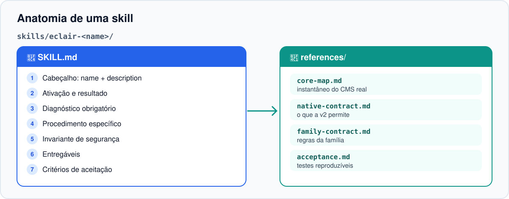
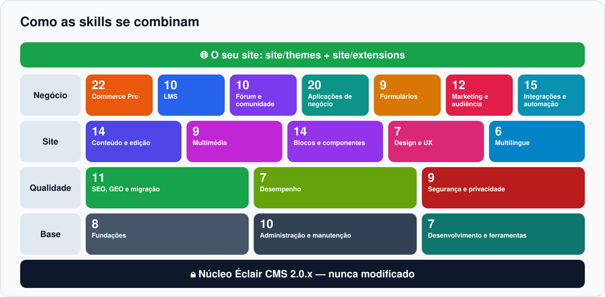
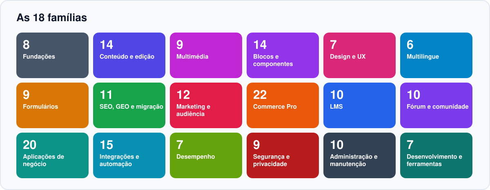
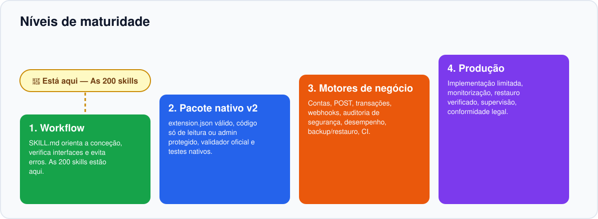

<!-- Generated by scripts/build_readmes.py — edit scripts/readme_data_*.py, not this file. -->
<a id="top"></a>

<p align="center"></p>

<p align="center"><a href="README.md">English</a> · <a href="README.fr.md">Français</a> · <a href="README.es.md">Español</a> · <a href="README.de.md">Deutsch</a> · <a href="README.it.md">Italiano</a> · <b>Português</b></p>

<p align="center"><a href="https://github.com/Jacckisback/eclair-skills/actions/workflows/validate.yml"></a>    <a href="LICENSE"></a></p>

**Éclair Skills** é uma biblioteca de **57 Agent Skills** para o [Éclair CMS](https://github.com/Jacckisback/eclair-cms) 2.0.x. Adicione-as ao seu projeto e o seu agente de código (Claude Code, Codex, ChatGPT ou qualquer agente que leia pastas `SKILL.md`) deixa de improvisar: segue um método comprovado, respeita o contrato do CMS, nunca toca no núcleo e prova o seu trabalho com testes.

> [!IMPORTANT]
> **Leia isto primeiro** — **57 skills ≠ 57 extensões PHP.** Uma skill é um guia para o seu agente (instruções, referências e testes a escrever). Não é um plugin para instalar num site em produção. O único exemplo funcional é o `catalogue-demo`, apenas de leitura.

## Porquê o Éclair Skills?

- **Método, não improviso** — cada skill impõe um diagnóstico, um procedimento, um invariante de segurança e critérios de aceitação antes de qualquer linha de código.
- **O núcleo fica intacto** — o seu código vive apenas em `site/themes/` e `site/extensions/`, por isso as atualizações do CMS continuam a funcionar.
- **Seguro e rápido por defeito** — CSRF, permissões por objeto, escaping, nenhum dado pessoal em cache partilhada, orçamentos de desempenho medidos.
- **Honesto quanto aos limites** — cada skill diz o que o Éclair 2.0 permite hoje e o que ainda exige uma capacidade do núcleo.

## Como funciona

<p align="center"></p>

Descreve o seu objetivo em linguagem simples. O agente encontra a skill certa pela descrição e segue cinco passos:

1. **Pedir** — Descreve o site ou a funcionalidade que pretende.
2. **Ativar** — O agente carrega a skill que corresponde à descrição.
3. **Diagnosticar** — Lê as referências e verifica a versão real do CMS e as suas capacidades.
4. **Construir** — Escreve código apenas em site/themes ou site/extensions.
5. **Provar** — Escreve testes positivos e de recusa, valida e mede. Uma pessoa publica.

## Anatomia de uma skill

<p align="center"></p>

Cada skill é uma pasta autónoma. Nenhuma depende dos ficheiros de outra skill.

```text
skills/eclair-commerce-pro/
├── SKILL.md
└── references/
    ├── core-map.md
    ├── native-contract.md
    ├── family-contract.md
    └── acceptance.md
```

| Parte | Função |
|---|---|
| `SKILL.md` — cabeçalho | `name` e `description`: o agente usa a descrição para decidir quando carregar a skill. |
| Ativação e resultado esperado | Para que serve a skill e o que deve entregar. |
| Diagnóstico obrigatório | Ler as referências, verificar a versão do CMS, o manifesto `eclair-extension/1` e as capacidades disponíveis, mapear os dados. |
| Procedimento específico | Fluxo de negócio, locais permitidos, limites do contrato atual, invariante de segurança, provas, validação nativa. |
| Entregáveis e aceitação | Mini especificação, matriz de permissões/cache, pacote só se o contrato o permitir, testes que passam e testes que devem recusar. |
| `references/core-map.md` | Instantâneo do núcleo real do Éclair CMS com que a skill foi verificada. |
| `references/native-contract.md` | O que o contrato nativo `eclair-extension/1` permite (e não permite). |
| `references/family-contract.md` | Regras comuns a toda a família (segurança, cache, dados). |
| `references/acceptance.md` | Plano de testes reproduzível: caso nominal, recusa, invariante, cache, ativação/desativação. |

## Como as skills se combinam

<p align="center"></p>

As skills foram feitas para serem combinadas. Pense nelas em camadas:

1. **Núcleo Éclair CMS 2.0.x** — Nunca modificado por uma skill. Alterações estruturais passam por um RFC e um PR dedicados.
2. **Fundações (8)** — Sempre primeiro: arquitetura, extensão, armazenamento, papéis, rotas, cache, segurança, testes. Todas as outras assentam nelas.
3. **Famílias de negócio** — Comércio, LMS, comunidade, aplicações de negócio e integrações: escolha as que o projeto precisa.
4. **Qualidade transversal** — Design e UX, SEO e GEO aplicam-se a todas as páginas, seja qual for o domínio.
5. **O seu site** — O resultado vive em site/themes e site/extensions, validado e testado.

## As 8 famílias

<p align="center"></p>

| | Família | Âmbito | Skills |
|---|---|---|---:|
| 🧱 | **Fundações** | Contrato nativo v2, testes e segurança | 8 |
| 🛒 | **Commerce Pro** | Loja transacional e pagamentos, concebidos antes da implementação | 10 |
| 🎓 | **LMS** | Cursos, inscrições, progresso, certificados | 7 |
| 💬 | **Fórum e comunidade** | Discussões, moderação, perfis, notificações | 6 |
| 🗂️ | **Aplicações de negócio** | Reservas, assinaturas, diretórios, ferramentas | 8 |
| 🎨 | **Design e UX** | Temas, blocos, acessibilidade, velocidade | 7 |
| 🔎 | **SEO, GEO e migração** | Indexabilidade, dados estruturados, WordPress | 5 |
| 🔌 | **Integrações e automação** | API, webhooks, email, IA, monitorização | 6 |
| | | | **57** |

## Início rápido

Requisitos: Git e Python 3 (apenas biblioteca padrão). PHP 8.1+ para executar os exemplos e testes PHP.

**1. Obter a biblioteca e verificá-la**

```bash
git clone https://github.com/Jacckisback/eclair-skills.git
cd eclair-skills
python3 scripts/validate_skills.py
```

**2. Ver o que está disponível**

```bash
python3 scripts/install_skills.py --list
```

**3. Instalar skills no seu projeto**

```bash
python3 scripts/install_skills.py --project /path/to/my-site --category commerce   # uma família
python3 scripts/install_skills.py --project /path/to/my-site --skill eclair-wordpress-migration   # uma skill
python3 scripts/install_skills.py --project /path/to/my-site --all   # tudo
```

O instalador copia as skills para o projeto. Nunca substitui uma skill existente, exceto com `--force` após revisão.

**4. Depois, basta pedir ao seu agente**

> Prepara uma loja online para o meu site Éclair: catálogo, variantes e checkout. Usa a skill eclair-commerce-pro e diz-me o que o Éclair 2.0 ainda não sabe fazer.

> Migra o meu blog WordPress para o Éclair 2 sem perder URLs nem tráfego.

> Audita a acessibilidade e o desempenho do meu tema e corrige os problemas.

O agente escolhe a skill automaticamente pela descrição. Também pode indicá-la pelo nome.

## Receitas: que skills para que projeto

Comece pelas fundações e siga a ordem indicada. Cada seta é um passo que o agente conclui e testa antes do seguinte.

**Loja online**

[`eclair-architecture`](skills/eclair-architecture/SKILL.md) → [`eclair-storage`](skills/eclair-storage/SKILL.md) → [`eclair-auth-roles`](skills/eclair-auth-roles/SKILL.md) → [`eclair-commerce-pro`](skills/eclair-commerce-pro/SKILL.md) → [`eclair-product-catalog`](skills/eclair-product-catalog/SKILL.md) → [`eclair-product-variants`](skills/eclair-product-variants/SKILL.md) → [`eclair-inventory`](skills/eclair-inventory/SKILL.md) → [`eclair-cart-checkout`](skills/eclair-cart-checkout/SKILL.md) → [`eclair-orders-payments`](skills/eclair-orders-payments/SKILL.md) → [`eclair-tax-invoicing`](skills/eclair-tax-invoicing/SKILL.md) → [`eclair-shipping`](skills/eclair-shipping/SKILL.md) → [`eclair-discounts`](skills/eclair-discounts/SKILL.md) → [`eclair-email-automation`](skills/eclair-email-automation/SKILL.md) → [`eclair-security-audit`](skills/eclair-security-audit/SKILL.md) → [`eclair-test-suite`](skills/eclair-test-suite/SKILL.md)

**Escola online**

[`eclair-architecture`](skills/eclair-architecture/SKILL.md) → [`eclair-auth-roles`](skills/eclair-auth-roles/SKILL.md) → [`eclair-lms`](skills/eclair-lms/SKILL.md) → [`eclair-course-builder`](skills/eclair-course-builder/SKILL.md) → [`eclair-lessons-media`](skills/eclair-lessons-media/SKILL.md) → [`eclair-enrollment-access`](skills/eclair-enrollment-access/SKILL.md) → [`eclair-progress`](skills/eclair-progress/SKILL.md) → [`eclair-quizzes-certificates`](skills/eclair-quizzes-certificates/SKILL.md) → [`eclair-lms-analytics`](skills/eclair-lms-analytics/SKILL.md) → [`eclair-test-suite`](skills/eclair-test-suite/SKILL.md)

**Comunidade / fórum**

[`eclair-auth-roles`](skills/eclair-auth-roles/SKILL.md) → [`eclair-forum`](skills/eclair-forum/SKILL.md) → [`eclair-discussions-topics`](skills/eclair-discussions-topics/SKILL.md) → [`eclair-community-profiles`](skills/eclair-community-profiles/SKILL.md) → [`eclair-moderation`](skills/eclair-moderation/SKILL.md) → [`eclair-notifications`](skills/eclair-notifications/SKILL.md) → [`eclair-community-search`](skills/eclair-community-search/SKILL.md) → [`eclair-security-audit`](skills/eclair-security-audit/SKILL.md)

**Site de negócio local**

[`eclair-design`](skills/eclair-design/SKILL.md) → [`eclair-theme-builder`](skills/eclair-theme-builder/SKILL.md) → [`eclair-bookings`](skills/eclair-bookings/SKILL.md) → [`eclair-appointments-calendar`](skills/eclair-appointments-calendar/SKILL.md) → [`eclair-forms-crm`](skills/eclair-forms-crm/SKILL.md) → [`eclair-crm-integration`](skills/eclair-crm-integration/SKILL.md) → [`eclair-seo-audit`](skills/eclair-seo-audit/SKILL.md) → [`eclair-structured-data`](skills/eclair-structured-data/SKILL.md)

**Migração WordPress e SEO/GEO**

[`eclair-wordpress-migration`](skills/eclair-wordpress-migration/SKILL.md) → [`eclair-routing`](skills/eclair-routing/SKILL.md) → [`eclair-seo-audit`](skills/eclair-seo-audit/SKILL.md) → [`eclair-structured-data`](skills/eclair-structured-data/SKILL.md) → [`eclair-multilingual-seo`](skills/eclair-multilingual-seo/SKILL.md) → [`eclair-geo-optimization`](skills/eclair-geo-optimization/SKILL.md) → [`eclair-performance-ux`](skills/eclair-performance-ux/SKILL.md) → [`eclair-accessibility`](skills/eclair-accessibility/SKILL.md)

## Catálogo completo das 57 skills

Clique numa skill para abrir o seu `SKILL.md`. A coluna estado indica o que pode ser entregue hoje no Éclair 2.0.

**Legenda** — 🟢 **Nativo v2**: realizável hoje com o contrato nativo. 🔵 **Protótipo só de leitura possível**: uma versão pública GET já é possível; as escritas exigem mais. 🟠 **Conceção · requer núcleo**: conceção e testes completos desde já, a produção exige capacidades ainda ausentes do Éclair 2.0 (POST público, transações, contas de membros…). 🟡 **Parcialmente bloqueado**: algumas partes dependem de uma evolução do contrato do núcleo.

### 🧱 Fundações (8)

_Contrato nativo v2, testes e segurança._

| Skill | O que ajuda o agente a fazer | Estado |
|---|---|---|
| [`eclair-architecture`](skills/eclair-architecture/SKILL.md) | Decidir onde colocar cada funcionalidade (ajuste, tema, extensão ou RFC do núcleo) sem tocar no núcleo v2. | 🟢 Nativo v2 |
| [`eclair-extension-builder`](skills/eclair-extension-builder/SKILL.md) | Criar uma extensão v2 realmente instalável: `extension.json`, `extension.php`, contrato `eclair-extension/1`. | 🟢 Nativo v2 |
| [`eclair-storage`](skills/eclair-storage/SKILL.md) | Escolher a persistência certa, migrações, backups e necessidades SQL de cada módulo. | 🟢 Nativo v2 |
| [`eclair-auth-roles`](skills/eclair-auth-roles/SKILL.md) | Separar os direitos de administração de membros, alunos, clientes e moderadores. | 🟢 Nativo v2 |
| [`eclair-routing`](skills/eclair-routing/SKILL.md) | Criar rotas públicas/admin protegendo URLs existentes, redirecionamentos e SEO. | 🟢 Nativo v2 |
| [`eclair-cache-contract`](skills/eclair-cache-contract/SKILL.md) | Manter o cache rápido e seguro: invalidação, privacidade e orçamentos de desempenho. | 🟢 Nativo v2 |
| [`eclair-security-audit`](skills/eclair-security-audit/SKILL.md) | Auditar uma extensão antes da ativação: cadeia de fornecimento, ações admin, dados de membros. | 🟢 Nativo v2 |
| [`eclair-test-suite`](skills/eclair-test-suite/SKILL.md) | Escrever testes de CI, regressão, segurança e desempenho: uma prova antes de publicar. | 🟢 Nativo v2 |

### 🛒 Commerce Pro (10)

_Loja transacional e pagamentos, concebidos antes da implementação._

| Skill | O que ajuda o agente a fazer | Estado |
|---|---|---|
| [`eclair-commerce-pro`](skills/eclair-commerce-pro/SKILL.md) | Projetar uma loja completa, do catálogo ao pedido entregue (ponto de entrada da família). | 🟠 Conceção · requer núcleo |
| [`eclair-product-catalog`](skills/eclair-product-catalog/SKILL.md) | Construir um catálogo público de produtos rápido e indexável. | 🔵 Protótipo só de leitura possível |
| [`eclair-product-variants`](skills/eclair-product-variants/SKILL.md) | Modelar tamanhos, cores e configurações sem erros de preço. | 🟠 Conceção · requer núcleo |
| [`eclair-cart-checkout`](skills/eclair-cart-checkout/SKILL.md) | Projetar carrinho e checkout com várias linhas, preços e estoque coerentes. | 🟠 Conceção · requer núcleo |
| [`eclair-orders-payments`](skills/eclair-orders-payments/SKILL.md) | Implementar estados de pedido e provedores de pagamento (PSP) com webhooks assinados. | 🟠 Conceção · requer núcleo |
| [`eclair-tax-invoicing`](skills/eclair-tax-invoicing/SKILL.md) | Preparar os pontos de IVA e faturação adaptados a cada jurisdição (sem taxa universal). | 🟠 Conceção · requer núcleo |
| [`eclair-inventory`](skills/eclair-inventory/SKILL.md) | Sincronizar o estoque real entre produtos, variantes e pedidos. | 🟠 Conceção · requer núcleo |
| [`eclair-shipping`](skills/eclair-shipping/SKILL.md) | Gerir zonas, tarifas, rastreio e estados de entrega. | 🟠 Conceção · requer núcleo |
| [`eclair-discounts`](skills/eclair-discounts/SKILL.md) | Criar descontos e cupões coerentes, nunca acumulados por engano. | 🟠 Conceção · requer núcleo |
| [`eclair-commerce-analytics`](skills/eclair-commerce-analytics/SKILL.md) | Medir vendas e conversões sem expor dados de clientes. | 🟠 Conceção · requer núcleo |

### 🎓 LMS (7)

_Cursos, inscrições, progresso, certificados._

| Skill | O que ajuda o agente a fazer | Estado |
|---|---|---|
| [`eclair-lms`](skills/eclair-lms/SKILL.md) | Estruturar uma escola online modular (ponto de entrada da família). | 🟠 Conceção · requer núcleo |
| [`eclair-course-builder`](skills/eclair-course-builder/SKILL.md) | Compor cursos, secções e lições versionados. | 🟠 Conceção · requer núcleo |
| [`eclair-lessons-media`](skills/eclair-lessons-media/SKILL.md) | Disponibilizar vídeos e documentos protegidos para os cursos. | 🟠 Conceção · requer núcleo |
| [`eclair-enrollment-access`](skills/eclair-enrollment-access/SKILL.md) | Ligar uma compra ou validação a uma inscrição e às suas permissões. | 🟠 Conceção · requer núcleo |
| [`eclair-progress`](skills/eclair-progress/SKILL.md) | Acompanhar o progresso sem perdas nem atualizações incoerentes. | 🟠 Conceção · requer núcleo |
| [`eclair-quizzes-certificates`](skills/eclair-quizzes-certificates/SKILL.md) | Criar avaliações, limites de aprovação e certificados controlados. | 🟠 Conceção · requer núcleo |
| [`eclair-lms-analytics`](skills/eclair-lms-analytics/SKILL.md) | Analisar conclusão e envolvimento sem vigilância abusiva. | 🟠 Conceção · requer núcleo |

### 💬 Fórum e comunidade (6)

_Discussões, moderação, perfis, notificações._

| Skill | O que ajuda o agente a fazer | Estado |
|---|---|---|
| [`eclair-forum`](skills/eclair-forum/SKILL.md) | Projetar discussões públicas e privadas com moderação (ponto de entrada da família). | 🟠 Conceção · requer núcleo |
| [`eclair-discussions-topics`](skills/eclair-discussions-topics/SKILL.md) | Gerir criação, edição e estado de tópicos e respostas. | 🟠 Conceção · requer núcleo |
| [`eclair-community-profiles`](skills/eclair-community-profiles/SKILL.md) | Oferecer perfis públicos escolhidos, separados dos dados privados. | 🟠 Conceção · requer núcleo |
| [`eclair-moderation`](skills/eclair-moderation/SKILL.md) | Construir ferramentas de remoção, denúncia e recurso. | 🟠 Conceção · requer núcleo |
| [`eclair-notifications`](skills/eclair-notifications/SKILL.md) | Notificar os membros sem spam nem fugas de dados. | 🟠 Conceção · requer núcleo |
| [`eclair-community-search`](skills/eclair-community-search/SKILL.md) | Pesquisar tópicos e mensagens respeitando as permissões. | 🟠 Conceção · requer núcleo |

### 🗂️ Aplicações de negócio (8)

_Reservas, assinaturas, diretórios, ferramentas._

| Skill | O que ajuda o agente a fazer | Estado |
|---|---|---|
| [`eclair-bookings`](skills/eclair-bookings/SKILL.md) | Gerir um recurso reservável sem reservas duplicadas. | 🟠 Conceção · requer núcleo |
| [`eclair-appointments-calendar`](skills/eclair-appointments-calendar/SKILL.md) | Marcar consultas e integrar calendários externos. | 🟠 Conceção · requer núcleo |
| [`eclair-memberships`](skills/eclair-memberships/SKILL.md) | Gerir níveis de adesão, renovações e direitos de acesso. | 🟠 Conceção · requer núcleo |
| [`eclair-directory`](skills/eclair-directory/SKILL.md) | Criar fichas e filtros indexáveis de um diretório profissional. | 🔵 Protótipo só de leitura possível |
| [`eclair-events-ticketing`](skills/eclair-events-ticketing/SKILL.md) | Vender lugares, bilhetes e entradas para eventos. | 🟠 Conceção · requer núcleo |
| [`eclair-job-board`](skills/eclair-job-board/SKILL.md) | Publicar ofertas de emprego e candidaturas que respeitam os dados. | 🟠 Conceção · requer núcleo |
| [`eclair-real-estate`](skills/eclair-real-estate/SKILL.md) | Construir um catálogo imobiliário com pesquisa e contacto. | 🟠 Conceção · requer núcleo |
| [`eclair-forms-crm`](skills/eclair-forms-crm/SKILL.md) | Recolher pedidos por formulário e acompanhar o seu tratamento (mini-CRM). | 🟠 Conceção · requer núcleo |

### 🎨 Design e UX (7)

_Temas, blocos, acessibilidade, velocidade._

| Skill | O que ajuda o agente a fazer | Estado |
|---|---|---|
| [`eclair-design`](skills/eclair-design/SKILL.md) | Direção de arte: criar sites coerentes com Éclair Design e o tema nativo. | 🟢 Nativo v2 |
| [`eclair-theme-builder`](skills/eclair-theme-builder/SKILL.md) | Produzir um tema Éclair v2 compatível com as atualizações. | 🟢 Nativo v2 |
| [`eclair-blocks-library`](skills/eclair-blocks-library/SKILL.md) | Compor blocos de conteúdo e extensões editáveis. | 🟢 Nativo v2 |
| [`eclair-accessibility`](skills/eclair-accessibility/SKILL.md) | Auditar e corrigir uma interface acessível (WCAG). | 🟢 Nativo v2 |
| [`eclair-design-system`](skills/eclair-design-system/SKILL.md) | Construir uma linguagem visual coerente e sustentável (tokens, componentes). | 🟢 Nativo v2 |
| [`eclair-responsive-ux`](skills/eclair-responsive-ux/SKILL.md) | Otimizar navegação, formulários e layouts em dispositivos móveis. | 🟢 Nativo v2 |
| [`eclair-performance-ux`](skills/eclair-performance-ux/SKILL.md) | Medir e reduzir o peso e a instabilidade das páginas. | 🟢 Nativo v2 |

### 🔎 SEO, GEO e migração (5)

_Indexabilidade, dados estruturados, WordPress._

| Skill | O que ajuda o agente a fazer | Estado |
|---|---|---|
| [`eclair-seo-audit`](skills/eclair-seo-audit/SKILL.md) | Verificar indexabilidade, canonical, robots, links e desempenho. | 🟢 Nativo v2 |
| [`eclair-geo-optimization`](skills/eclair-geo-optimization/SKILL.md) | Tornar as páginas legíveis para motores de busca e assistentes de IA (GEO). | 🟢 Nativo v2 |
| [`eclair-wordpress-migration`](skills/eclair-wordpress-migration/SKILL.md) | Migrar do WordPress preservando URLs, conteúdos e tráfego. | 🟢 Nativo v2 |
| [`eclair-structured-data`](skills/eclair-structured-data/SKILL.md) | Adicionar ou verificar dados schema.org coerentes com o conteúdo. | 🟡 Parcialmente bloqueado |
| [`eclair-multilingual-seo`](skills/eclair-multilingual-seo/SKILL.md) | Gerir várias línguas sem duplicados nem canonical erradas (hreflang). | 🟢 Nativo v2 |

### 🔌 Integrações e automação (6)

_API, webhooks, email, IA, monitorização._

| Skill | O que ajuda o agente a fazer | Estado |
|---|---|---|
| [`eclair-webhooks`](skills/eclair-webhooks/SKILL.md) | Ligar aplicações externas por eventos seguros, assinados e idempotentes. | 🟠 Conceção · requer núcleo |
| [`eclair-email-automation`](skills/eclair-email-automation/SKILL.md) | Enviar confirmações e lembretes fiáveis (emails transacionais). | 🟠 Conceção · requer núcleo |
| [`eclair-api-integration`](skills/eclair-api-integration/SKILL.md) | Criar conectores de API externos robustos e limitados. | 🟠 Conceção · requer núcleo |
| [`eclair-crm-integration`](skills/eclair-crm-integration/SKILL.md) | Sincronizar leads e clientes com um CRM, sem duplicados. | 🟠 Conceção · requer núcleo |
| [`eclair-ai-workflows`](skills/eclair-ai-workflows/SKILL.md) | Automatizar a ajuda editorial com IA, nunca publicar sem um humano. | 🟠 Conceção · requer núcleo |
| [`eclair-observability`](skills/eclair-observability/SKILL.md) | Monitorizar saúde, custos e incidentes dos módulos, com alertas. | 🟠 Conceção · requer núcleo |

## Maturidade: do guia do agente à produção

<p align="center"></p>

Uma skill é o primeiro passo, não o último. Quatro níveis separam um guia de uma aplicação em produção:

1. **Workflow** — SKILL.md orienta a conceção, verifica interfaces e evita erros. As 57 skills estão aqui.
2. **Pacote nativo v2** — extension.json válido, código só de leitura ou admin protegido, validador oficial e testes nativos.
3. **Motores de negócio** — Contas, POST, transações, webhooks, auditoria de segurança, desempenho, backup/restauro, CI.
4. **Produção** — Implementação limitada, monitorização, restauro verificado, supervisão, conformidade legal.

> [!WARNING]
> Antes de ativar uma aplicação comercial, cinco barreiras têm de ser superadas: compatibilidade exata do CMS, autenticação e isolamento de dados testados, armazenamento transacional e pagamentos assinados, auditoria de segurança independente e nenhuma regressão de desempenho ou SEO. Ver [docs/ROADMAP_57.md](docs/ROADMAP_57.md).

## Exemplos e protótipos

| Pasta | Estado | O que é |
|---|---|---|
| [`examples/extensions/catalogue-demo`](examples/extensions/catalogue-demo) | ✅ Exemplo funcional | Montra só de leitura, GET `/catalogue-demo`, sem clientes, carrinho, pedido nem pagamento. |
| [`examples/extensions/skill-sample`](examples/extensions/skill-sample) | ✅ Amostra de teste | Pacote nativo mínimo usado pelos testes offline. |
| [`examples/extensions/member-directory`](examples/extensions/member-directory) | ⚠️ Experimental | Protótipo independente, não qualificado. Registo e recuperação desativados por defeito. Não é para produção. |
| [`core-patch/`](core-patch/) | ⚠️ Experimental | Patch de rotas POST públicas, ligado ao [PR #19 do eclair-cms](https://github.com/Jacckisback/eclair-cms/pull/19), em rascunho e não integrado. Não é para produção. |

**Testar a demo num checkout real do Éclair**

```bash
# in a checkout of https://github.com/Jacckisback/eclair-cms
php tools/validate.php /path/to/eclair-skills/examples/extensions/catalogue-demo --json
php tests/run.php
php tools/measure.php --check
```

## Qualidade e testes

Cada push executa o workflow [validate](.github/workflows/validate.yml) em PHP 8.1 e 8.3:

```bash
python3 scripts/validate_skills.py
python3 scripts/check_release.py
python3 scripts/verify_sample.py
python3 scripts/verify_member_directory.py
python3 -m unittest discover -s tests -p 'test_*.py' -v
php -l examples/extensions/catalogue-demo/extension.php
php tests/member-directory.php
php tests/member-public.php
php tests/member-enroll.php
```

Estas verificações provam a estrutura e o comportamento isolado. **Não** são testes de integração HTTP/SMTP nem uma auditoria de segurança dos protótipos experimentais.

## O que esta biblioteca não promete

- Nenhuma pontuação Lighthouse, posição no Google ou citação por assistentes de IA garantida: mede-se, não se promete.
- Nenhuma loja, LMS ou fórum chave na mão: as skills de comércio, LMS e comunidade são guias de construção.
- Nenhuma conformidade legal ou fiscal por defeito: IVA, faturação e dados pessoais validam-se localmente.
- Nenhuma implementação automática: o agente prepara, uma pessoa autorizada revê e publica.

## Compatibilidade

- Éclair CMS **2.0.x**, contrato de extensões `eclair-extension/1`.
- PHP **8.1+** para os exemplos (CI em 8.1 e 8.3). Python **3**, biblioteca padrão, para os scripts.
- Agentes: Claude Code, Codex, ChatGPT e qualquer agente compatível com pastas `SKILL.md`.
- O conteúdo das skills está escrito em francês; funcionam com qualquer agente, seja qual for a língua em que fala com ele.

## Saber mais

- [Catálogo completo (gerado)](docs/CATALOGUE_COMPLET.md)
- [Roteiro e barreiras de produção](docs/ROADMAP_57.md)
- [Matriz de capacidades](docs/CAPABILITY_MATRIX.md)
- [Início rápido para agentes](docs/AGENT_QUICKSTART.md)
- [Regras para agentes](AGENTS.md)
- [Contribuir](CONTRIBUTING.md)
- [Comunicar uma vulnerabilidade](SECURITY.md)

## Licença

GNU Affero General Public License v3.0 only (`AGPL-3.0-only`), tal como o Éclair CMS. Texto oficial completo em [LICENSE](LICENSE).

---

<p align="center"><a href="README.md">English</a> · <a href="README.fr.md">Français</a> · <a href="README.es.md">Español</a> · <a href="README.de.md">Deutsch</a> · <a href="README.it.md">Italiano</a> · <b>Português</b> · <a href="#top">Voltar ao topo ↑</a></p>
